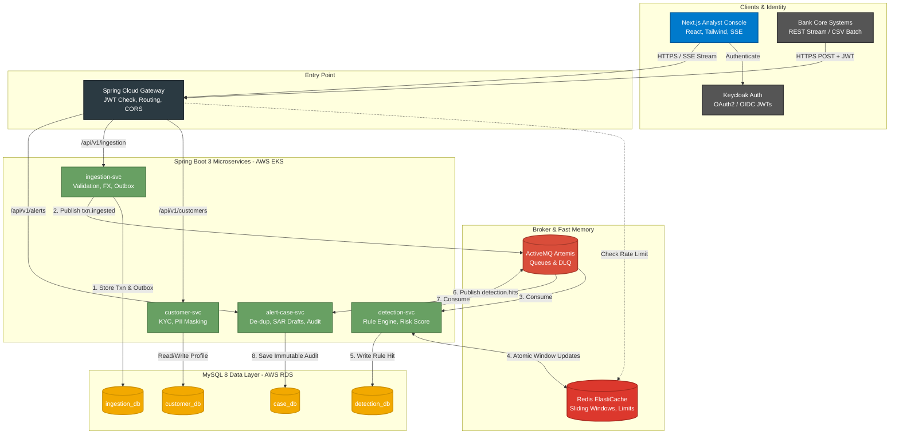

# 🛡️ Sentinel AML
**Cloud-Native, Event-Driven Anti-Money Laundering (AML) Transaction Monitoring Platform**

[](https://java.com)
[](https://spring.io/projects/spring-boot)
[](https://nextjs.org/)
[](https://aws.amazon.com/)

> **Project Vision:** Sentinel is a production-grade microservices platform that transforms a bank's 48–72 hour, spreadsheet-driven manual compliance review into a sub-second, real-time detection engine. It delivers explainable risk-scored alerts and an immutable, auditable case workflow for analysts.

---

## 🏗️ Architecture

The system utilizes an event-driven architecture with bounded contexts. Synchronous REST calls are reserved for the Gateway and UI, while the core detection pipeline is fully asynchronous to meet latency guarantees under high throughput.



## 🛠️ Technology Stack

| Domain | Technology | Justification |
| :--- | :--- | :--- |
| **Backend** | Java 21, Spring Boot 3, Spring Cloud Gateway | Leverages virtual threads for high I/O concurrency. |
| **Frontend** | Next.js 14, TypeScript, TailwindCSS, NextAuth | Provides fast SSR, type safety, and real-time SSE components. |
| **Data Layer** | MySQL 8, Spring Data JPA, Flyway | Database-per-service pattern with repeatable migrations. |
| **State & Cache**| Redis | Sorted Sets for sliding windows, idempotency locks, rate limits. |
| **Messaging** | ActiveMQ Artemis | Guaranteed persistent delivery, DLQ routing, and topic broadcasting. |
| **Security** | Keycloak, Spring Security | OAuth2/OIDC RBAC and JWT validation. |
| **Cloud/Infra** | AWS (EKS, RDS, ElastiCache), Terraform | Reproducible infrastructure via IaC. |
| **Observability**| Prometheus, Grafana, OpenTelemetry | Tracks p95 latencies and distributed tracing across microservices. |

## 🔍 Core Detection Typologies (Rules)

The Detection Service utilizes a dynamic, hot-reloadable rule engine covering 6 critical AML typologies:
1. **CTR Threshold:** Single transactions exceeding a defined fiat equivalent.
2. **Structuring (Smurfing):** Multiple transactions just below reporting thresholds within 24 hours.
3. **Rapid Movement / Layering:** High percentage of received funds exiting the account within 48 hours.
4. **High-Risk Jurisdictions:** Transfers involving sanctioned entities (fuzzy matched) or listed countries.
5. **Behavioral Deviation:** Daily transactional value significantly exceeding a 90-day rolling baseline.
6. **Round Amount:** Recurring high-value, exact round-number transfers.

## 🚀 Performance Benchmarks (JMeter)

*(Note: These values will be populated in Phase 9 after rigorous load testing).*

| Scenario | Load | Target Metric | Achieved Metric |
| :--- | :--- | :--- | :--- |
| **Streaming Ingestion** | 200 TPS | End-to-End Latency p95 < 1s | *TBD* |
| **Batch Bulk Upload** | 10,000 txns | Processing Time < 2 min | *TBD* |
| **Rule Hot-Reload** | Live Topic | Time to active < 5s | *TBD* |

## 💻 Local Setup & Development

This repository relies on Docker Compose to orchestrate local backing services before running the Java applications.

**1. Clone the repository**
```bash
git clone https://github.com/yourusername/sentinel-aml.git
cd sentinel-aml
```

**2. Start local infrastructure (Databases, Broker, Auth)**
```bash
docker-compose up -d
```
*(This provisions MySQL, Redis, ActiveMQ, and Keycloak locally)*

**3. Build the backend services**
```bash
cd services
./mvnw clean install
```

**4. Start the Frontend**
```bash
cd ../frontend
npm install
npm run dev
```

## 📜 Documentation

* **Architecture Decision Records (ADRs):** View our major technical decisions in `docs/ADR`.
* **Repository Structure:** See `docs/repository_structure.md` for a breakdown of the monorepo layout.
* **API Specs:** Swagger UI is available at `http://localhost:8080/swagger-ui.html` when the Gateway is running.