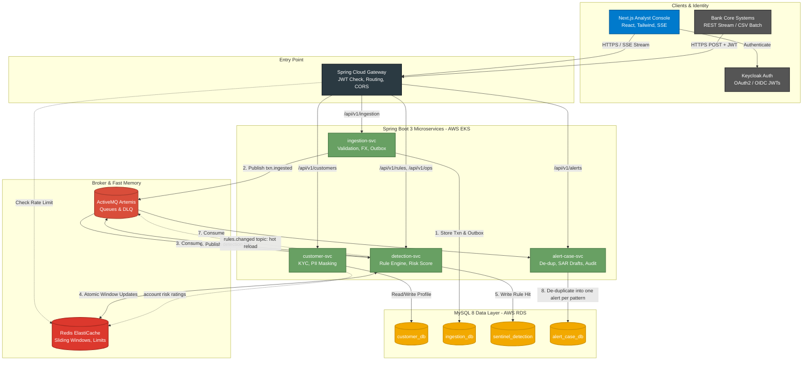
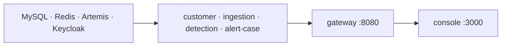

<p align="center">
  <picture>
    <source media="(prefers-color-scheme: dark)" srcset="brand/svg/sentinel-logo-horizontal-white.svg">
    
  </picture>
</p>

# 🛡️ Sentinel AML
**Cloud-Native, Event-Driven Anti-Money Laundering (AML) Transaction Monitoring Platform**

[](https://java.com)
[](https://spring.io/projects/spring-boot)
[](https://nextjs.org/)
[](https://aws.amazon.com/)

> **Project Vision:** Sentinel is a production-grade microservices platform that transforms a bank's 48–72 hour, spreadsheet-driven manual compliance review into a sub-second, real-time detection engine. It delivers explainable risk-scored alerts and an immutable, auditable case workflow for analysts.

---

> **Run it locally in one command:** `docker compose up -d --build`, then open http://localhost:3000 (sign in as `analyst1`, `senior1` or `admin1`; the password is the username). Step by step, with a five-minute tour: **[docs/GETTING-STARTED.md](docs/GETTING-STARTED.md)**.

## 🏗️ Architecture

The system utilizes an event-driven architecture with bounded contexts. Synchronous REST calls are reserved for the Gateway and UI, while the core detection pipeline is fully asynchronous to meet latency guarantees under high throughput.



## 🛠️ Technology Stack

| Domain | Technology | Justification |
| :--- | :--- | :--- |
| **Backend** | Java 21, Spring Boot 3, Spring Cloud Gateway | Leverages virtual threads for high I/O concurrency. |
| **Frontend** | Next.js 15, React 19, TypeScript, Tailwind CSS 4, NextAuth, Redux Toolkit | Server-rendered pages with the token kept on the server; Redux only for client state (live stream, notifications, theme); real-time SSE. |
| **Data Layer** | MySQL 8, Spring Data JPA, Flyway | Database-per-service pattern with repeatable migrations. |
| **State & Cache**| Redis | Sorted Sets for sliding windows, idempotency locks, rate limits. |
| **Messaging** | ActiveMQ Artemis | Guaranteed persistent delivery, DLQ routing, and topic broadcasting. |
| **Security** | Keycloak, Spring Security | OAuth2/OIDC RBAC and JWT validation. |
| **Cloud/Infra** | AWS (EKS, RDS, ElastiCache), Terraform | Reproducible infrastructure via IaC. |
| **Observability**| Prometheus, Grafana, OpenTelemetry | Tracks p95 latencies and distributed tracing across microservices. |

## 🔍 Core Detection Typologies (Rules)

The Detection Service utilizes a dynamic, hot-reloadable rule engine covering 6 critical AML typologies:
1. **CTR Threshold:** Single transactions exceeding a defined fiat equivalent.
2. **Structuring (Smurfing):** Multiple transactions just below reporting thresholds within 24 hours.
3. **Rapid Movement / Layering:** High percentage of received funds exiting the account within 48 hours.
4. **High-Risk Jurisdictions:** Transfers involving sanctioned entities (fuzzy matched) or listed countries.
5. **Behavioral Deviation:** Daily transactional value significantly exceeding a 90-day rolling baseline.
6. **Round Amount:** Recurring high-value, exact round-number transfers.

## 🚀 Performance Benchmarks (JMeter)

*(Note: These values will be populated in Phase 9 after rigorous load testing).*

| Scenario | Load | Target Metric | Achieved Metric |
| :--- | :--- | :--- | :--- |
| **Streaming Ingestion** | 200 TPS | End-to-End Latency p95 < 1s | *TBD* |
| **Batch Bulk Upload** | 10,000 txns | Processing Time < 2 min | *TBD* |
| **Rule Hot-Reload** | Live Topic | Time to active < 5s | *TBD* |

## 💻 Local Setup & Development

### Run everything (Docker only)

You need **Docker** (Docker Desktop, OrbStack or Colima) with at least **6 GB** of memory. Nothing else: no Java, Maven or Node.js.

**1. Clone the repository**
```bash
git clone https://github.com/yourusername/sentinel-aml.git
```
```bash
cd sentinel-aml
```

**2. Start the whole application**
```bash
docker compose up -d --build
```
The first run builds six images (the five Java services share [`services/Dockerfile`](services/Dockerfile); the console uses [`frontend/Dockerfile`](frontend/Dockerfile)) and takes a few minutes. Later runs start in seconds.

Compose starts things in order, each step waiting for the previous one to be **healthy**:



Only want the infrastructure, to run the services or console yourself? `docker compose up -d infra` instead (see [Develop locally](#develop-locally)). Both modes share the same containers and data: `docker compose up -d` later adds the rest, `docker compose stop` stops whatever is running.

**3. Wait until everything is healthy** (about a minute after the build)
```bash
docker compose ps
```

**4. Sign in** at **http://localhost:3000** → *Continue with Keycloak* → `analyst1`, `senior1` or `admin1` (password = username). To create data, sign in as `admin1` and open **Simulation**: one click per detection rule creates a demo customer and the transactions that trip it, and you can upload CSVs or send single transactions. [docs/GETTING-STARTED.md](docs/GETTING-STARTED.md) has a five-minute tour through alerts, cases, PII reveal, the audit trail and rules.

**5. Stop** (data is kept in Docker volumes)
```bash
docker compose stop
```
Start fresh, deleting all local data: `docker compose down -v`.

**No persistence at all:** add the ephemeral file, which keeps MySQL, Redis and the broker in memory, so nothing survives a stop and your volumes are left untouched. It works with both modes (everything, or `infra`):
```bash
docker compose -f docker-compose.yml -f docker-compose.ephemeral.yml up -d --build
```
Make it your machine's default with `COMPOSE_FILE=docker-compose.yml:docker-compose.ephemeral.yml` in a git-ignored `.env` file. Details: [docs/GETTING-STARTED.md#run-without-keeping-any-data](docs/GETTING-STARTED.md#run-without-keeping-any-data).

Useful while it runs: `docker compose logs -f <service>` (e.g. `detection-service`), `docker compose restart <service>`, `docker compose up -d --build` after pulling new code.

### Develop locally

Run the part you're changing on your machine and keep the rest in Docker. Tools: Java 21, Maven 3.9+, Node.js 20+ (22 recommended).

- **Infrastructure only:** `docker compose up -d infra` (MySQL, Redis, Artemis, Keycloak and the GUIs, no services or console; returns once healthy), then build (`cd services && mvn clean install -DskipTests`) and start each service with `java -jar <service>/target/<service>-1.0.0-SNAPSHOT.jar` from `services/`. The services' defaults point at `localhost`.
- **Console with hot reload:** `docker compose stop console`, then in `frontend/`: `cp .env.example .env.local` (set `NEXTAUTH_SECRET`), `npm install`, `npm run dev`.
- **One Java service:** `docker compose stop <service>` and run its jar. If it sits behind the gateway, run the gateway locally too.

Full instructions: [docs/GETTING-STARTED.md#developing-locally](docs/GETTING-STARTED.md#developing-locally). The manual testing guide ([`docs/manual-testing-guide.md`](docs/manual-testing-guide.md)) goes through every feature by hand, with SQL, Redis and broker checks.

### Tests

**Java services** (alert-case-service's 50-thread de-dup test starts a MySQL Testcontainer, so Docker must be running; without Docker it is skipped)
```bash
cd services && mvn test
```

**Console** (type check, unit tests, production build)
```bash
cd frontend && npm run typecheck && npm test && npm run build
```

**API end to end** with the Postman collection in `docs/postman/` (or `npx newman run docs/postman/Sentinel-AML.postman_collection.json -e docs/postman/Sentinel-AML-local.postman_environment.json`).

CI (`.github/workflows/ci.yml`) runs the Java tests, the console checks and the console image build on every push.

## 🖥️ Local web UIs & routes

### Container consoles

| Container | Web UI | Login | Notes |
|---|---|---|---|
| MySQL (`sentinel-mysql`, :3306) | **Adminer** → http://localhost:8081 | System `MySQL`, server `mysql`, user `root`, password `root` | Databases: `customer_db`, `ingestion_db`, `sentinel_detection`, `alert_case_db` |
| Redis (`sentinel-redis`, :6379) | **RedisInsight** → http://localhost:5540 | none | First time: *Add Redis database* → host `redis`, port `6379` |
| ActiveMQ Artemis (`sentinel-activemq`, :61616) | **Artemis console** → http://localhost:8161/console | `admin` / `adminpassword` | *Artemis* tab → *Queues*: `sentinel.txn.ingested`, `sentinel.detection.hits`, topic `sentinel.rules.changed`, `DLQ.sentinel.*` (redelivery policy: `infra/artemis/broker.properties`) |
| Analyst console (`sentinel-console`, :3000) | **Sentinel console** → http://localhost:3000 | `analyst1` / `senior1` / `admin1` (password = username) | Starts with `docker compose up`; for hot reload, `docker compose stop console` and `npm run dev` in `frontend/`. How to use it: [docs/console-user-guide.md](docs/console-user-guide.md) |
| API reference (all services) | **Swagger UI** → http://localhost:8080/swagger-ui.html | Click *Authorize*, paste a token | Served by the gateway; *Try it out* goes through the gateway (Phase 7b) |
| Keycloak (`sentinel-keycloak`) | **Admin console** → http://localhost:8180/admin | `admin` / `admin` | Realm `sentinel` is imported on start from `infra/keycloak/sentinel-realm.json` (roles, clients, test users) |

Command-line alternatives: `docker exec -it sentinel-mysql mysql -uroot -proot --default-character-set=utf8mb4` and `docker exec -it sentinel-redis redis-cli`.

### Services

| Service | Port | Swagger UI | Actuator |
|---|---|---|---|
| gateway-service | **8080** (use this for API calls; rate limit 100 burst / 20 per s per user, 413 over 1 MB) | – | `/actuator/health`, `/actuator/info` |
| customer-service | 8082 | http://localhost:8082/swagger-ui.html | `/actuator/health` |
| ingestion-service | 8083 | http://localhost:8083/swagger-ui.html | `/actuator/health`, `/info`, `/metrics` |
| detection-service | 8084 | http://localhost:8084/swagger-ui.html | `/actuator/health`, `/info`, `/metrics` |
| alert-case-service | 8085 | http://localhost:8085/swagger-ui.html | `/actuator/health`, `/info`, `/metrics` |

Raw OpenAPI JSON for each service: `http://localhost:<port>/v3/api-docs`.

### API routes (all reachable through the gateway on :8080)

| Method | Route | Service | Purpose |
|---|---|---|---|
| POST | `/api/v1/customers` | customer | Onboard a customer (PII encrypted, masked response) |
| GET | `/api/v1/customers/{id}` | customer | Customer with accounts and effective risk ratings |
| POST | `/api/v1/customers/{id}/accounts` | customer | Open an account (optional explicit `accountId`, e.g. `ACC-RAPID-01`) |
| PUT | `/api/v1/customers/{id}/risk-rating` | customer | Change customer risk; republishes every account to Redis |
| GET / PUT | `/api/v1/accounts/{id}` · `/api/v1/accounts/{id}/risk-rating` | customer | Account view / account risk change |
| POST | `/api/v1/admin/seed-data` | customer | Generate 5,000 synthetic customers (then syncs risk ratings to Redis) |
| POST | `/api/v1/admin/risk-sync` | customer | Full resync of `aml:acct-risk:*` |
| POST | `/api/v1/transactions` | ingestion | Ingest one transaction (`Idempotency-Key` header required) |
| POST | `/api/v1/ingestion/batches` | ingestion | Upload a CSV (multipart field `file`) |
| GET | `/api/v1/ingestion/batches/{id}` | ingestion | Batch status + rejected-row report |
| GET | `/api/v1/rules` · `/api/v1/rules/{code}` · `/api/v1/rules/{code}/versions` | detection | All rules with DB and live-loaded version; audit history |
| PUT | `/api/v1/rules/{code}` | detection | Change a rule (`expectedVersion`, `changedBy`, `reason`); live on every pod in ms |
| POST | `/api/v1/detection/rules/reload` | detection | Reload rules and watchlist from the DB |
| POST | `/api/v1/detection/baseline/recompute` | detection | Run the 90-day baseline job now |
| GET | `/api/v1/ops/dlq` · `/api/v1/ops/dlq/{queue}` | detection | Dead-letter depth / browse |
| POST · DELETE | `/api/v1/ops/dlq/{queue}/replay` · `/api/v1/ops/dlq/{queue}/messages/{id}` | detection | Replay to the source queue / delete one |
| GET | `/api/v1/alerts?status=&accountId=&ruleCode=` · `/api/v1/alerts/{id}` · `/api/v1/alerts/stats` | alert-case | De-duplicated alerts, detail with hits, noise statistics |
| PATCH | `/api/v1/alerts/{id}/status` | alert-case | Analyst workflow (NEW → UNDER_REVIEW → ESCALATED → CLOSED_*) |

Detection metrics: `http://localhost:8084/actuator/metrics/sentinel_ingest_to_detection_latency`, `sentinel_detection_latency`, `sentinel_rule_hits_total`, `sentinel_rule_reload_lag`. Alert metrics (:8085): `sentinel_alerts_created_total`, `sentinel_alert_hits_merged_total`, `sentinel_alert_hits_duplicate_total`.

Flow diagrams for every route: open `docs/flows/index.html` in a browser.

## 📜 Documentation

* **Getting started:** [`docs/GETTING-STARTED.md`](docs/GETTING-STARTED.md) (one command, sign in, a five-minute tour, local development, troubleshooting).
* **Architecture Decision Records (ADRs):** View our major technical decisions in `docs/ADR` (ADR-009 covers the one-command stack, Redux and the console's feedback states).
* **Repository Structure:** See `docs/repository_structure.md` for a breakdown of the monorepo layout.
* **Manual run & test guide:** `docs/manual-testing-guide.md` (step by step, with the Postman collection in `docs/postman/`).
* **Console user guide:** [`docs/console-user-guide.md`](docs/console-user-guide.md) (alerts vs cases, every page, by role).
* **Console technical guide:** [`docs/frontend-technical-guide.md`](docs/frontend-technical-guide.md) (architecture, auth, Redux state, SSE, recipes).
* **Flow documentation:** Open `docs/flows/index.html` for per-flow diagrams with the classes, tables, Redis keys and queues involved.
* **API Specs:** Swagger UI is available at `http://localhost:8080/swagger-ui.html` when the Gateway is running.
* **Brand kit:** [`brand/`](brand/README.md) has the logo in SVG, PNG, JPG, WebP and PDF, the favicons and LinkedIn-sized images.