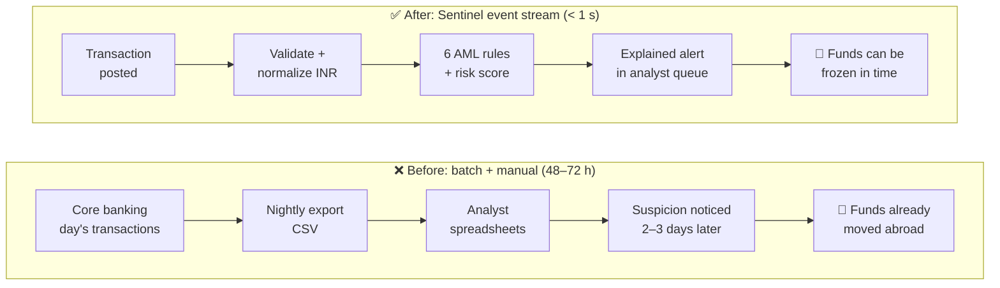
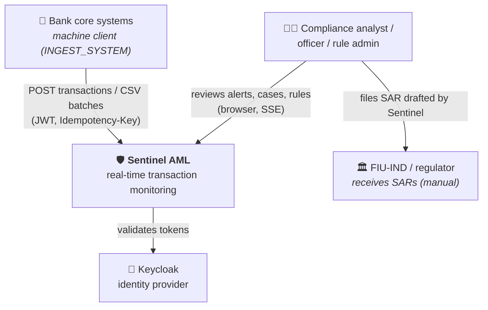
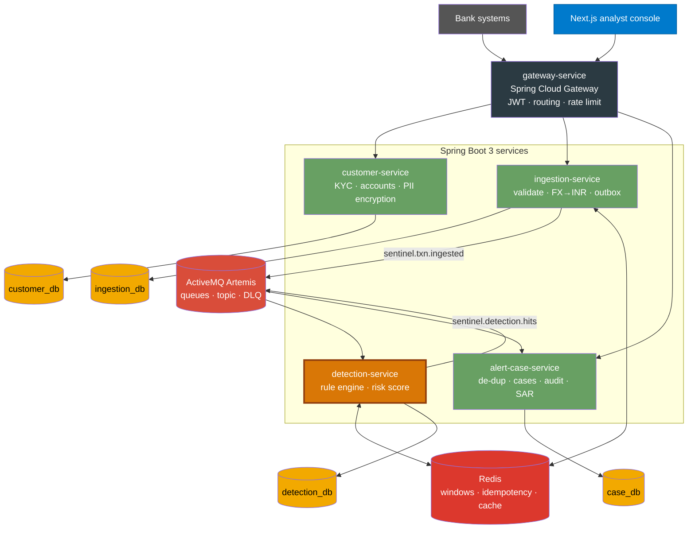
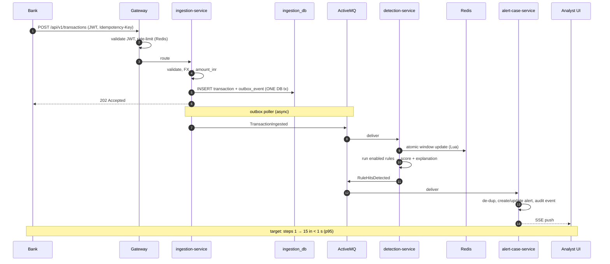
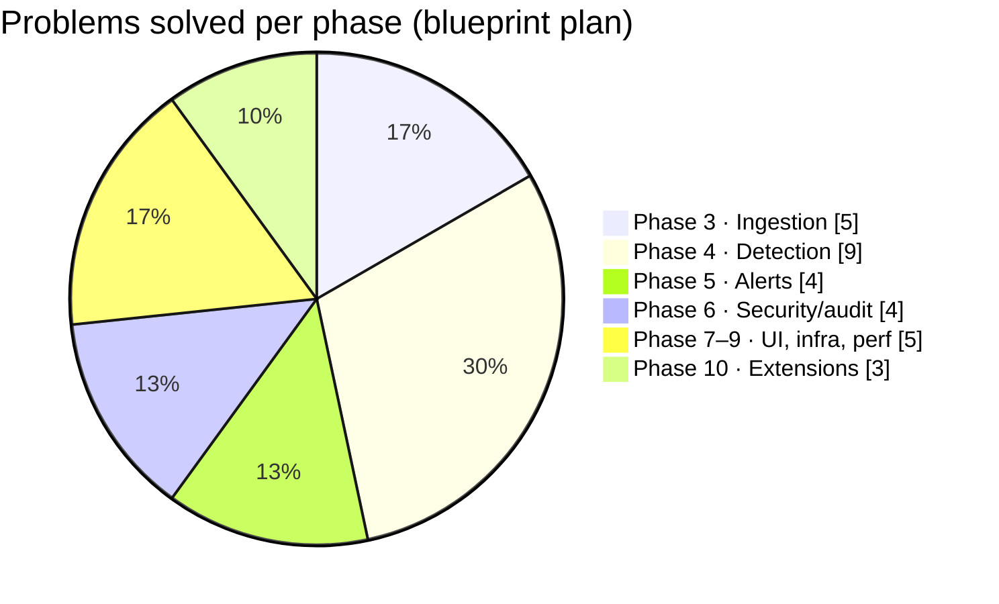
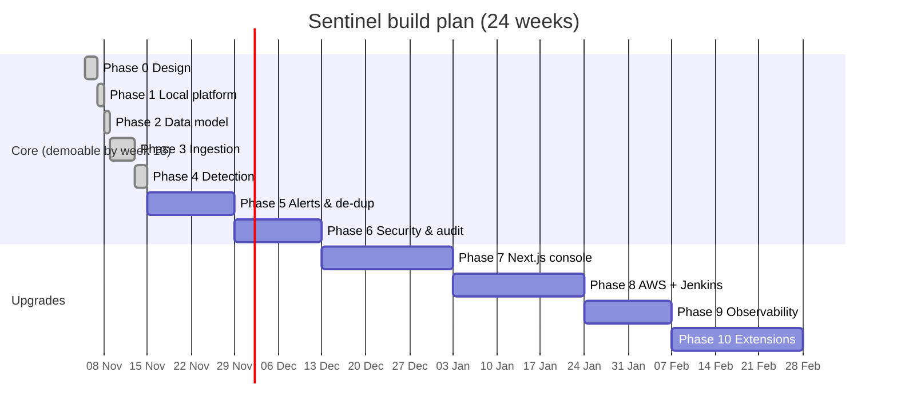

# ADR-000 · Phase 0 — System Design & Kickoff

| | |
|---|---|
| **Status** | Accepted |
| **Date** | 2026-11-05 → 2026-11-06 (commits `5bcd346` "Initial Commit", `fe15046` "Added readme") |
| **Phase promise** | Frame the business problem, decide the architecture and stack, so every later phase has a "why" |
| **Problems framed** | All 30 (P1–P21, X1–X9). Architecture choices directly target **P1** (48–72 h detection delay) |
| **LinkedIn post** | #1 — "I'm building a real-time AML transaction monitoring system in public" |

> **One-line recall:** *Banks find laundering 48–72 h late because review is a nightly spreadsheet batch. Sentinel makes it an event stream: ingest → detect → alert in < 1 s, with explainable scores and an audit trail.*

---

## 1. Context — what problem are we solving?

A bank (the "MeridianTrust" brief) reviews transactions in a nightly batch, by hand, in spreadsheets. By the time a suspicious pattern is noticed, the money has already left — so it can't be frozen.



### AML vocabulary I had to learn first

| Term | Meaning | Where it shows up in Sentinel |
|---|---|---|
| **Placement** | Dirty cash enters the financial system | CTR rule, Structuring rule |
| **Layering** | Money is moved around fast to hide its origin | Rapid Movement rule, network graph (Phase 10) |
| **Integration** | Clean-looking money re-enters the economy | Behavioral deviation |
| **CTR** (Currency Transaction Report) | Mandatory report for a single transaction ≥ USD 10,000 (≈ ₹8.3 L) | `CTR_THRESHOLD` rule |
| **SAR** (Suspicious Activity Report) | Report an analyst files with the FIU when something looks suspicious | SAR draft generator (Phase 10) |
| **Structuring / smurfing** | Splitting cash into amounts just under the CTR limit to avoid the report | `STRUCTURING` rule |
| **FIU-IND / FinCEN** | India's / USA's financial intelligence units that receive SARs | Context only |

---

## 2. Decisions taken in Phase 0

| # | Decision | Chosen | Rejected alternative | Why (the problem it solves) |
|---|---|---|---|---|
| D1 | Architecture style | **Microservices, event-driven** (5 services + gateway) | Monolith | Detection must scale independently of the UI and admin APIs (P1, X3). Bounded contexts keep PII, ingestion and detection separable. |
| D2 | Communication on the detection path | **Asynchronous** (ActiveMQ queues) | Synchronous REST chain | A slow detection pod must not make the bank's POST time out; the broker buffers spikes (P5, X2). |
| D3 | Communication for users/admin | **Synchronous REST** via a gateway | GraphQL, gRPC | Simple, Swagger-documentable, one entry point for auth + rate limits (P19, X3). |
| D4 | Data ownership | **Database per service** (one MySQL schema each) | Shared DB | Services can't break each other through joins; each owns its schema & migrations (P2). |
| D5 | Database | **MySQL 8** | PostgreSQL (brief's preference) | Brief accepts MySQL; familiarity; AWS RDS support. Consequences documented in §5. |
| D6 | Message broker | **ActiveMQ Artemis** (Amazon MQ on AWS) | Kafka, RabbitMQ | JMS gives persistent delivery, redelivery and DLQ out of the box; topics for rule hot-reload; I already knew it. |
| D7 | Fast state | **Redis** | Query MySQL per transaction | "Last 24 h for this account" must be answered in microseconds (P7, P8, P10). |
| D8 | Identity | **Keycloak** (OAuth2/OIDC) | Hand-rolled JWT login, AWS Cognito | Real RBAC with roles in JWTs, free & local (P17, P19). |
| D9 | Repo layout | **Monorepo** | Repo per service | One link for recruiters; atomic cross-service changes. |
| D10 | Language/runtime | **Java 21 + Spring Boot 3** | Java 17 | LTS; virtual threads help I/O-heavy services. |
| D11 | Way of working | **One branch per phase**, tests in the same phase, an ADR per phase, a LinkedIn post per phase | "Test later" | Keeps the build honest and demoable every 1–3 weeks. |

---

## 3. Target architecture

### 3.1 C4 — System context



### 3.2 C4 — Containers (the 5 services + gateway)



**detection-service is highlighted:** it's the one that scales out under load and the one interviewers ask about.

### 3.3 The end-to-end flow of one transaction (the north-star)



### 3.4 Communication rules (decided here, enforced in every phase)

1. **Synchronous REST only for user-facing queries and admin actions.** Everything on the detection path is asynchronous.
2. **Every message carries an event ID** (and later a correlation ID).
3. **Every consumer is idempotent**: at-least-once delivery means duplicates *will* arrive.
4. **Services never join across schemas.** They share data through events.
5. **All money is stored twice:** original `amount + currency`, and normalized `amount_inr`.

---

## 4. Problem catalogue → phase map

Every commit/PR should be able to say "this solves P7". The phases are ordered so each one builds on the last:

```mermaid
flowchart LR
    P0["Phase 0<br/>Design"] --> P1["Phase 1<br/>Local platform<br/>X4"]
    P1 --> P2["Phase 2<br/>Data model<br/>P2"]
    P2 --> P3["Phase 3<br/>Ingestion<br/>P3 P4 P5 P18 X1"]
    P3 --> P4["Phase 4<br/>Detection<br/>P1 P6–P12 P15"]
    P4 --> P5["Phase 5<br/>Alerts & de-dup<br/>P13 P14 P21 X2"]
    P5 --> P6["Phase 6<br/>Security & audit<br/>P16 P17 P19 P20"]
    P6 --> P7["Phase 7<br/>Next.js UI<br/>X3"]
    P7 --> P8["Phase 8<br/>AWS + CI/CD<br/>X4 X5"]
    P8 --> P9["Phase 9<br/>Observability + load<br/>X6"]
    P9 --> P10["Phase 10<br/>Extensions<br/>X7 X8 X9"]
    style P0 fill:#16a34a,color:#fff
    style P1 fill:#16a34a,color:#fff
    style P2 fill:#16a34a,color:#fff
    style P3 fill:#16a34a,color:#fff
    style P4 fill:#16a34a,color:#fff
```





### Planned timeline (~16 h/week)



---

## 5. Consequences of the big choices

### MySQL instead of PostgreSQL: things handled consciously

| Concern | Rule we follow | Where |
|---|---|---|
| Money precision | `DECIMAL(19,4)`, never `FLOAT`/`DOUBLE` | every `amount` column |
| Time | `DATETIME(6)`, stored in **UTC** | `txn_timestamp`, `created_at` |
| Charset | InnoDB + `utf8mb4` | `customer_db` V1 |
| Append-only audit | MySQL has no append-only tables → DB user with only `INSERT, SELECT` on `audit_event` + SHA-256 hash chain | Phase 6 |
| Flexible params | JSON columns for rule params and alert evidence | detection V4 |

### Microservices: the cost I accepted

- **Distributed data.** There are no cross-service joins, so the detection service only knows what the event tells it. That's why the event contract matters so much (see ADR-004).
- **Eventual consistency.** An alert appears a few hundred ms after the 202, not inside the same request.
- **Operational weight.** Many processes on a laptop. Mitigation: `-Xmx256m` per service, and only run what you're working on.

---

## 6. What the repository looks like (from Phase 0)

```text
sentinel-aml/
├── docs/            ADRs (this folder), blueprint PDF, test data, LinkedIn drafts
├── services/        Maven multi-module: common-lib, gateway, customer, ingestion, detection, alert-case
├── frontend/        (Phase 7) Next.js analyst console
├── infra/           (Phase 8) Terraform modules + envs/dev
├── deploy/          (Phase 8) Helm charts
├── load-tests/      (Phase 9) JMeter plans
├── docker-compose.yml
└── .env.example     12-factor config template, no secrets in Git
```

---

## 7. Definition of Done: blueprint checklist

| Item | Status |
|---|---|
| Repo public, monorepo layout | ✅ |
| README with problem statement + architecture (Mermaid) | ✅ |
| C4 context & container diagrams | ✅ (this ADR, §3) |
| ADRs for microservices / MySQL / ActiveMQ | ✅ (merged into this ADR, §2 D1, D5, D6) |
| LinkedIn post #1 | ✅ |

---

## 8. Recall card 🧠

**Explain Sentinel in 30 seconds:**
> "Banks review transactions in nightly batches, so laundering is found 48–72 hours late. I built an event-driven platform: transactions are ingested with idempotency and FX normalization, written with a transactional outbox, streamed over ActiveMQ to a Redis-backed rule engine with 6 AML typologies, scored and explained, and pushed to an analyst queue in under a second."

**Why microservices?** Detection has a very different scaling profile from the UI/admin APIs. It's the hot path that needs to scale out under load.

**Why async on the detection path?** It decouples the bank's request latency from rule-evaluation latency, absorbs spikes, and the broker gives persistence, redelivery and a DLQ for free.

**Why Redis?** Sliding-window questions ("how many deposits on this account in 24 h?") would mean a MySQL range query per transaction, which can't stay sub-second at 200 TPS.

**Bounded context?** A part of the domain with its own model and data: customer (KYC/PII), ingestion (raw transactions), detection (rules/hits), alert-case (workflow/audit).
