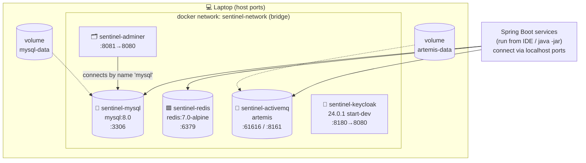
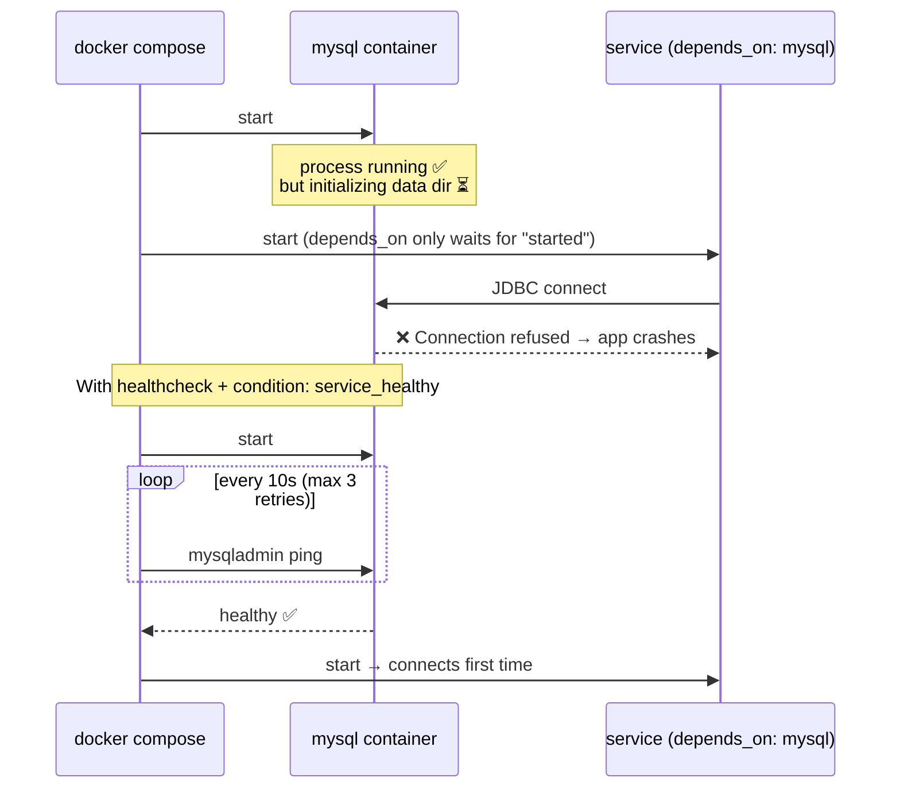
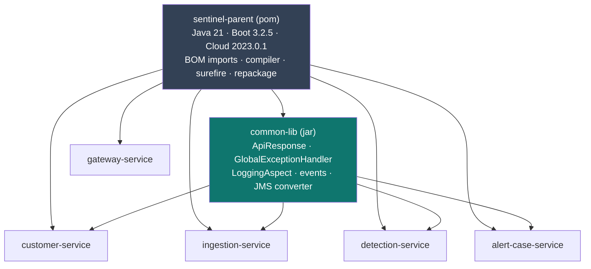
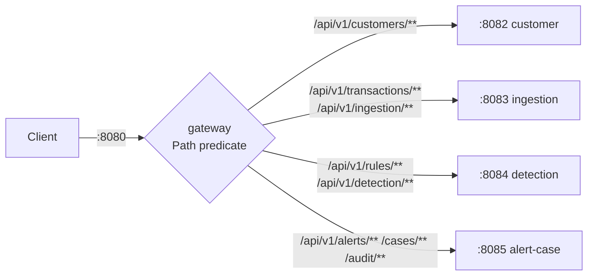
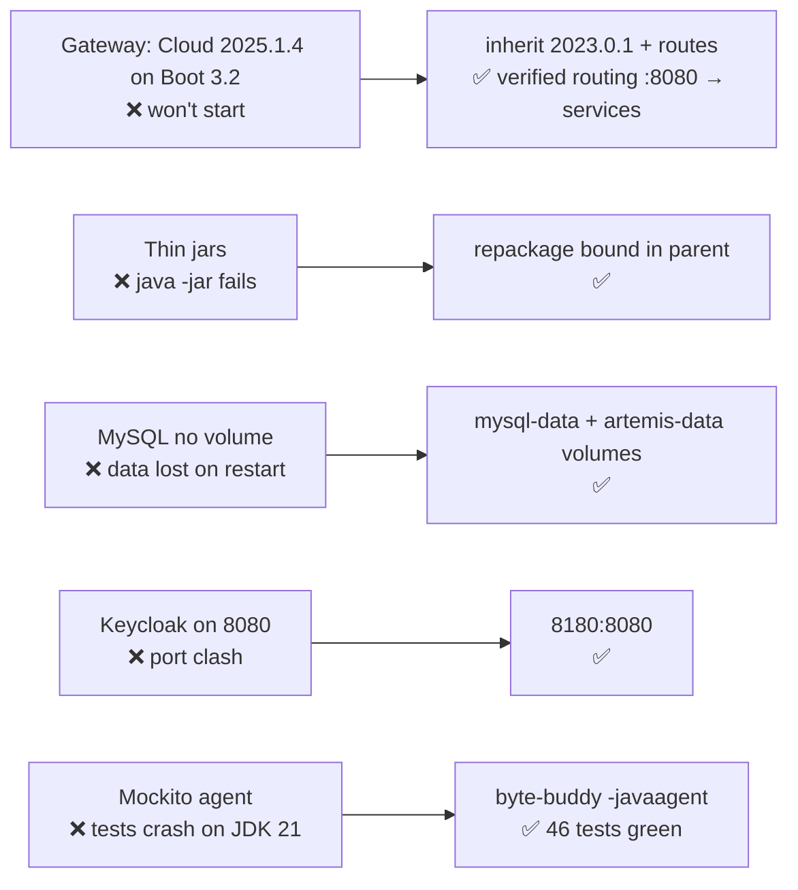

# ADR-001 · Phase 1 — Local Platform & Service Skeletons

| | |
|---|---|
| **Status** | Accepted (stabilized 2026-11-14) |
| **Date** | 2026-11-07 (commits `dab600d` gateway, `79bfb55` all services, `e8784a5` compose) |
| **Phase promise** | "One command" brings up the whole backing infrastructure; every service has a skeleton in a Maven multi-module build |
| **Problems solved** | **X4** ("works on my machine"): foundation |
| **Skills** | Docker Compose, healthchecks, Maven parent POM + BOMs, Spring Cloud Gateway (basic), 12-factor config |
| **LinkedIn post** | #2: "One command. A complete local infrastructure stack." |

> **One-line recall:** *`docker compose up -d` starts MySQL, Redis, Artemis, Keycloak and Adminer on one bridge network with healthchecks; a parent POM pins every version once so 6 modules build identically.*

---

## 1. Context

Before writing any business code I needed real backing services (no mocks), because the bugs that matter in this system come from **integration**: broker redelivery, Redis atomicity, MySQL type mapping. Installing MySQL/Redis/Artemis/Keycloak by hand differs on every laptop and can't be reproduced in CI.

---

## 2. Decisions

| # | Decision | Why |
|---|---|---|
| D1 | **Docker Compose** for all backing services | One command, same versions for everyone, throw-away state |
| D2 | **Healthchecks** on every stateful container | "Started" ≠ "ready": `depends_on` alone does not wait for MySQL to accept connections |
| D3 | **One user-defined bridge network** `sentinel-network` | Containers resolve each other by name (`mysql`, `redis`) |
| D4 | **Named volumes** for MySQL and Artemis *(added during stabilization)* | Data and persistent queues survive `docker compose restart` |
| D5 | **Maven multi-module** with a parent POM that **imports BOMs** | Spring Boot, Spring Cloud and Testcontainers versions defined once; children declare deps without versions |
| D6 | **`common-lib` module** | Shared error format, response envelope, constants, events: written once |
| D7 | **Port plan** fixed up front | No collisions when everything runs at once (table below) |
| D8 | **Spring Cloud Gateway (Server MVC)** as the single entry point | Code-level gateway I control: routing now, JWT + rate limiting later (Phase 6/7) |

### Port map

| Port (host) | What | Notes |
|---|---|---|
| **8080** | gateway-service | the only port clients should use |
| 8081 | Adminer | DB GUI |
| 8082 | customer-service | |
| 8083 | ingestion-service | |
| 8084 | detection-service | |
| 8085 | alert-case-service | Phase 5 |
| **8180** | Keycloak | moved from 8080 during stabilization (see §6) |
| 3306 | MySQL | |
| 6379 | Redis | |
| 61616 / 8161 | Artemis JMS / web console | |

---

## 3. Architecture

### 3.1 Compose topology



### 3.2 Why healthchecks: `depends_on` vs readiness



The healthchecks used:

```yaml
mysql:    test: ["CMD", "mysqladmin", "ping", "-h", "localhost"]          # interval 10s, retries 3
redis:    test: ["CMD", "redis-cli", "ping"]                               # PONG = ready
activemq: test: ["CMD", "wget", "-q", "-O", "/dev/null", "http://localhost:8161/console"]
```

### 3.3 Maven module graph



---

## 4. How it's built: the important code

### 4.1 Parent POM: the "rulebook" (versions) vs the "uniform" (forced deps)

```xml
<properties>
    <java.version>21</java.version>
    <spring-boot.version>3.2.5</spring-boot.version>
    <spring-cloud.version>2023.0.1</spring-cloud.version>
    <testcontainers.version>1.19.7</testcontainers.version>
</properties>

<!-- The Rulebook: locks versions, but does not force download -->
<dependencyManagement>
    <dependencies>
        <dependency>
            <groupId>org.springframework.boot</groupId>
            <artifactId>spring-boot-dependencies</artifactId>
            <version>${spring-boot.version}</version>
            <type>pom</type>
            <scope>import</scope>          <!-- BOM import -->
        </dependency>
        <!-- spring-cloud-dependencies, testcontainers-bom, springdoc, datafaker, commons-text ... -->
    </dependencies>
</dependencyManagement>

<!-- The Mandatory Uniform: forced into every child module -->
<dependencies>
    <dependency><groupId>org.projectlombok</groupId><artifactId>lombok</artifactId><optional>true</optional></dependency>
    <dependency><groupId>org.springframework.boot</groupId><artifactId>spring-boot-starter-test</artifactId><scope>test</scope></dependency>
</dependencies>
```

**Key idea:** `<dependencyManagement>` only *declares* versions. A child still has to list the dependency, but without `<version>`. `<dependencies>` in the parent *forces* them into every child.

### 4.2 Why our parent needs explicit `repackage` (stabilization fix)

We don't inherit from `spring-boot-starter-parent` (we have our own parent), so the Boot plugin's `repackage` goal is **not bound automatically**. Without it `mvn package` produced a thin jar → `java -jar` failed with **"no main manifest attribute"**.

```xml
<pluginManagement>
  <plugins>
    <plugin>
      <groupId>org.springframework.boot</groupId>
      <artifactId>spring-boot-maven-plugin</artifactId>
      <version>${spring-boot.version}</version>
      <executions>
        <execution><id>repackage</id><goals><goal>repackage</goal></goals></execution>
      </executions>
    </plugin>
  </plugins>
</pluginManagement>
```

Each service then just declares `<plugin><groupId>org.springframework.boot</groupId><artifactId>spring-boot-maven-plugin</artifactId></plugin>`.

### 4.3 Mockito on JDK 21 (stabilization fix)

JDK 21 restricts dynamically attached agents; Mockito's inline mock maker failed with *"Could not initialize plugin: MockMaker"*. Fix: load Byte Buddy's agent at JVM start for every test run:

```xml
<plugin>  <!-- exposes ${net.bytebuddy:byte-buddy-agent:jar} as a property -->
  <artifactId>maven-dependency-plugin</artifactId>
  <executions><execution><goals><goal>properties</goal></goals></execution></executions>
</plugin>
<plugin>
  <artifactId>maven-surefire-plugin</artifactId>
  <configuration>
    <argLine>@{argLine} -javaagent:${net.bytebuddy:byte-buddy-agent:jar} -Xshare:off</argLine>
  </configuration>
</plugin>
```

### 4.4 Gateway routes (Spring Cloud Gateway **Server MVC**, 2023.0.x)

```properties
server.port=8080
spring.cloud.gateway.mvc.routes[0].id=customer-service
spring.cloud.gateway.mvc.routes[0].uri=${CUSTOMER_SERVICE_URL:http://localhost:8082}
spring.cloud.gateway.mvc.routes[0].predicates[0]=Path=/api/v1/customers/**,/api/v1/admin/seed-data

spring.cloud.gateway.mvc.routes[1].id=ingestion-service
spring.cloud.gateway.mvc.routes[1].uri=${INGESTION_SERVICE_URL:http://localhost:8083}
spring.cloud.gateway.mvc.routes[1].predicates[0]=Path=/api/v1/transactions/**,/api/v1/ingestion/**
# detection (/api/v1/rules/**, /api/v1/detection/**) and alert-case (/api/v1/alerts/** ...) likewise
```



`${ENV:default}` placeholders are the **12-factor** pattern: the same jar runs locally and in Kubernetes, only env vars change.

### 4.5 Configuration & secrets hygiene

- `.gitignore` excludes `.env`, `*.pem`, `*.key`, `target/`, IDE files.
- `.env.example` documents every variable with **no real values** (`DB_PASSWORD=change-me`, `SENTINEL_ENCRYPTION_KEY=` with the `openssl rand -base64 32` hint).

---

## 5. Edge cases & gotchas I hit

| Gotcha | Symptom | Fix / rule |
|---|---|---|
| `depends_on` doesn't wait for readiness | App starts before DB accepts connections | Healthchecks (+ `condition: service_healthy` when services are containerized in Phase 8) |
| No volume on MySQL | Every container recreate **wiped all databases** (happened for real on 2026-11-14) | Named volume `mysql-data` |
| Two things on 8080 | Gateway and Keycloak both default to 8080 | Keycloak → host 8180 |
| Spring Cloud ↔ Boot version mismatch | Gateway pinned Cloud `2025.1.4` (built for Boot 4) on Boot 3.2 → can't start | Remove the override, inherit `2023.0.1`; artifact name is `spring-cloud-starter-gateway-mvc` in that train |
| Thin jars | `no main manifest attribute` | Bind `repackage` (§4.2) |
| MySQL 8 auth from JDBC | `Public Key Retrieval is not allowed` | `allowPublicKeyRetrieval=true&useSSL=false` (local only) |

---

## 6. Stabilization log (what changed on 2026-11-14 and why)



> After pulling these changes run `docker compose up -d` once so the containers are **recreated** with the new port and volumes.

---

## 7. Definition of Done: blueprint checklist

| Item | Status | Note |
|---|---|---|
| `docker compose up` brings infra up healthy | ✅ | 5 containers (MySQL, Redis, Artemis, Keycloak, Adminer) |
| Maven parent + modules (`common-lib`, gateway, 4 services) | ✅ | notification-service is optional, skipped |
| Gateway routes `/api/v1/customers/**`, `/api/v1/transactions/**`… | ✅ | added in stabilization |
| `/actuator/health` on each service | ⚠️ | ingestion, detection, gateway, customer, alert-case have actuator; check each once alert-case is configured |
| Multi-stage **Dockerfile** per service (non-root, layered jar) | ❌ | Do before Phase 8 |
| "12 containers healthy" (services containerized too) | ❌ | Needs the Dockerfiles; add the services to compose with `condition: service_healthy` |
| Redis Insight container | ❌ | optional |
| `gitleaks` pre-commit hook | ❌ | cheap to add, blueprint asks for it |

---

## 8. Recall card 🧠

- **Image vs container:** image = immutable template (layers); container = a running instance with its own writable layer.
- **Layer caching:** order Dockerfile steps from least to most frequently changing (`COPY pom.xml` → `mvn dependency:go-offline` → `COPY src`).
- **Why healthchecks:** `depends_on` waits for *started*, not *ready*.
- **BOM import:** `<scope>import</scope>` + `<type>pom</type>` inside `dependencyManagement` copies a whole version list into your build.
- **12-factor config:** config in env vars (`${DB_PASSWORD:...}`), never in code or Git.

**Commands**

```bash
docker compose up -d
```
```bash
docker compose ps
```
```bash
cd services && mvn clean install -DskipTests
```
