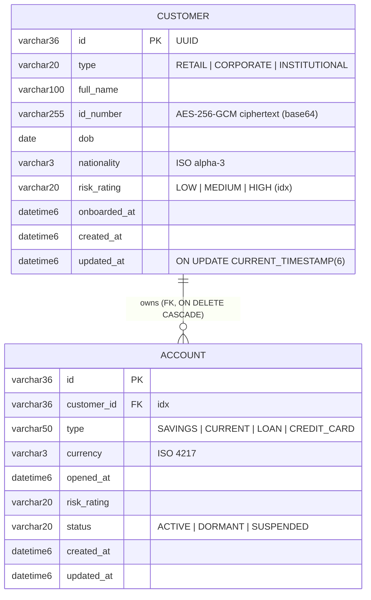
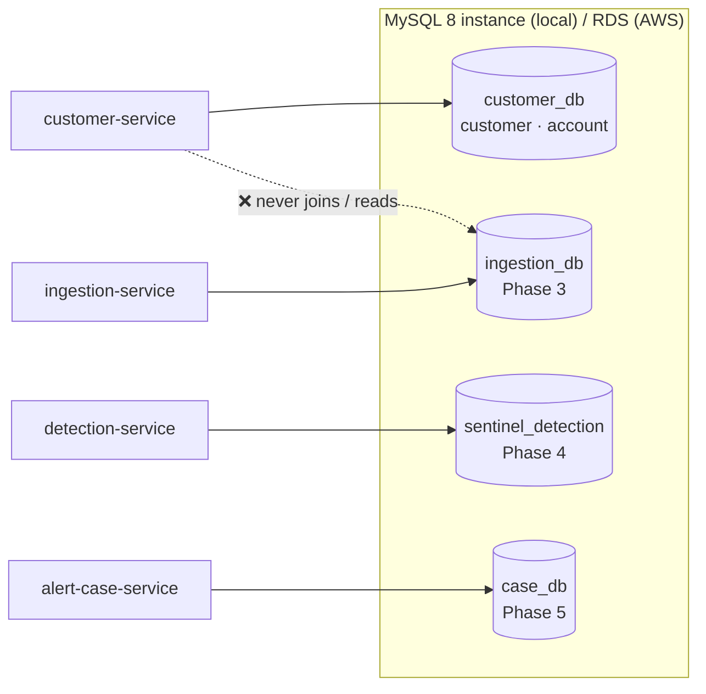
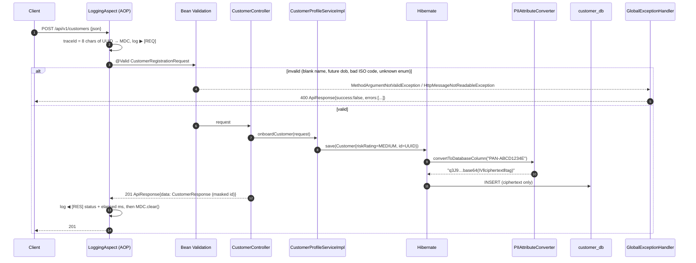
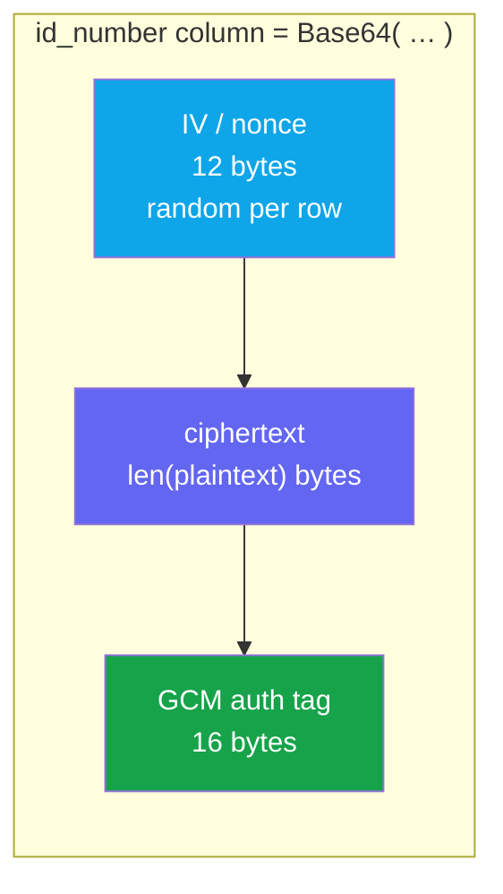
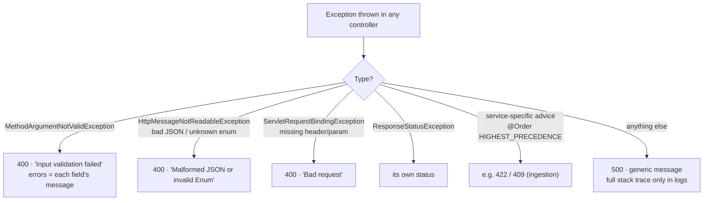
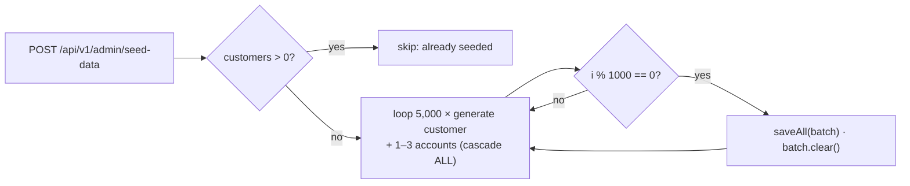

# ADR-002 · Phase 2 — Data Model, customer-service & Shared Foundations

| | |
|---|---|
| **Status** | Accepted (PII hardening on 2026-11-14) |
| **Date** | 2026-11-08 (commit `6c3edc5` "Phase2 done!") |
| **Phase promise** | A normalized **customer → account** model with versioned migrations, encrypted PII, validated input and a consistent API surface |
| **Problems solved** | **P2** (no proper data model) · foundations for **P17** (PII exposure) |
| **Skills** | JPA/Hibernate, Flyway, MySQL types, `AttributeConverter`, Bean Validation, Spring AOP, `@RestControllerAdvice`, Datafaker, JUnit 5 + Mockito, springdoc |
| **LinkedIn post** | #3: encryption at rest, multi-module, AOP logging, validation, DB-per-service, 5,000-customer seeder |

> **One-line recall:** *customer-service owns `customer_db` (Flyway V1). `id_number` is AES-256-GCM encrypted by a JPA `AttributeConverter`, so business code never sees ciphertext. Every controller call is traced by an AOP aspect, and every error goes out in one `ApiResponse` envelope.*

---

## 1. Context

An AML system is judged by regulators on **data integrity, traceability and protection of personal data**, not only on detection. Before ingesting a single transaction we need:

1. A relational model where an account can't exist without its customer (FKs, migrations).
2. National ID numbers that are **unreadable in the database** (a DB dump or an over-privileged DBA must not leak PII).
3. One way of validating input and reporting errors across all services.
4. Realistic volume (thousands of customers) to develop against, with no real PII.

---

## 2. Decisions

| # | Decision | Alternative rejected | Why |
|---|---|---|---|
| D1 | **Flyway** owns the schema, Hibernate `ddl-auto=validate` | `ddl-auto=update` | Versioned, reviewable, repeatable migrations; Hibernate only *checks* that entities match |
| D2 | **UUID `VARCHAR(36)` primary keys** generated in Java | DB auto-increment | IDs known before insert (useful for events/outbox), no cross-service collisions, no enumeration |
| D3 | **Field-level encryption via JPA `AttributeConverter`** | Encrypt in service code; whole-disk encryption only | Transparent to business logic; protects against DB dumps, not only stolen disks |
| D4 | **AES-256-GCM** with a random IV per value *(was AES/ECB, fixed)* | AES/ECB, AES/CBC | GCM = confidentiality **+ integrity**; random IV means same ID → different ciphertext |
| D5 | **Enums** for `CustomerType`, `RiskRating` persisted as `VARCHAR` | Free strings, ordinal ints | Invalid values rejected at the JSON boundary; readable in SQL; reordering enums can't corrupt data |
| D6 | **Bean Validation** on request records (`@NotBlank`, `@Past`, `@Pattern`) | Manual `if` checks | Declarative, self-documenting, auto-400 via the global handler |
| D7 | **`ApiResponse<T>` envelope + `GlobalExceptionHandler` in `common-lib`** | Each service invents its own | Every service answers in the same shape; no stack traces to clients |
| D8 | **AOP `LoggingAspect`** around every `@RestController` | Logging in each controller | Cross-cutting concern written once: trace ID, payload, status, duration |
| D9 | **API returns DTOs, never entities** *(added in stabilization)* | Return `Customer` entity | The entity holds the **decrypted** ID and lazy collections |
| D10 | **Datafaker seeder** behind an admin endpoint | Hand-written SQL inserts | 5,000 customers / ~8,000 accounts with realistic shapes, zero real PII |

---

## 3. Data model

### 3.1 ERD (customer_db)



### 3.2 Database-per-service: where this schema sits



One MySQL **server**, many **schemas**. Each service connects only to its own (`createDatabaseIfNotExist=true` creates it on first boot). Sharing happens through events, never SQL.

### 3.3 Migration `V1__init.sql` (key parts)

```sql
CREATE TABLE customer (
    id VARCHAR(36) PRIMARY KEY,
    type VARCHAR(20) NOT NULL,           -- RETAIL / CORPORATE / INSTITUTIONAL
    full_name VARCHAR(100) NOT NULL,
    id_number VARCHAR(255) NOT NULL,     -- stored encrypted
    dob DATE,
    nationality VARCHAR(3) NOT NULL,     -- ISO alpha-3
    risk_rating VARCHAR(20) NOT NULL,
    onboarded_at DATETIME(6) NOT NULL,
    created_at DATETIME(6) DEFAULT CURRENT_TIMESTAMP(6),
    updated_at DATETIME(6) DEFAULT CURRENT_TIMESTAMP(6) ON UPDATE CURRENT_TIMESTAMP(6)
) ENGINE=InnoDB DEFAULT CHARSET=utf8mb4 COLLATE=utf8mb4_unicode_ci;

CREATE TABLE account ( ...
    CONSTRAINT fk_account_customer FOREIGN KEY (customer_id) REFERENCES customer(id) ON DELETE CASCADE
) ENGINE=InnoDB DEFAULT CHARSET=utf8mb4;

CREATE INDEX idx_customer_rating     ON customer(risk_rating);
CREATE INDEX idx_account_customer_id ON account(customer_id);
```

Flyway rules I follow: file name `V<n>__<description>.sql`; **never edit an applied migration**, always add `V<n+1>`; Flyway records checksums in `flyway_schema_history`.

---

## 4. Request lifecycle: how the pieces fit



---

## 5. The important code

### 5.1 PII encryption: `PIIAttributeConverter` (AES-256-GCM)

```java
@Converter
@Component
public class PIIAttributeConverter implements AttributeConverter<String, String> {
    private static final String TRANSFORMATION = "AES/GCM/NoPadding";
    private static final int IV_BYTES = 12;     // 96-bit nonce, GCM standard
    private static final int TAG_BITS = 128;    // authentication tag
    private static final SecureRandom RANDOM = new SecureRandom();
    private final SecretKey key;

    public PIIAttributeConverter(@Value("${sentinel.encryption.key}") String base64Key) {
        byte[] decoded = Base64.getDecoder().decode(base64Key);
        if (decoded.length != 32) throw new IllegalStateException("...must be a 32-byte (256-bit) key");
        this.key = new SecretKeySpec(decoded, "AES");
    }

    @Override public String convertToDatabaseColumn(String attribute) {
        byte[] iv = new byte[IV_BYTES];
        RANDOM.nextBytes(iv);                                         // fresh IV every time
        Cipher cipher = Cipher.getInstance(TRANSFORMATION);
        cipher.init(Cipher.ENCRYPT_MODE, key, new GCMParameterSpec(TAG_BITS, iv));
        byte[] ct = cipher.doFinal(attribute.getBytes(UTF_8));        // ciphertext + 16-byte tag
        return Base64.getEncoder().encodeToString(
                ByteBuffer.allocate(iv.length + ct.length).put(iv).put(ct).array());
    }

    @Override public String convertToEntityAttribute(String dbData) {
        byte[] all = Base64.getDecoder().decode(dbData);
        Cipher cipher = Cipher.getInstance(TRANSFORMATION);
        cipher.init(Cipher.DECRYPT_MODE, key, new GCMParameterSpec(TAG_BITS, all, 0, IV_BYTES));
        return new String(cipher.doFinal(all, IV_BYTES, all.length - IV_BYTES), UTF_8); // throws if tampered
    }
}
```

Used on the entity with one annotation:

```java
@Convert(converter = PIIAttributeConverter.class)
@Column(name = "id_number", nullable = false)
private String idNumber;
```

**Stored value layout:**



**Why GCM, not the original `Cipher.getInstance("AES")`:** on the JDK `"AES"` silently means **AES/ECB/PKCS5Padding**:

| Property | AES/ECB (original) | AES/GCM (now) |
|---|---|---|
| Same input → same output? | **Yes**: leaks which customers share an ID, enables frequency analysis | No: random IV each write |
| Detects tampering? | No | Yes: auth tag; decrypt throws |
| Blueprint requirement | ❌ | ✅ "AES-GCM, key from env" |

**Key management:** `sentinel.encryption.key=${SENTINEL_ENCRYPTION_KEY:<dev-only default>}`. The real key comes from the environment (AWS Secrets Manager → K8s Secret in Phase 8). Generate one with `openssl rand -base64 32`.

> ⚠️ Consequence: because ciphertext is random, you **cannot `WHERE id_number = ?`**. If lookup by ID is ever needed, add a separate `id_number_hash` column = HMAC-SHA256(key2, id) (a "blind index").

### 5.2 Never return entities: masked DTO

```java
public record CustomerResponse(String id, CustomerType type, String fullName, String idNumberMasked,
                               LocalDate dob, String nationality, RiskRating riskRating, LocalDateTime onboardedAt) {
    public static CustomerResponse from(Customer c) { ... mask(c.getIdNumber()) ... }

    /** "PAN-ABCD1234E" -> "*********234E" */
    static String mask(String value) {
        int visible = Math.min(4, value.length() / 3);
        return "*".repeat(value.length() - visible) + value.substring(value.length() - visible);
    }
}
```

Originally the controller returned `ApiResponse<Customer>`: Jackson serialized the entity *after* the converter decrypted it, so **the full national ID went back over the wire**. Role-based unmasking (full value only for `SENIOR_ANALYST`) is Phase 6.

### 5.3 Validation at the boundary

```java
public record CustomerRegistrationRequest(
    @NotNull(message = "Customer type is required (RETAIL, CORPORATE, INSTITUTIONAL)") CustomerType type,
    @NotBlank(message = "Full name cannot be blank") String fullName,
    @NotBlank(message = "National ID number cannot be blank") String idNumber,
    @NotNull @Past(message = "Date of birth must be a past date") LocalDate dob,
    @NotBlank @Pattern(regexp = "^[A-Z]{3}$", message = "Nationality must be a valid 3-letter ISO code (e.g., IND)") String nationality
) {}
```

Enum persistence that is safe and readable:

```java
@Enumerated(EnumType.STRING)                                   // "MEDIUM", not 1
@org.hibernate.annotations.JdbcTypeCode(java.sql.Types.VARCHAR) // match VARCHAR column for schema validation
@Column(name = "risk_rating", nullable = false, length = 20)
private RiskRating riskRating;
```

### 5.4 One error format everywhere: `GlobalExceptionHandler` (common-lib)



```java
@JsonInclude(JsonInclude.Include.NON_NULL)   // hides "errors" on success
public class ApiResponse<T> { private boolean success; private String message; private T data; private List<String> errors; }
```

### 5.5 Cross-cutting logging: `LoggingAspect`

```java
@Aspect @Component
public class LoggingAspect {
    @Pointcut("within(@org.springframework.web.bind.annotation.RestController *)")
    public void controllerPointcut() {}

    @Around("controllerPointcut()")
    public Object logAround(ProceedingJoinPoint jp) throws Throwable {
        String traceId = UUID.randomUUID().toString().substring(0, 8);
        MDC.put("traceId", traceId);                          // every log line in this thread gets it
        log.info("▶ [REQ] [{}] {} {} | Executing: {}.{}() | Payload: {}", traceId, method, uri, cls, m, args);
        long start = System.currentTimeMillis();
        try {
            Object result = jp.proceed();
            log.info("◀ [RES] [{}] ... Status: {} | Time: {}ms", traceId, status, elapsed);
            return result;
        } catch (Exception e) { log.error("✖ [ERR] ..."); throw e; }
        finally { MDC.clear(); }                               // thread pools reuse threads → must clear
    }
}
```

`within(@RestController *)` matches **every method of every class annotated `@RestController`**, in every service that scans `com.sentinel.aml`.

> ⚠️ Known limitation: it logs the full payload (`Arrays.toString(args)`), which includes the raw `idNumber` on registration. Phase 6 should mask or skip sensitive args. The trace ID is per-service; cross-service correlation IDs come in Phase 9.

### 5.6 Synthetic data: `DataSeederService`

```java
@Transactional
public String seedDatabase() {
    if (customerRepository.count() > 0) return "Database is already seeded...";   // idempotent endpoint
    for (int i = 1; i <= 5000; i++) {
        Customer customer = generateFakeCustomer();          // faker.idNumber().valid() → encrypted by converter
        int accountCount = faker.number().numberBetween(1, 4); // 1–3 accounts ⇒ ≈ 8,000 total
        ... customer.setAccounts(accounts); batch.add(customer);
        if (i % 1000 == 0) { customerRepository.saveAll(batch); batch.clear(); }   // chunked saves
    }
}
```



> 📝 Learning note: `batch.clear()` only clears **my list**. Hibernate's persistence context (L1 cache) still holds all 13,000 entities until the single transaction ends. To truly bound memory, call `entityManager.flush(); entityManager.clear();` per chunk. Also, because IDs are pre-assigned, `save()` → `merge()` issues an extra `SELECT` per entity. Ingestion (ADR-003) uses `persist()` to avoid that.

### 5.7 Unit test (JUnit 5 + Mockito)

```java
@ExtendWith(MockitoExtension.class)
class CustomerProfileServiceImplTest {
    @Mock CustomerRepository customerRepository;
    @InjectMocks CustomerProfileServiceImpl customerProfileService;

    @Test void onboardCustomer_Success() {
        when(customerRepository.save(any(Customer.class))).thenAnswer(inv -> inv.getArgument(0));
        customerProfileService.onboardCustomer(new CustomerRegistrationRequest(RETAIL, "Rupam Biswas", "PAN-ABCD1234E", LocalDate.of(2004,4,5), "IND"));
        ArgumentCaptor<Customer> captor = ArgumentCaptor.forClass(Customer.class);
        verify(customerRepository, times(1)).save(captor.capture());
        assertEquals(RiskRating.MEDIUM, captor.getValue().getRiskRating());   // default AML rating applied
    }
}
```

`ArgumentCaptor` lets the test assert on **what the service built**, not just that `save` was called.

---

## 6. Stabilization log (2026-11-14)

| Issue | Risk | Fix |
|---|---|---|
| `Cipher.getInstance("AES")` = ECB | Equal IDs → equal ciphertext; no integrity | AES-256-GCM, random IV, key length check |
| Controller returned the entity | **Full decrypted national ID in API response** | `CustomerResponse` DTO with masked ID; `201 Created` |
| Key hard-coded in properties | Secret in Git | `${SENTINEL_ENCRYPTION_KEY:dev-default}` + `.env.example` |
| `open-in-view` default true | Lazy loading during JSON rendering, long DB sessions | `spring.jpa.open-in-view=false` |
| Catch-all handler echoed `ex.getMessage()` | Internal details leak to clients | Generic 500 message; detail stays in logs |

---

## 7. Definition of Done: blueprint checklist

| Item | Status |
|---|---|
| Flyway migrations for customer & account | ✅ |
| ERD | ✅ (§3.1) |
| Field-level encryption with AES-GCM, key from env | ✅ (after stabilization) |
| Synthetic data: 5,000 customers / ~8,000 accounts | ✅ |
| `POST /api/v1/customers` | ✅ |
| `GET /api/v1/customers` (search), `GET /{id}`, `GET /{id}/accounts` | ❌ to do |
| Repository tests with **Testcontainers MySQL** | ❌ to do |
| Controller tests with **MockMvc** | ❌ to do |
| 80%+ coverage on service layer | ❌ (add JaCoCo) |

---

## 8. Recall card 🧠

- **LAZY vs EAGER:** `@ManyToOne(fetch = LAZY)` on `Account.customer` loads the customer only when touched → avoids loading graphs you don't need. Default for `@ManyToOne` is EAGER, so set it explicitly.
- **N+1 problem:** loading 100 accounts, then touching `account.getCustomer()` in a loop = 1 + 100 queries. Fix with `JOIN FETCH` or an entity graph.
- **`@Version` (optimistic locking):** a version column; the 2nd concurrent update fails instead of silently overwriting. Use for alert/case status changes in Phase 5–6.
- **MySQL default isolation:** REPEATABLE READ.
- **Why DECIMAL for money:** binary floats can't represent 0.1 exactly; `DECIMAL(19,4)` is exact.
- **Why encrypt ID numbers if the disk is encrypted?** Disk encryption protects a stolen disk; field encryption protects against DB dumps, backups, read replicas and over-privileged users.

**Try it**

```bash
curl -s -X POST localhost:8082/api/v1/customers -H 'Content-Type: application/json' -d '{"type":"RETAIL","fullName":"Test User","idNumber":"PAN-ABCD1234E","dob":"1999-01-01","nationality":"IND"}'
```
```bash
docker exec sentinel-mysql mysql -uroot -proot -e "select full_name, id_number from customer_db.customer limit 3"
```
