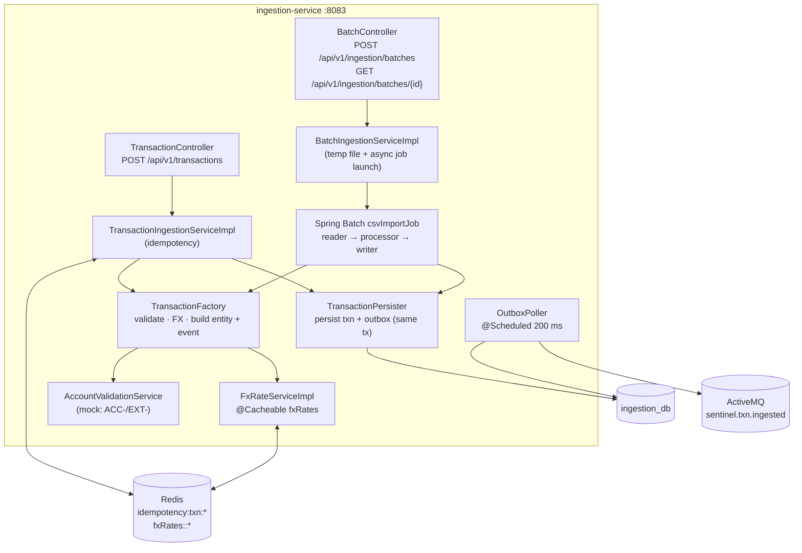
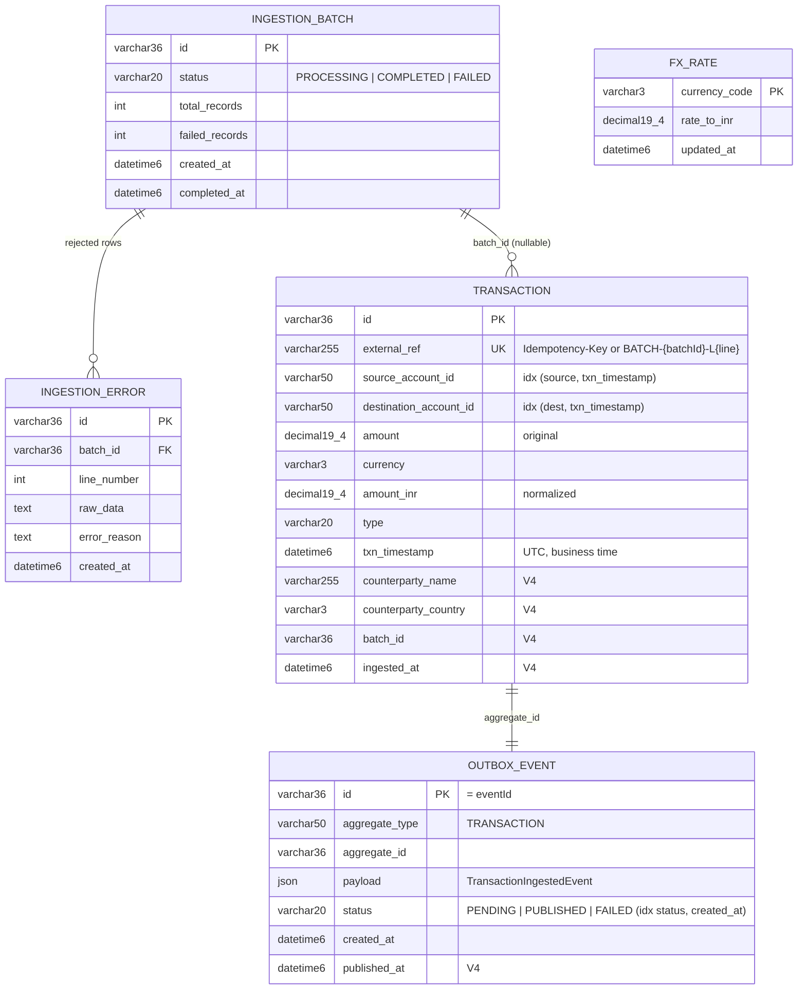
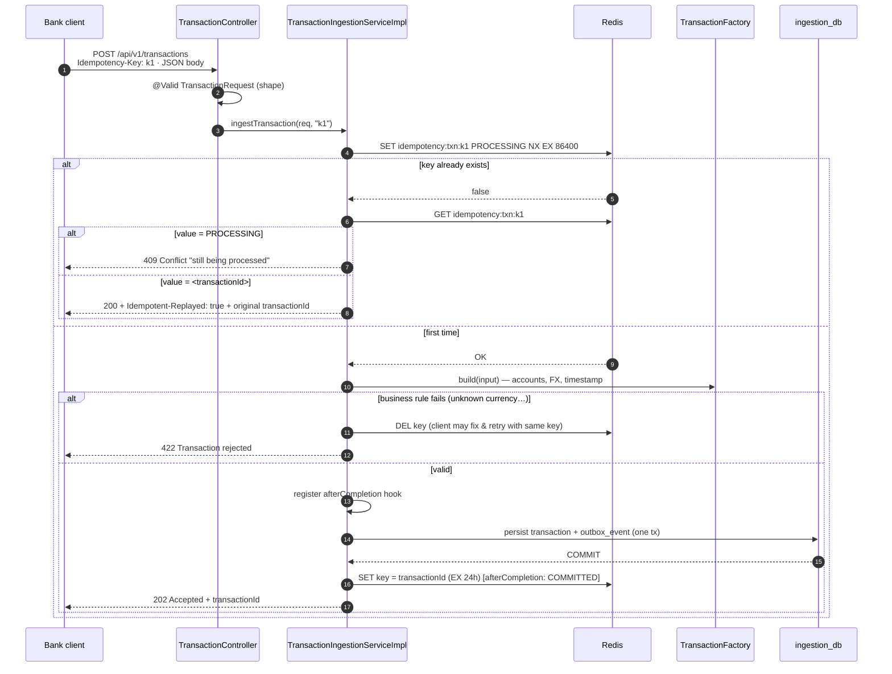
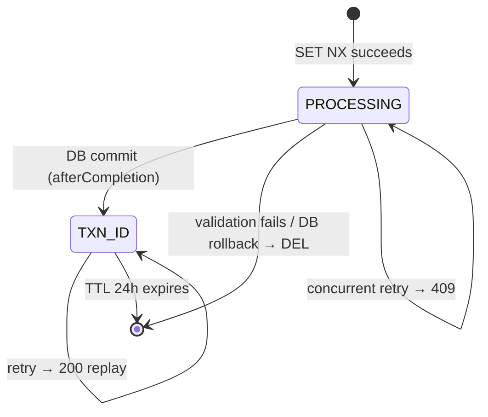
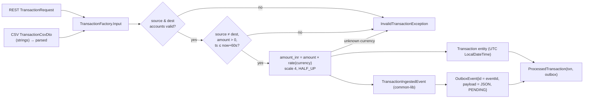
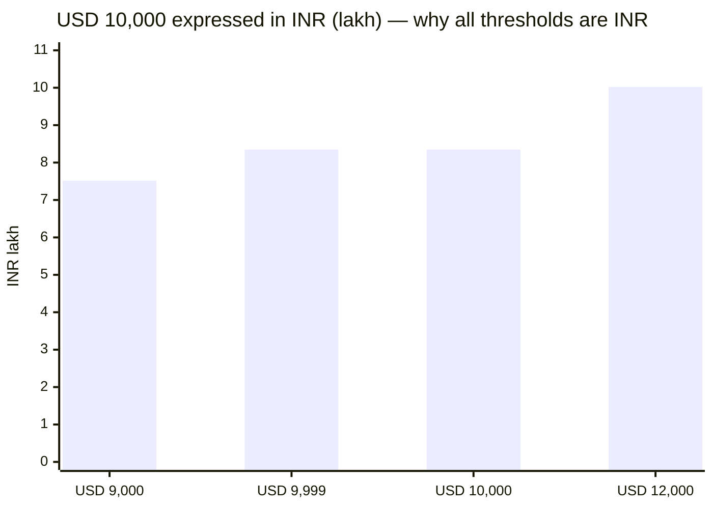
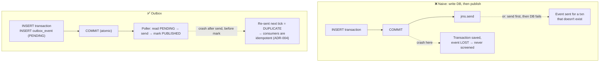
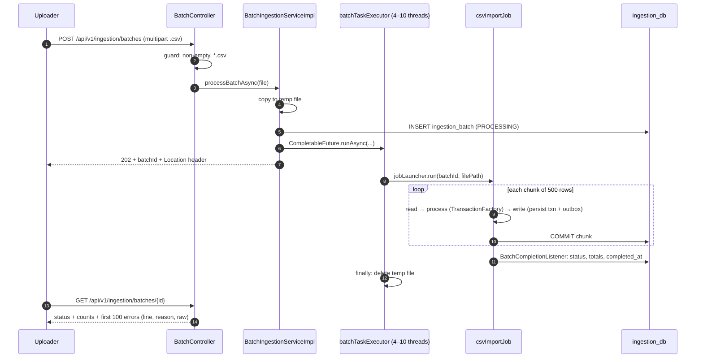
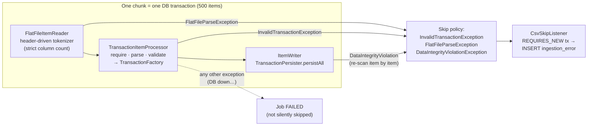
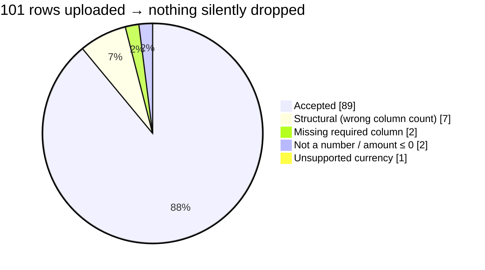

# ADR-003 · Phase 3 — Ingestion: Streaming, Bulk CSV, Validation, FX & Transactional Outbox

| | |
|---|---|
| **Status** | Accepted (hardened 2026-11-14) |
| **Date** | 2026-11-09 → 2026-11-12 (commits `6ca47cf` CSV batch, `6309171` robust, `242be32` mock account validation, `f5b9e15` fixes) |
| **Phase promise** | Accept transactions **one at a time (REST)** and **in bulk (CSV)**, reject bad data loudly, normalize every amount to INR, never lose or duplicate a transaction on its way to detection |
| **Problems solved** | **P3** bulk loading · **P4** malformed records · **P5** streaming arrival · **P18** multi-currency · **X1** duplicate submissions · foundation of **X2** (no lost messages) |
| **Skills** | Spring Batch, JMS producer, Redis `SET NX EX`, Spring Cache on Redis, Bean Validation, transactional outbox, thread-pool isolation |
| **LinkedIn post** | #4: skip listener, thread-pool isolation, startup reconciliation, resource cleanup, O(1) account checks |

> **One-line recall:** *Both entry paths funnel into one `TransactionFactory` (validate → FX→INR → entity + outbox event), persisted in **one DB transaction**. A poller relays the outbox to ActiveMQ every 200 ms. REST retries are idempotent through Redis (`SET NX`, value = transactionId after commit), and every rejected CSV row is stored in `ingestion_error` with its line number.*

---

## 1. Context

Banks deliver transactions two ways: a **continuous stream** (every payment, as it happens) and **files** (end-of-day dumps, back-fills, migrations). Both arrive dirty: missing columns, text in amount fields, unknown currencies, retries of the same request after a network timeout. And whatever we accept must reach the detection engine **exactly as many times as it happened**: a lost transaction is a compliance failure, and a duplicate creates false alerts.

---

## 2. Decisions

| # | Decision | Alternative rejected | Why |
|---|---|---|---|
| D1 | **Two entry points, one core** (`TransactionFactory`) | Separate logic per path | REST and CSV can never drift apart in validation or event shape |
| D2 | **202 Accepted**, async detection | 200 after detection | The bank's call isn't coupled to rule-evaluation latency |
| D3 | **Idempotency-Key header + Redis `SET NX EX 24h`** | DB-only unique check | O(1), works across instances, TTL cleans itself up (X1) |
| D4 | **Replay returns the original transactionId (200)** *(was 400)* | Reject duplicates | A retrying client needs the *answer*, not an error (Stripe-style semantics) |
| D5 | **Transactional outbox** | `jmsTemplate.send()` inside the request | DB write and publish can't diverge: the event is a row in the same transaction |
| D6 | **Normalize to INR at ingestion**, keep the original amount too | Normalize in each rule | One conversion, one FX snapshot; every rule threshold is in INR (P18) |
| D7 | **FX rates in MySQL, cached in Redis** (`@Cacheable`, 1 h TTL) | Call an FX API per txn | Fast, deterministic, auditable rate table |
| D8 | **Spring Batch chunk-oriented step** with a **skip policy** | Read whole file in a loop | Restartable, transactional chunks, built-in skip/retry bookkeeping (P3, P4) |
| D9 | **Skip only data errors**; infra errors fail the job *(tightened)* | `skip(Exception.class)` | A DB outage must not mark 10,000 good rows as "bad data" |
| D10 | **Header-driven CSV columns** *(new)* | Fixed column list | Optional columns (`counterpartyName`, `counterpartyCountry`, `txnTimestamp`) in any order |
| D11 | **Dedicated `batchTaskExecutor`** (4–10 threads, queue 50) | Common ForkJoinPool | Heavy file I/O can't starve other async work (bulkhead) |
| D12 | **Startup reconciliation** marks stale `PROCESSING` batches `FAILED` | Leave them forever | A crash mid-batch leaves an honest status |
| D13 | **`persist()` + JDBC batching** for writes *(new)* | `repository.save()` | Pre-assigned UUIDs make `save()` do `merge()` = an extra SELECT per row |
| D14 | **Account check behind an interface** (`AccountValidationService`), mock = prefix rule | HTTP call to customer-service per row | Avoid N+1 network calls; the real version will be a Redis `SISMEMBER` registry |

---

## 3. Architecture

### 3.1 Component view



### 3.2 Schema (ingestion_db, V1–V4)



---

## 4. Streaming path (P5) with idempotency (X1)

### 4.1 Sequence



### 4.2 The idempotency key as a state machine



### 4.3 Code

```java
@Override
@Transactional
public IngestionResult ingestTransaction(TransactionRequest request, String idempotencyKey) {
    String redisKey = KEY_PREFIX + idempotencyKey;                       // "idempotency:txn:"
    Boolean isNew = redisTemplate.opsForValue().setIfAbsent(redisKey, IN_PROGRESS, KEY_TTL);
    if (Boolean.FALSE.equals(isNew)) {
        String existing = redisTemplate.opsForValue().get(redisKey);
        if (existing == null || IN_PROGRESS.equals(existing))
            throw new RequestInProgressException("...still being processed. Retry shortly.");   // → 409
        return new IngestionResult(existing, true);                       // → 200 replay
    }

    ProcessedTransaction processed;
    try {
        processed = transactionFactory.build(new TransactionFactory.Input(idempotencyKey, null, ...));
    } catch (RuntimeException e) {
        redisTemplate.delete(redisKey);   // let the client fix the payload and retry with the same key
        throw e;
    }

    String transactionId = processed.getTransaction().getId();
    TransactionSynchronizationManager.registerSynchronization(new TransactionSynchronization() {
        @Override public void afterCompletion(int status) {
            if (status == STATUS_COMMITTED) redisTemplate.opsForValue().set(redisKey, transactionId, KEY_TTL);
            else redisTemplate.delete(redisKey);                          // rollback → free the key
        }
    });
    transactionPersister.persistAll(List.of(processed));
    return new IngestionResult(transactionId, false);
}
```

**Why `afterCompletion` and not just `set()` at the end of the method?** Because the method returns *before* the commit. If we wrote the transactionId and the commit then failed, a retry would get a 200 for a transaction that **doesn't exist**.

Controller: same body, two status codes:

```java
@PostMapping({"", "/ingest"})            // blueprint path + old alias
public ResponseEntity<ApiResponse<String>> ingestTransaction(
        @RequestHeader("Idempotency-Key") @NotBlank @Size(max = 128) String idempotencyKey,
        @Valid @RequestBody TransactionRequest request) {
    IngestionResult result = ingestionService.ingestTransaction(request, idempotencyKey);
    ...
    return result.replayed()
            ? ResponseEntity.ok().header("Idempotent-Replayed", "true").body(body)
            : ResponseEntity.accepted().body(body);
}
```

### 4.4 Request contract

```java
public record TransactionRequest(
    @NotBlank String sourceAccountId,
    @NotBlank String destinationAccountId,
    @NotNull @DecimalMin("0.01") BigDecimal amount,
    @NotBlank @Pattern(regexp = "^[A-Z]{3}$") String currency,
    @NotBlank String type,
    @Size(max = 255) String counterpartyName,                 // optional, for the watchlist rule
    @Pattern(regexp = "^[A-Z]{2,3}$") String counterpartyCountry,  // optional, ISO-2 or ISO-3
    @PastOrPresent Instant txnTimestamp                       // optional, defaults to now
) {}
```

### 4.5 Status codes (verified live)

| Situation | Status | Body / header |
|---|---|---|
| First valid request | **202** | `data = transactionId` |
| Same key again (after commit) | **200** | `Idempotent-Replayed: true`, **same** transactionId |
| Same key while the first is in flight | **409** | "still being processed" |
| Missing `Idempotency-Key` | **400** | was a **500** before stabilization |
| Bad JSON shape (`amount: -5`, `currency: "usd"`) | **400** | field messages |
| Business rejection (unknown currency/account) | **422** | reason; key released |

---

## 5. One core for both paths: `TransactionFactory`



```java
public ProcessedTransaction build(Input in) {
    if (!accountValidationService.isAccountValid(in.sourceAccountId()))
        throw new InvalidTransactionException("Unknown source account: " + in.sourceAccountId());
    ...
    Instant now = clock.instant();                                   // injected Clock → testable
    Instant txnTime = in.txnTimestamp() != null ? in.txnTimestamp() : now;
    BigDecimal amountInr = fxRateService.normalizeToInr(in.amount(), currency);   // throws on unknown currency
    ...
    TransactionIngestedEvent event = new TransactionIngestedEvent(UUID.randomUUID().toString(), transactionId,
            txn.getExternalRef(), txn.getSourceAccountId(), txn.getDestinationAccountId(), txn.getAmount(),
            txn.getCurrency(), amountInr, txn.getType(), txn.getCounterpartyName(), txn.getCounterpartyCountry(),
            txnTime, now);
    OutboxEvent outbox = OutboxEvent.builder().id(event.eventId()).aggregateType("TRANSACTION")
            .aggregateId(transactionId).payload(toJson(event)).status("PENDING").createdAt(...).build();
    return new ProcessedTransaction(txn, outbox);
}
```

### FX normalization (P18)

```java
@Cacheable(value = "fxRates", key = "#currencyCode")      // Redis cache, spring.cache.redis.time-to-live=1h
public BigDecimal getRateToInr(String currencyCode) {
    return fxRateRepository.findById(currencyCode.toUpperCase()).map(FxRate::getRateToInr)
            .orElseThrow(() -> new InvalidTransactionException("Unsupported currency: " + currencyCode));
}
public BigDecimal normalizeToInr(BigDecimal amount, String currencyCode) {
    if ("INR".equalsIgnoreCase(currencyCode)) return amount.setScale(4, RoundingMode.HALF_UP);
    return amount.multiply(getRateToInr(currencyCode)).setScale(4, RoundingMode.HALF_UP);
}
```

Seeded rates (V2): USD 83.50 · EUR 89.20 · GBP 105.10 · AED 22.73 · INR 1.00.



---

## 6. Transactional outbox (X2 foundation)

### 6.1 The problem it solves



The outbox converts "maybe lost" into "maybe duplicated", and duplicates are something we *can* handle (idempotent consumer on `transactionId`).

### 6.2 Persisting both rows in one transaction

```java
@Transactional(propagation = Propagation.MANDATORY)   // must be called inside the caller's tx
public void persistAll(List<? extends ProcessedTransaction> items) {
    for (ProcessedTransaction item : items) {
        entityManager.persist(item.getTransaction());
        entityManager.persist(item.getOutboxEvent());
    }
    entityManager.flush();
    entityManager.clear();      // keep the persistence context small across chunks
}
```

`MANDATORY` is a guard: if someone ever calls it without a transaction, it fails loudly instead of committing each row separately (which would break the outbox guarantee).

### 6.3 The relay

```java
@Scheduled(fixedDelayString = "${sentinel.outbox.poll-interval-ms:200}")
@Transactional
public void processOutboxEvents() {
    List<OutboxEvent> pending = outboxRepository.findPage("PENDING", PageRequest.of(0, pageSize)); // max 500
    for (OutboxEvent event : pending) {
        try {
            TransactionIngestedEvent payload = objectMapper.readValue(event.getPayload(), TransactionIngestedEvent.class);
            jmsTemplate.convertAndSend(MessagingConstants.TRANSACTION_QUEUE, payload);   // "sentinel.txn.ingested"
            event.setStatus("PUBLISHED");
            event.setPublishedAt(LocalDateTime.now(clock));
        } catch (JsonProcessingException e) {
            event.setStatus("FAILED");        // poison row: never retry forever
        } catch (Exception e) {
            break;                            // broker down: stop this tick, keep order, retry later
        }
    }
}
```

| Setting | Before | After | Why |
|---|---|---|---|
| Poll interval | 2,000 ms | **200 ms** | A 2 s poll alone breaks the < 1 s end-to-end target |
| Rows per tick | all PENDING | **500** (`Pageable`) | A 10k batch doesn't load 10k rows into memory |
| Index | none | `(status, created_at)` | The poll query runs 5×/s |
| Broker down | logged per row, kept trying | **break** | Don't hammer a dead broker 500× per tick |

> ⚠️ Multi-instance (Phase 8): two pods would both publish the same rows. Use `SELECT … FOR UPDATE SKIP LOCKED` or ShedLock before scaling ingestion horizontally.

### 6.4 One message contract for everyone (`common-lib`)

```java
public record TransactionIngestedEvent(String eventId, String transactionId, String externalRef,
        String sourceAccountId, String destinationAccountId, BigDecimal amount, String currency,
        BigDecimal amountInr, String type, String counterpartyName, String counterpartyCountry,
        Instant txnTimestamp, Instant ingestedAt) {}
```

```java
public static MessageConverter jackson(ObjectMapper objectMapper) {   // SentinelMessageConverters
    MappingJackson2MessageConverter c = new MappingJackson2MessageConverter();
    c.setObjectMapper(objectMapper);                 // Spring's mapper → java.time (Instant) works
    c.setTargetType(MessageType.TEXT);               // JSON text, not Java serialization
    c.setTypeIdPropertyName("_type");
    c.setTypeIdMappings(Map.of("TransactionIngested", TransactionIngestedEvent.class,
                               "RuleHitsDetected",   RuleHitsDetectedEvent.class));
    return c;
}
```

The `_type` header carries a **logical name** (`TransactionIngested`), not a Java class name, so producer and consumer can live in different packages.

---

## 7. Bulk path: Spring Batch (P3, P4)

### 7.1 Flow



### 7.2 Chunk-oriented step with fault tolerance



```java
return new StepBuilder("csvImportStep", jobRepository)
        .<TransactionCsvDto, ProcessedTransaction>chunk(chunkSize, transactionManager)   // 500
        .reader(csvReader).processor(processor).writer(writer)
        .faultTolerant()
        .skip(InvalidTransactionException.class)
        .skip(FlatFileParseException.class)
        .skip(DataIntegrityViolationException.class)
        .skipLimit(Integer.MAX_VALUE)
        .listener(skipListener)
        .build();
```

**Header-driven reader:** column names come from line 1 of the file:

```java
DelimitedLineTokenizer tokenizer = new DelimitedLineTokenizer();
tokenizer.setStrict(true);            // wrong number of tokens = structural error
return new FlatFileItemReaderBuilder<TransactionCsvDto>()
        .resource(new FileSystemResource(filePath))
        .linesToSkip(1)
        .skippedLinesCallback(header -> tokenizer.setNames(
                Arrays.stream(header.replace("", "").split(",")).map(String::trim).toArray(String[]::new)))
        .lineMapper(lineMapper)       // BeanWrapperFieldSetMapper → TransactionCsvDto
        .build();
```

`` strips the BOM that Excel puts at the start of "CSV UTF-8" files: without it the first column name would be `"sourceAccountId"` and wouldn't map.

**Line numbers for free:** `TransactionCsvDto implements ItemCountAware`, so Spring Batch calls `setItemCount(n)` and we store `lineNumber = n + 1` (header is line 1).

**Processor throws, never swallows:**

```java
public ProcessedTransaction process(TransactionCsvDto item) {
    require(item.getSourceAccountId(), "sourceAccountId"); ...
    try { amount = new BigDecimal(item.getAmount().trim()); }
    catch (NumberFormatException e) { throw new InvalidTransactionException("Amount is not a number: '" + item.getAmount() + "'"); }
    ...
    return transactionFactory.build(new TransactionFactory.Input(
            "BATCH-" + batchId + "-L" + item.getLineNumber(),    // deterministic → re-run can't double insert
            batchId, ...));
}
```

### 7.3 Skip listener: thread-safe batch id

```java
@Override
@Transactional(propagation = Propagation.REQUIRES_NEW)   // error row survives the chunk rollback
public void onSkipInProcess(TransactionCsvDto item, Throwable t) {
    save(item.getLineNumber(), item.toString(), reason(t));
}
private static String currentBatchId() {
    return StepSynchronizationManager.getContext().getStepExecution().getJobParameters().getString("batchId");
}
```

**Why not a `batchId` field (the original design)?** The listener is a **singleton** shared by every concurrently running batch. With a field set in `beforeStep`, two uploads at the same time overwrote each other's id, so errors were filed under the wrong batch. Reading it from the **step context of the current thread** is always correct.

### 7.4 Final status & report

```java
public void afterJob(JobExecution jobExecution) {                 // BatchCompletionListener
    for (StepExecution step : jobExecution.getStepExecutions()) {
        read += step.getReadCount(); readSkips += step.getReadSkipCount();
        processSkips += step.getProcessSkipCount(); writeSkips += step.getWriteSkipCount(); written += step.getWriteCount();
    }
    long total = read + readSkips;                       // read-skipped lines are not in readCount
    long failed = readSkips + processSkips + writeSkips;
    batch.setStatus(jobExecution.getStatus() == COMPLETED ? "COMPLETED" : "FAILED"); ...
}
```

### 7.5 Robustness around the job

```java
@Bean(name = "batchTaskExecutor")              // AsyncConfig: bulkhead for file I/O
public Executor batchTaskExecutor() {
    ThreadPoolTaskExecutor ex = new ThreadPoolTaskExecutor();
    ex.setCorePoolSize(4); ex.setMaxPoolSize(10); ex.setQueueCapacity(50); ex.setThreadNamePrefix("BatchWorker-");
    ex.initialize(); return ex;
}

@EventListener(ApplicationReadyEvent.class)    // BatchReconciliationListener
@Transactional
public void cleanupStaleBatches() {
    List<IngestionBatch> stale = batchRepository.findByStatus("PROCESSING");
    stale.forEach(b -> b.setStatus("FAILED"));  // JVM died mid-batch → be honest about it
    batchRepository.saveAll(stale);
}
// BatchIngestionServiceImpl: finally { Files.deleteIfExists(tempFile); }   → no disk leak
```

### 7.6 Real result: `docs/testData/sentinel_demo_with_error_entry.csv`



| Line | Rejection reason (as stored) |
|---|---|
| 4 | `STRUCTURAL ERROR: … Incorrect number of tokens found in record: expected 5 actual 4` |
| 9 | `Amount must be positive` |
| 13 | `Column 'type' is missing or empty` |
| 100 | `Unsupported currency: XYZ` |
| 101 | `Amount is not a number: 'fsafsf'` |

Clean file `sentinel_demo_data.csv`: **99/99 accepted, COMPLETED in ~0.2 s**.

---

## 8. Edge cases & how each is handled

| # | Edge case | Handling |
|---|---|---|
| 1 | Client retries after a timeout | Same key → 200 with the original transactionId |
| 2 | Two identical requests at the same instant | `SET NX` lets exactly one win; the other gets 409 |
| 3 | Validation fails after the key is taken | Key deleted → client can retry with the same key |
| 4 | DB commit fails after the key is taken | `afterCompletion(ROLLED_BACK)` deletes the key |
| 5 | Same key, **different payload** (typo fix) | Currently returns the original response; payload isn't compared. 🔜 store a SHA-256 of the body with the key and return **409/422 on mismatch** |
| 6 | App crashes after commit, before publish | Row stays PENDING → published next tick |
| 7 | App crashes after publish, before PUBLISHED | Re-published → duplicate → detection dedups on transactionId |
| 8 | Broker down | Poller stops the tick, rows wait as PENDING |
| 9 | Unparseable outbox payload | Marked FAILED (no infinite retry) |
| 10 | Same batch re-run | `external_ref = BATCH-{id}-L{line}` is UNIQUE → write skip, recorded |
| 11 | Two batches in parallel | Separate threads; batch id read from step context |
| 12 | JVM dies mid-batch | Startup reconciliation marks it FAILED |
| 13 | Excel BOM in header | Stripped before mapping |
| 14 | Future-dated transaction | Rejected (> now + 60 s clock-skew allowance) |
| 15 | Idempotency key reused after 24 h | Redis key expired → DB UNIQUE on `external_ref` is the safety net |

---

## 9. Stabilization log (2026-11-14)

| Before | Problem | After |
|---|---|---|
| Duplicate key → 400 "already processed" | Retrying client gets an error, not its id | 200 + original id (DoD: "duplicate POST returns the original response") |
| Key left as PROCESSING when validation threw | Legit retry blocked for 24 h | Released on failure/rollback |
| Missing header → 500 | Client error reported as server error | 400 via `ServletRequestBindingException` handler |
| Processor caught exceptions & returned `null` | Skip listener never ran, `line_number` empty, rows "filtered" not "skipped" | Processor throws; listener records line + reason |
| Singleton listener with a `batchId` field | Parallel batches mixed up their errors | Step-context lookup |
| `skip(Exception.class)` | DB outage = every row "bad data" | Only data exceptions skipped |
| Totals & `completed_at` never set; status overwritten by a stale object | Batch report useless | `BatchCompletionListener` |
| No `GET /batches/{id}` | Can't see the rejected-row report | Added (P4) |
| `repository.save()` with assigned UUIDs | Extra SELECT per row | `persist()` + `jdbc.batch_size=500` + `rewriteBatchedStatements=true` |
| Event = generic `Map` with nested `payload` | Detection couldn't read direction/country; amounts not INR | Typed `TransactionIngestedEvent` in common-lib |
| Outbox poll 2 s, unbounded | Blows the < 1 s target; memory spike on big batches | 200 ms, pages of 500, index |
| Batch transactions stamped with `now()` | Can't replay historic scenarios (30 h rapid movement) | Optional `txnTimestamp` column/field |
| FX cache without TTL | Rate changes never picked up | `spring.cache.redis.time-to-live=1h` |

---

## 10. Definition of Done: blueprint checklist

| Item | Status |
|---|---|
| `POST /api/v1/transactions` with `Idempotency-Key` → 202 | ✅ |
| Duplicate POST returns the original response | ✅ |
| `POST /api/v1/ingestion/batches` (multipart CSV) → Spring Batch | ✅ |
| `GET …/batches/{id}` status + error report | ✅ |
| Validation: required, positive, ISO currency/country, account exists | ✅ (account = mock) |
| Failed rows → `ingestion_error`, never silently dropped | ✅ |
| `fx_rate` table, INR normalization, Redis-cached rates | ✅ |
| Outbox + poller publishing to `sentinel.txn.ingested` | ✅ |
| `fx_rate` **admin API** | ❌ to do |
| Real account registry (Redis set fed by customer-service) | ❌ to do (mock prefix rule today) |
| CSV import of customers & accounts (not only transactions) | ❌ to do |
| 10k-row CSV < 2 min (measured) | ⚠️ not yet measured at 10k (Phase 9 JMeter) |
| Payload-hash check on idempotent replay | ❌ to do (edge case #5) |

---

## 11. Recall card 🧠

- **Queue vs topic:** queue = one consumer gets each message (work distribution); topic = every subscriber gets a copy (broadcast, e.g. rule reload).
- **At-least-once:** the broker redelivers until it gets an ack, so duplicates are normal and **consumers must be idempotent**.
- **Outbox in one sentence:** "write the event as a row in the same DB transaction as the business change, and let a relay publish it."
- **Idempotency key lifecycle:** `SET NX PROCESSING` → commit → value = result → TTL.
- **Chunk-oriented processing:** read N, process N, write N in **one transaction**; on a skippable error in the writer, Spring Batch re-runs the chunk item by item to isolate the bad one.
- **`REQUIRES_NEW`** in the skip listener: the error log commits even though the chunk around it rolls back.
- **Bulkhead:** separate thread pool so one workload can't starve another.

**Try it**

```bash
curl -s -X POST localhost:8083/api/v1/transactions -H 'Content-Type: application/json' -H 'Idempotency-Key: demo-1' -d '{"sourceAccountId":"ACC-1","destinationAccountId":"EXT-9","amount":2500,"currency":"USD","type":"WIRE"}'
```
```bash
curl -s -F file=@docs/testData/sentinel_demo_with_error_entry.csv localhost:8083/api/v1/ingestion/batches
```
