# ADR-004 · Phase 4 — Detection Engine & Risk Scoring

| | |
|---|---|
| **Status** | Accepted (re-engineered 2026-11-14) |
| **Date** | 2026-11-12 → 2026-11-14 (commit `2080016` "Phase 4 done!", then stabilization) |
| **Phase promise** | Consume every ingested transaction, evaluate 6 AML typologies with Redis sliding windows, produce a 0–100 risk score and a human-readable explanation with evidence, idempotently |
| **Problems solved** | **P1** (sub-second detection) · **P6** CTR · **P7** structuring · **P8** rapid movement · **P9** high-risk jurisdiction · **P10** behavioral deviation · **P11** round amounts · **P12** explainability · **P15** prioritization (score) |
| **Skills** | JMS consumer, Redis ZSET/HASH/SET + Lua, Strategy pattern, probabilistic scoring, Jaro-Winkler, `@Scheduled`, Micrometer, JUnit 5 + Mockito + AssertJ |
| **LinkedIn post** | #5: rule engine + "the bugs that taught me the most" (`docs/linkedin/phase-4-detection-engine.md`) |

> **One-line recall:** *One `@JmsListener` takes `TransactionIngestedEvent`, short-circuits duplicates via `processed_event`, splits the transfer into a DEBIT view (sender) and a CREDIT view (receiver) for every internal account, runs each enabled `DetectionRule` (Strategy) against **atomic Lua sliding windows keyed by business time**, combines weights with `1 − ∏(1 − wᵢ/100)` and publishes `RuleHitsDetectedEvent` with evidence IDs.*

---

## 1. Context

Ingestion (ADR-003) now emits one clean, INR-normalized event per transaction. Detection must:

- answer **stateful** questions ("how many near-threshold deposits on this account in the last 24 h?") in microseconds, not with a MySQL range query per message;
- survive **redelivery** (at-least-once) without double counting;
- be **explainable**: analysts and regulators must see *why* (P12);
- let compliance **tune thresholds without a redeploy** (P13: params now, live reload in Phase 5);
- be **testable**, including window boundaries like 23 h 59 m.

---

## 2. Decisions

| # | Decision | Alternative rejected | Why |
|---|---|---|---|
| D1 | **Strategy pattern**: `DetectionRule` interface, one `@Component` per typology, injected as `List<DetectionRule>` | One big `if/else` evaluator | Add a rule = add a class; each rule unit-testable alone |
| D2 | **`DetectionEngine` free of JMS/DB** | Logic inside the listener | Pure orchestration → directly unit-tested |
| D3 | **Evaluate per internal account, per side** (DEBIT for source, CREDIT for destination) | Key everything on `sourceAccountId` | Laundering patterns are about *one account's* behaviour; structuring is usually *deposits in* |
| D4 | **Business time (`txnTimestamp`) for windows**, not wall clock | `System.currentTimeMillis()` | Deterministic tests, correct replays/back-fills, out-of-order safe |
| D5 | **Redis Sorted Sets + one Lua script** (add + trim + read) | MySQL range queries; separate Redis calls | O(log n) ops in RAM; **atomic** under concurrent consumers; 1 round trip |
| D6 | **Idempotent Redis writes** (ZADD member = `txnId\|amount`, HSET field = txnId) | `INCR` / `INCRBYFLOAT` | Redelivery overwrites instead of double counting (Redis is outside the DB rollback) |
| D7 | **Idempotent consumer** via `processed_event` in the same DB tx as the hit records | Trust the broker | At-least-once delivery means duplicates *will* come |
| D8 | **Thresholds in INR + JSON `params` column** | Hard-coded USD constants | Ingestion normalizes to INR; params tunable via SQL now, API in Phase 5 |
| D9 | **In-memory rule & watchlist cache**, swapped atomically (`volatile Map.copyOf`) | Query DB per message | O(1) reads; no half-refreshed state |
| D10 | **Probabilistic score** `min(100, (1 − ∏(1 − wᵢ/100)) × 100 × m)` | Sum of weights | More evidence → closer to 100, never above; customer risk multiplier `m` |
| D11 | **Explanation template + evidence txn IDs per hit** | Just a rule code | P12; also the input for SAR drafts (Phase 10) |
| D12 | **`windowBucket` per hit** | none | Ready for Phase 5 de-dup key `accountId:ruleCode:windowBucket` |
| D13 | **Jaro-Winkler fuzzy name match** (Apache commons-text) | Exact match | Sanctioned names are misspelled on purpose |
| D14 | **Fake `SlidingWindowStore` in tests** | Mock Redis calls | Same semantics in plain Java → 45 fast, readable tests |

---

## 3. Architecture

### 3.1 Inside detection-service

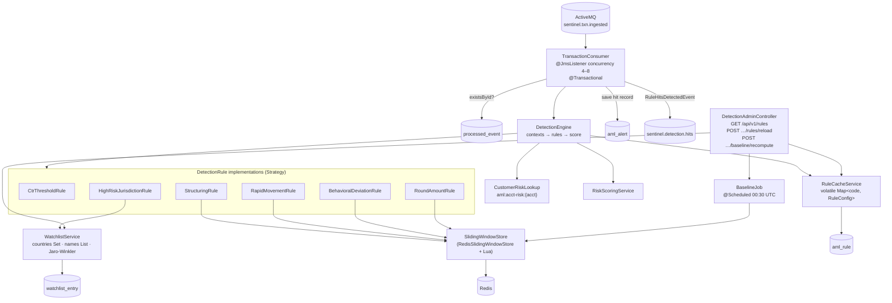

### 3.2 One message, end to end

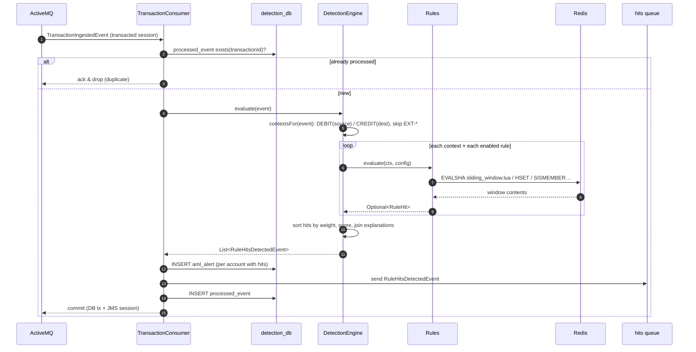

If anything throws, the DB transaction rolls back and the JMS session is not committed → Artemis redelivers → the Redis writes from the first attempt are simply **overwritten** (D6).

---

## 4. The account-perspective model (biggest design fix)

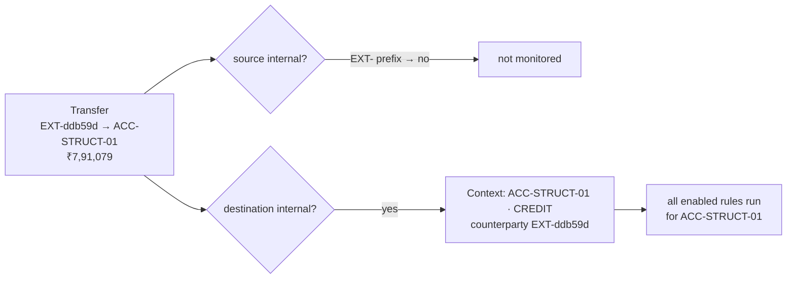

```java
List<TransactionContext> contextsFor(TransactionIngestedEvent e) {
    List<TransactionContext> out = new ArrayList<>(2);
    if (!isExternal(e.sourceAccountId()))
        out.add(new TransactionContext(e, e.sourceAccountId(), Direction.DEBIT, e.destinationAccountId()));
    if (!isExternal(e.destinationAccountId()))
        out.add(new TransactionContext(e, e.destinationAccountId(), Direction.CREDIT, e.sourceAccountId()));
    return out;
}
```

| Transfer | Contexts evaluated |
|---|---|
| `EXT-a → ACC-1` (incoming wire) | ACC-1 · CREDIT |
| `ACC-1 → EXT-b` (outgoing wire) | ACC-1 · DEBIT |
| `ACC-1 → ACC-2` (internal) | ACC-1 · DEBIT **and** ACC-2 · CREDIT |
| `EXT-a → EXT-b` | none |

**Why it mattered:** the demo CSV is four deposits from **different** senders into `ACC-STRUCT-01`. The original rules keyed windows on `sourceAccountId`, so each sender had 1 transaction and structuring could **never** fire. External prefixes are configurable: `sentinel.detection.external-account-prefixes=EXT-`.

---

## 5. Atomic sliding windows (Redis + Lua)

### 5.1 The script (`resources/scripts/sliding_window.lua`)

```lua
-- KEYS[1] = window key   ARGV[1] = score (event millis)   ARGV[2] = member
-- ARGV[3] = window millis ARGV[4] = ttl millis
local score  = tonumber(ARGV[1])
local window = tonumber(ARGV[3])
redis.call('ZADD', KEYS[1], score, ARGV[2])
redis.call('ZREMRANGEBYSCORE', KEYS[1], '-inf', '(' .. (score - window))
redis.call('PEXPIRE', KEYS[1], ARGV[4])
return redis.call('ZRANGEBYSCORE', KEYS[1], score - window, score, 'WITHSCORES')
```

### 5.2 Why atomic? The race it removes

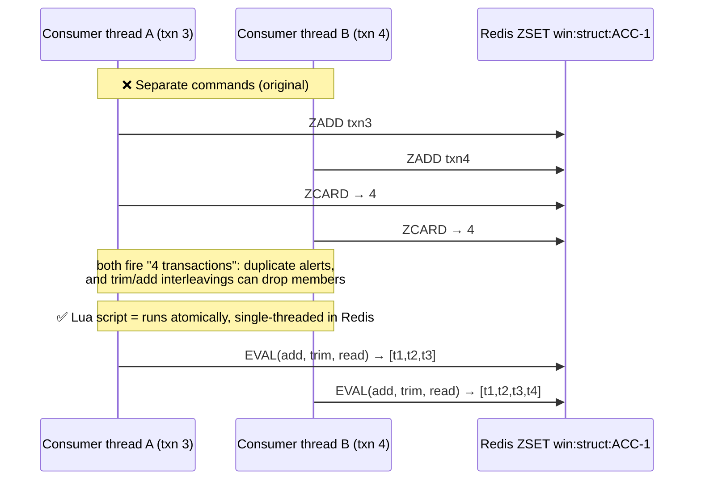

### 5.3 What a window looks like

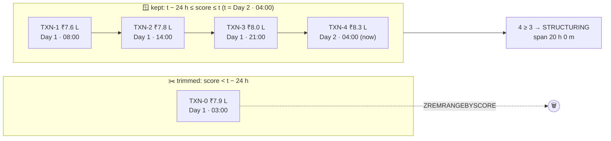

Member format `txnId|amountInr` (e.g. `7f5b…|791079.4500`). The amount travels inside the member so sums need no extra lookup, and the same txn → same member → **ZADD overwrites** on redelivery.

### 5.4 Redis key catalogue

| Key | Type | Written by | TTL | Purpose |
|---|---|---|---|---|
| `aml:win:struct:{acct}` | ZSET | Structuring | window + 1 h | near-threshold txns |
| `aml:win:cr:{acct}` / `aml:win:dr:{acct}` | ZSET | Rapid movement | window + 1 h | credits / debits |
| `aml:win:round:{acct}` | ZSET | Round amount | window + 1 h | suspicious round txns |
| `aml:day:{acct}:{yyyyMMdd}` | HASH txnId→amount | Behavioral | 95 days | per-day value |
| `aml:baseline:{acct}` | STRING | BaselineJob | 3 days | 90-day avg daily value |
| `aml:accounts:active` | SET | Engine | none | accounts the baseline job visits |
| `aml:acct-risk:{acct}` | STRING | *(Phase 5: customer-service)* | — | LOW/MEDIUM/HIGH multiplier |

---

## 6. The six rules

All thresholds live in `aml_rule` (`threshold_amount`, `window_minutes`, `weight`, `params` JSON) and are read through `RuleConfig`:

```java
public record RuleConfig(String ruleCode, BigDecimal weight, BigDecimal threshold, long windowMinutes,
                         int version, Map<String, Object> params) {
    public Duration window() { return Duration.ofMinutes(windowMinutes); }
    public BigDecimal decimal(String name, BigDecimal defaultValue) { ... }   // params lookup with default
}
public interface DetectionRule {
    String getRuleCode();
    Optional<RuleHit> evaluate(TransactionContext ctx, RuleConfig config);
}
```

| Rule | Logic | Default config (V4 migration) | Weight | Redis |
|---|---|---|---|---|
| **CTR_THRESHOLD** (P6) | `amount_inr ≥ threshold` | threshold ₹8,30,000 | 30 | — |
| **STRUCTURING** (P7) | ≥ N txns with `amount_inr ∈ [min, max]` in window | N=3, 24 h, ₹7,51,500–₹8,34,999 | 70 | ZSET |
| **RAPID_MOVEMENT** (P8) | on DEBIT: `Σdebits × 100 ≥ X × Σcredits` in window | X=80 %, 48 h, min credits ₹1 L | 75 | 2 ZSETs |
| **HIGH_RISK_JURISDICTION** (P9) | country ∈ list **or** JW(name, listed) ≥ s | s = 0.92 | 90 | (in-memory) |
| **BEHAVIORAL_DEVIATION** (P10) | today's value > M × 90-day avg | M = 3, min ₹50,000/day | 55 | HASH + STRING |
| **ROUND_AMOUNT** (P11) | ≥ N "round" txns in window; round = `amount % 1000 = 0` (original currency) **or** within 2 % below CTR; ≥ ₹1 L | N=5, 7 days | 40 | ZSET |

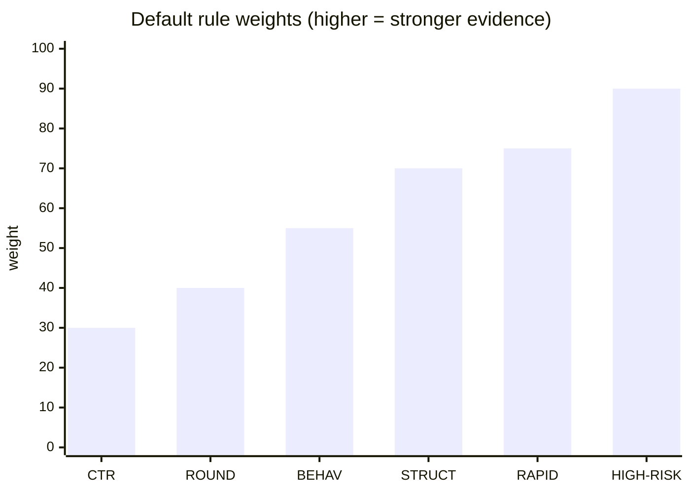

### 6.1 Structuring

```java
BigDecimal min = config.decimal("minAmountInr", new BigDecimal("751500"));
BigDecimal max = config.decimal("maxAmountInr", new BigDecimal("834999"));
if (amount.compareTo(min) < 0 || amount.compareTo(max) > 0) return Optional.empty();   // not near-threshold

List<WindowEntry> window = store.addAndGet("aml:win:struct:" + ctx.accountId(),
        new WindowEntry(ctx.transactionId(), amount, ctx.txnTimeMillis()), config.window());
if (window.size() < config.threshold().intValue()) return Optional.empty();
// explanation: "Account X had 4 transactions between ₹7,51,500 and ₹8,34,999 … within 19 h 40 m. Evidence: …"
return Optional.of(new RuleHit(CODE, config.weight(), explanation, RuleSupport.ids(window),
        RuleSupport.bucket(window.get(0).timestampMillis(), config.window())));
```

### 6.2 Rapid movement: exact comparison

```java
if (ctx.direction() == Direction.CREDIT) { store.addAndGet(creditKey, entry, config.window()); return Optional.empty(); }
List<WindowEntry> debits  = store.addAndGet(debitKey, entry, config.window());
List<WindowEntry> credits = store.read(creditKey, ctx.txnTimeMillis() - config.window().toMillis(), ctx.txnTimeMillis());
BigDecimal totalCredits = RuleSupport.sum(credits);
if (totalCredits.compareTo(config.decimal("minCreditInr", new BigDecimal("100000"))) < 0) return Optional.empty();
// Compare exactly: debits*100 >= threshold*credits. Rounding first turned 79.9999 % into "80.00 %".
if (totalDebits.multiply(HUNDRED).compareTo(config.threshold().multiply(totalCredits)) < 0) return Optional.empty();
```

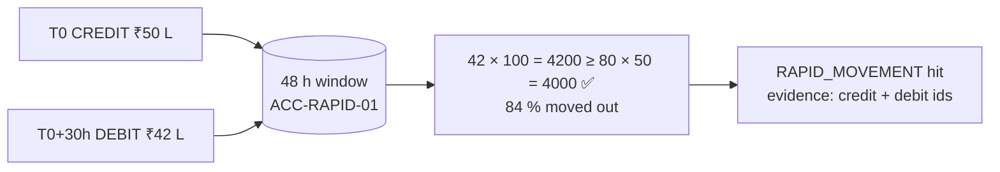

### 6.3 High-risk jurisdiction & fuzzy names

```java
static String normalize(String s) {        // "Zenith Shel Holdings Ltd." → "ZENITH SHEL HOLDINGS LTD"
    String n = Normalizer.normalize(s, Normalizer.Form.NFD).replaceAll("\\p{M}", "");   // strip accents
    return n.toUpperCase(Locale.ROOT).replaceAll("[^A-Z0-9 ]", " ").replaceAll("\\s+", " ").trim();
}
public Optional<NameMatch> bestNameMatch(String candidate, double minSimilarity) {
    for (String listed : names) {
        double score = JW.apply(normalize(candidate), listed);       // JaroWinklerSimilarity
        if (score >= minSimilarity && (best == null || score > best.score())) best = new NameMatch(listed, score);
    }
}
```

**Jaro-Winkler** rewards matching characters and transpositions, with a bonus for a common prefix, which suits names where the start is usually right. Live result: `'Zenith Shel Holdings Ltd.'` vs `ZENITH SHELL HOLDINGS LTD` = **0.95**. The watchlist (`V5__watchlist.sql`) is **synthetic** (FATF-style countries IR/KP/MM/SY, OFAC/UN-style made-up names).

### 6.4 Behavioral deviation + nightly baseline

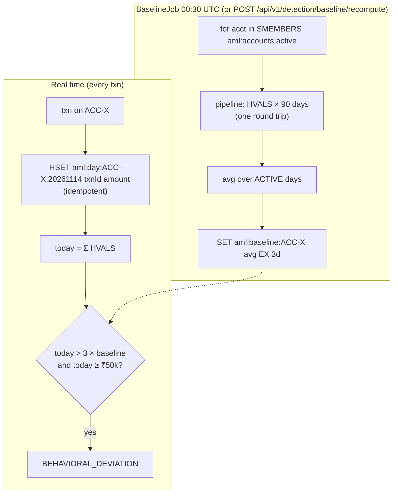

Original code used `INCRBYFLOAT` on a daily counter: a redelivered message added the amount **twice**. A hash keyed by txnId can't double count.

### 6.5 Round amount

```java
static boolean isSuspiciouslyRound(TransactionContext ctx, RuleConfig config) {
    if (ctx.amountInr().compareTo(config.decimal("minAmountInr", new BigDecimal("100000"))) < 0) return false; // rent/EMIs
    boolean exactMultiple = ctx.originalAmount().remainder(config.decimal("modulo", new BigDecimal("1000"))).signum() == 0;
    BigDecimal ctr = config.decimal("ctrThresholdInr", new BigDecimal("830000"));
    BigDecimal lowerEdge = ctr.subtract(ctr.multiply(config.decimal("nearThresholdPct", BigDecimal.TWO)).movePointLeft(2));
    boolean justBelowThreshold = ctx.amountInr().compareTo(lowerEdge) >= 0 && ctx.amountInr().compareTo(ctr) < 0;
    return exactMultiple || justBelowThreshold;
}
```

Roundness is checked on the **original** amount (USD 6,000 is round; its INR value ₹5,01,000 isn't).

---

## 7. Risk scoring (Rule 7, P15)

$$\text{score} = \min\Big(100,\; \big(1 - \prod_i (1 - \tfrac{w_i}{100})\big)\times 100 \times m\Big),\quad m \in \{1.0, 1.15, 1.3\}$$

Think of each weight as "probability this rule alone is right". The score is the probability that **at least one** is right. Adding evidence always raises it, but it never exceeds 100.

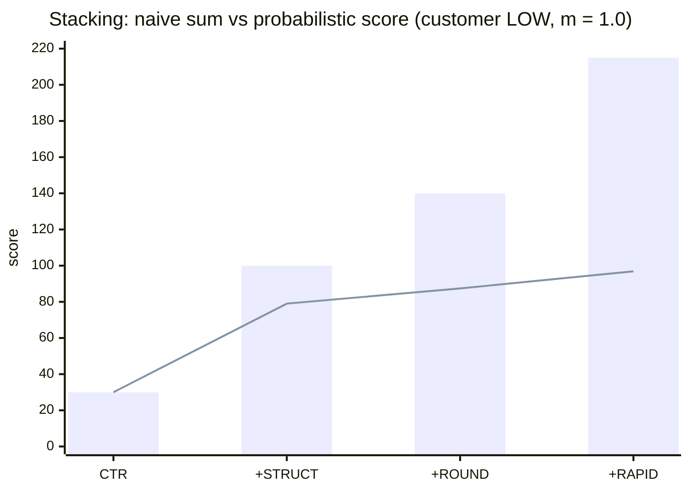

*(bars = naive sum of weights, which overflows past 100; line = the formula we use)*

| Combination | Calculation | Score |
|---|---|---|
| CTR alone | 1 − 0.70 | **30** |
| Rapid (75) + CTR (30), seen live on ACC-RAPID-01 | 1 − 0.25 × 0.70 = 0.825 | **82.5** |
| Structuring (70) + Round (40), MEDIUM customer (blueprint example) | (1 − 0.3 × 0.6) × 1.15 | **94.3** |
| High-risk (90) + Rapid (75) + Structuring (70), HIGH | capped | **100** |

```java
double nonMatch = 1.0;
for (RuleHit hit : hits) nonMatch *= (1.0 - hit.weight().doubleValue() / 100.0);
BigDecimal score = BigDecimal.valueOf((1.0 - nonMatch) * 100.0).multiply(customerRiskMultiplier);
return score.min(HUNDRED).setScale(2, RoundingMode.HALF_UP);
```

> Customer risk multiplier currently defaults to **1.0** because nothing writes `aml:acct-risk:{acct}` yet (Phase 5 task).

---

## 8. Explainability (P12)

Real explanations produced in the live run (₹ formatted with Indian grouping by `Inr.format`):

> **RAPID_MOVEMENT:** "Account ACC-RAPID-01 received ₹50,00,000 and sent out ₹42,00,000 (84.00%) within 48 hours. Evidence: f7df7892-…, b1e951e8-…."
>
> **HIGH_RISK_JURISDICTION:** "Transaction aed44bb8-… on account ACC-TRADE-01 for ₹2,08,750: counterparty name 'Zenith Shel Holdings Ltd.' matches watchlisted 'ZENITH SHELL HOLDINGS LTD' (similarity 0.95)."
>
> **CTR_THRESHOLD:** "Account ACC-CTR-01 received ₹12,00,000 (INR 1200000.0) in transaction 7f5b…, at or above the ₹8,30,000 CTR reporting threshold."

The event sent to alert-case-service:

```java
public record RuleHitsDetectedEvent(String eventId, String transactionId, String accountId,
        List<RuleHitPayload> hits,            // ruleCode, weight, explanation, evidenceTxnIds, windowBucket
        BigDecimal riskScore, String explanation, Instant txnTimestamp, Instant detectedAt) {}
```

`Inr.format` exists because the JDK's `en-IN` `NumberFormat` still groups by thousands (`1,000,000`), and the test caught it. It groups the last 3 digits, then pairs: `₹50,00,000`.

---

## 9. Rule configuration & caching

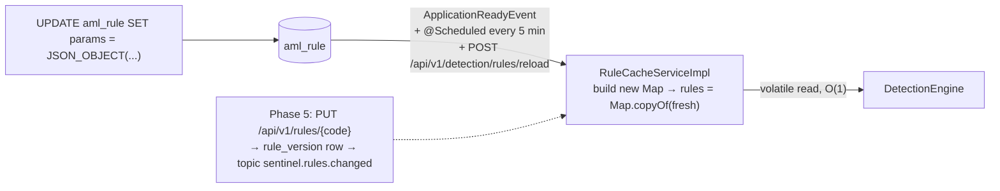

```java
private volatile Map<String, RuleConfig> rules = Map.of();
public void refreshRuleCache() {
    Map<String, RuleConfig> fresh = new HashMap<>();
    for (AmlRule r : amlRuleRepository.findByActiveTrue()) fresh.put(r.getRuleCode(), new RuleConfig(..., parseParams(r)));
    rules = Map.copyOf(fresh);          // one atomic reference swap
}
```

The original used `ruleCache.clear(); ruleCache.putAll(newCache);` on a `ConcurrentHashMap`. Between those two calls a consumer thread could see **zero rules** and let a transaction through unscreened.

---

## 10. Idempotency & failure model (carried over from the old edge-case tracker)

| # | Scenario | What protects us |
|---|---|---|
| 1 | **Phantom redelivery:** processed & committed, crash before ack | `processed_event` row written in the **same DB tx** as the hit records → duplicate short-circuits |
| 2 | **Mid-flight crash:** Redis updated, DB rolled back, message redelivered | Redis writes are idempotent (ZADD same member / HSET same field) → no double count |
| 3 | **Payload mutation:** retry with same key but changed amount | Must be stopped at ingestion (ADR-003 edge #5: payload hash, 🔜) → detection never sees it |
| 4 | **Memory bloat** | Lua trims every write (`ZREMRANGEBYSCORE -inf (t-window`) + `PEXPIRE` window+1 h; day hashes 95 d |
| 5 | One rule throws | Caught per rule in the engine, logged; other rules still run |
| 6 | Poison message (always fails) | Transacted session → Artemis redelivers → DLQ after max attempts (explicit DLQ + replay API in Phase 5) |
| 7 | Out-of-order events | Windows use event time; an older event only trims what is older than *its own* window |
| 8 | Redis down | Rules throw → message redelivered later (Redis is a SPOF → Sentinel/ElastiCache Multi-AZ in prod) |

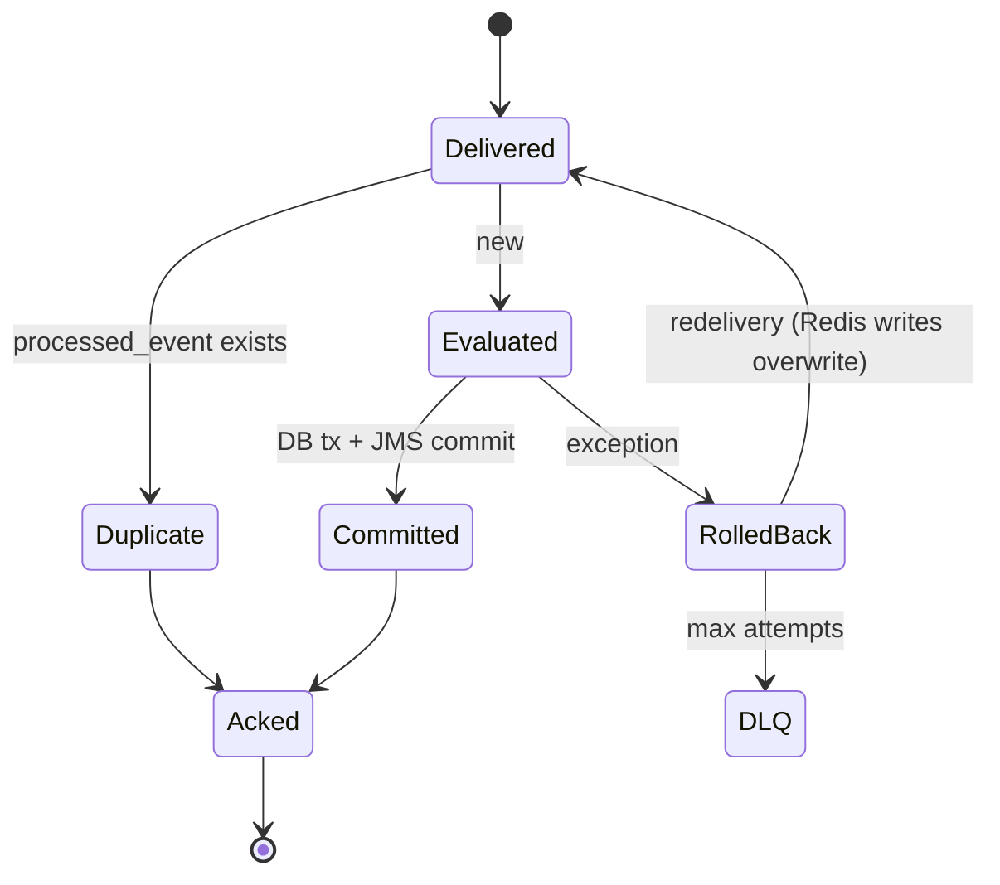

---

## 11. Data model (sentinel_detection, V1–V5)

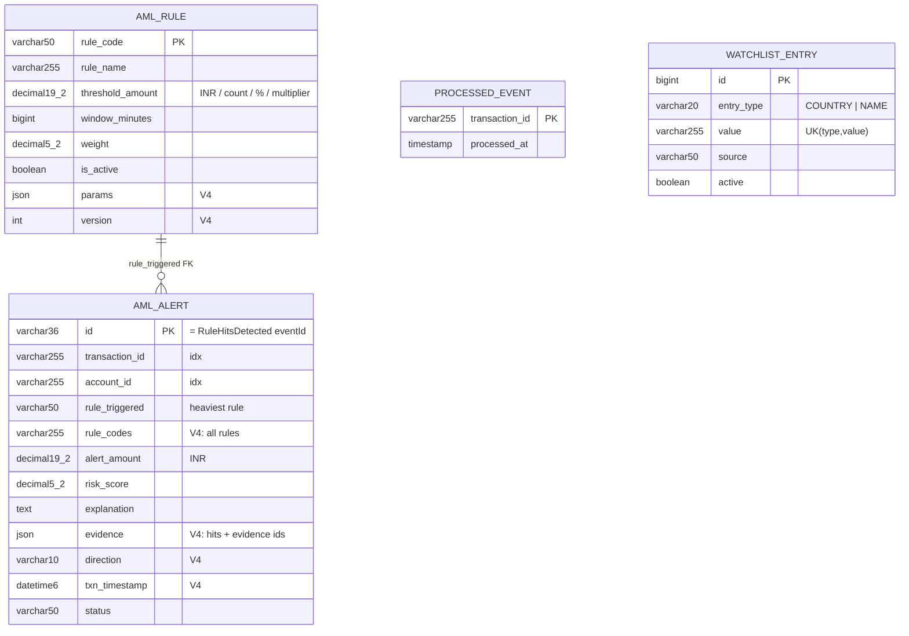

`aml_alert` is the detection-side **rule-hit record** (the blueprint's `rule_hit`). The analyst-facing alert with de-dup and workflow belongs to alert-case-service (Phase 5).

---

## 12. Testing: 45 tests, no Redis needed

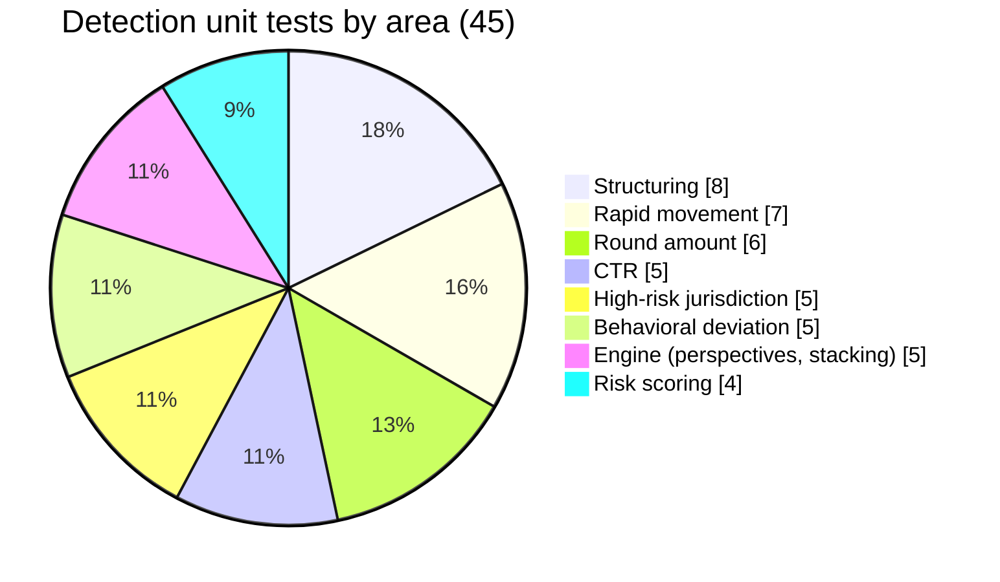

The trick: `InMemorySlidingWindowStore` implements the same interface with the same semantics (add → trim by event time → read), so rules are tested on **logic**, not on mocks:

```java
@Test
void boundary_23h59m_is_inside_window() {
    rule.evaluate(credit("760000", T0), cfg);
    rule.evaluate(credit("770000", plus(Duration.ofHours(12))), cfg);
    assertThat(rule.evaluate(credit("780000", plus(Duration.ofHours(23).plusMinutes(59))), cfg)).isPresent();
}

@Test
void redelivered_transaction_is_not_double_counted() {
    var first = credit("760000", T0);
    rule.evaluate(first, cfg);
    rule.evaluate(first, cfg);                       // JMS redelivery
    assertThat(rule.evaluate(credit("770000", plus(Duration.ofHours(1))), cfg)).isEmpty();
}

@Test
void deposits_from_different_external_senders_are_structuring_on_the_receiving_account() {
    engine.evaluate(event("EXT-a", "ACC-STRUCT-01", "791000", T0));
    engine.evaluate(event("EXT-b", "ACC-STRUCT-01", "819000", plus(Duration.ofHours(1))));
    var out = engine.evaluate(event("EXT-c", "ACC-STRUCT-01", "815000", plus(Duration.ofHours(2))));
    assertThat(out).singleElement().satisfies(d -> assertThat(d.accountId()).isEqualTo("ACC-STRUCT-01"));
}
```

Every rule has the blueprint's triad: **fires**, **does not fire**, **edge case** (exactly 3 txns, exactly 80 %, 23 h 59 m vs 24 h 01 m, exactly 3× baseline).

Run them:

```bash
cd services && mvn test -pl detection-service -Dtest='*RuleTest,RiskScoring*,DetectionEngineTest' -Dsurefire.failIfNoSpecifiedTests=false
```

---

## 13. Live verification (2026-11-14, laptop, local Docker)

| Check | Result |
|---|---|
| Fresh DB boot: Flyway V1–V5, Hibernate validate, 6 rules + watchlist loaded | ✅ |
| Demo CSVs → STRUCTURING, RAPID_MOVEMENT+CTR, CTR, ROUND_AMOUNT | ✅ |
| Fuzzy name + listed country → HIGH_RISK_JURISDICTION (score 90) | ✅ |
| `sentinel_ingest_to_detection_latency` (190 events incl. batch backlog) | avg **≈ 0.75 s**, max 0.95 s |
| `sentinel_detection_latency` (consumer work per message) | avg **≈ 19 ms** |

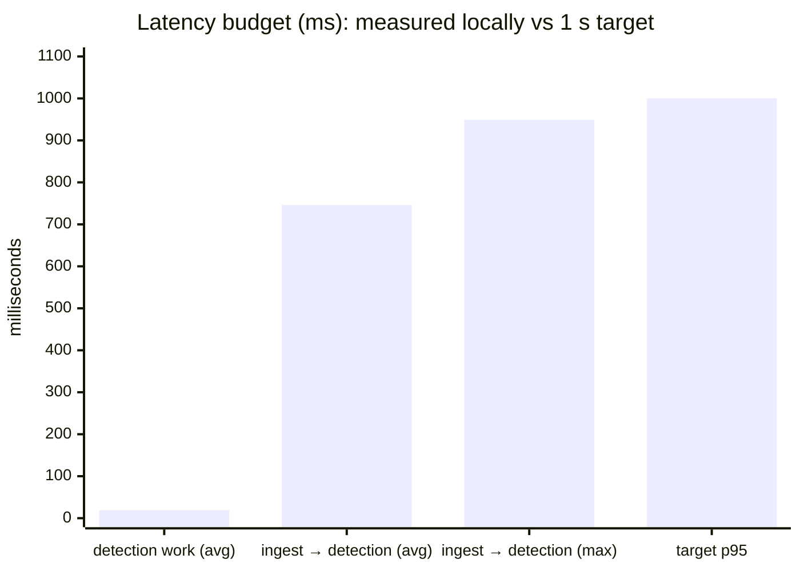

Most of the ingest→detection time is **outbox wait + batch backlog**, not rules: an obvious Phase 9 tuning target (poll interval, `SKIP LOCKED` paging, consumer concurrency).

---

## 14. Stabilization log: what was wrong in the first Phase 4 and why it was fixed

| # | Bug in the original | Effect | Fix |
|---|---|---|---|
| 1 | No `flyway-core` dependency | Migrations never ran → `Schema-validation: missing table [aml_alert]` on a fresh DB | Added flyway-core + flyway-mysql |
| 2 | **Two `@JmsListener`s on one queue** (logging `TransactionListener` + `TransactionConsumer`) | Competing consumers: ~**half the transactions never evaluated** | Deleted the logging listener |
| 3 | `riskScore` / `explanation` never set on the entity | `NOT NULL` violation → every alert insert failed → redelivery loop | Set from engine output |
| 4 | `Double`/`double` for `DECIMAL(5,2)` columns | Hibernate validate type mismatch | `BigDecimal` |
| 5 | CTR rule had no `aml_rule` row | CTR never ran | V4 inserts it |
| 6 | Event shape mismatch (generic Map, nested payload) | `direction`, `counterpartyCountry` always "UNKNOWN" → Rapid Movement & High-Risk **could never fire** | Shared `TransactionIngestedEvent` |
| 7 | Rules compared **original** amount to USD constants | GBP/AED/INR amounts judged wrongly | All thresholds in INR via `amount_inr` |
| 8 | Windows keyed on `sourceAccountId` only | Structuring into one account from many senders missed | Account-perspective contexts (§4) |
| 9 | Wall-clock `System.currentTimeMillis()` | Untestable; back-filled history lands "now" | Event time |
| 10 | Separate ZADD/ZREM/ZCARD calls | Race under concurrency | Lua script |
| 11 | `INCRBYFLOAT` daily total | Double count on redelivery | HASH keyed by txnId |
| 12 | Rounded % compared to threshold | 79.9999 % fired as 80 % | Exact integer-style comparison |
| 13 | Cache `clear()`+`putAll()` | Window with zero rules | Atomic reference swap |
| 14 | `@Scheduled` without `@EnableScheduling` | Rule refresh never ran after startup | `@EnableScheduling` |
| 15 | Customer multiplier hard-coded; score discarded | Score never stored or published | Score in entity & event; lookup hook for Phase 5 |

---

## 15. Definition of Done: blueprint checklist

| Item | Status |
|---|---|
| `DetectionRule` interface, one class per rule | ✅ |
| Rule registry loading enabled rules + params from DB | ✅ |
| 6 rules with Redis windows, **Lua for atomic add-trim-count** | ✅ |
| Risk scorer + explanation builder; publish `RuleHitsDetected` to `sentinel.detection.hits` | ✅ |
| Watchlist (synthetic OFAC/UN-style + FATF-style), fuzzy matching | ✅ |
| Nightly `BaselineJob` (90-day average) | ✅ (ShedLock 🔜 for multi-pod) |
| ~40+ rule tests: fires / doesn't fire / edge | ✅ 45 |
| All planted seed scenarios (§2.3) trigger the right rules | ⚠️ 5 of 7 shown with demo CSVs; behavioral (needs prior-day history) & "mix on one customer" need a dedicated seed CSV with `txnTimestamp` |
| Seed CSV with planted scenarios + 10,000 background txns | ❌ to do |
| Testcontainers test for the Lua script against real Redis | ❌ to do |
| Customer risk multiplier fed from customer-service | ❌ Phase 5 |

---

## 16. Recall card 🧠

- **Sliding vs tumbling window:** sliding = "last 24 h from *this* event" (moves with each txn); tumbling = fixed buckets (00:00–24:00). Rules use sliding windows; `windowBucket` (tumbling index) is only for de-dup keys.
- **ZADD / ZREMRANGEBYSCORE / ZRANGEBYSCORE complexity:** O(log n) per add, O(log n + m) for range ops.
- **Why Lua?** Redis runs a script atomically (single-threaded), so add-trim-read can't interleave with another consumer, and it's one network round trip.
- **Why idempotent writes even with `processed_event`?** Redis isn't part of the MySQL transaction: a rollback after a Redis write leaves the write behind.
- **How do you test time?** Windows use event time; tests build events at `T0 + Duration` (and services inject a `Clock`).
- **Exactly-once is a myth:** build at-least-once delivery + idempotent consumers.
- **Strategy vs Chain-of-Responsibility:** Strategy = interchangeable algorithms all run independently (our rules). CoR = each handler decides whether to pass on (not used here, since every rule must run).

**Ops endpoints**

```bash
curl -s localhost:8084/api/v1/rules
```
```bash
curl -s -X POST localhost:8084/api/v1/detection/rules/reload
```
```bash
curl -s -X POST localhost:8084/api/v1/detection/baseline/recompute
```
```bash
curl -s localhost:8084/actuator/metrics/sentinel_detection_latency
```
