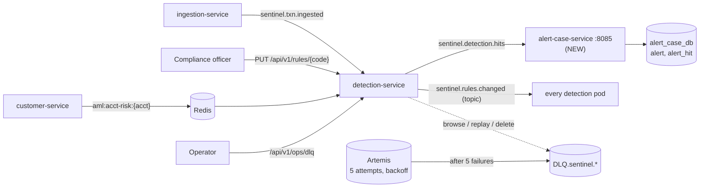
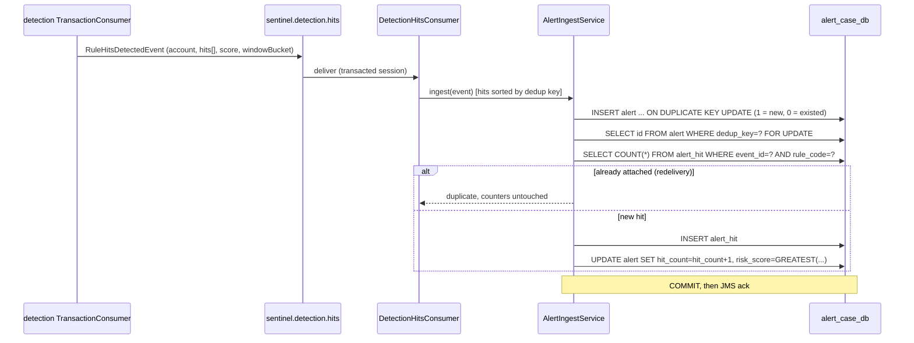
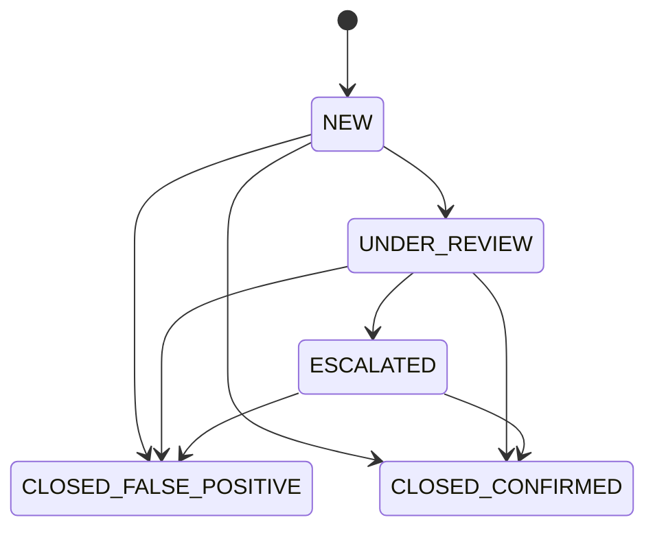
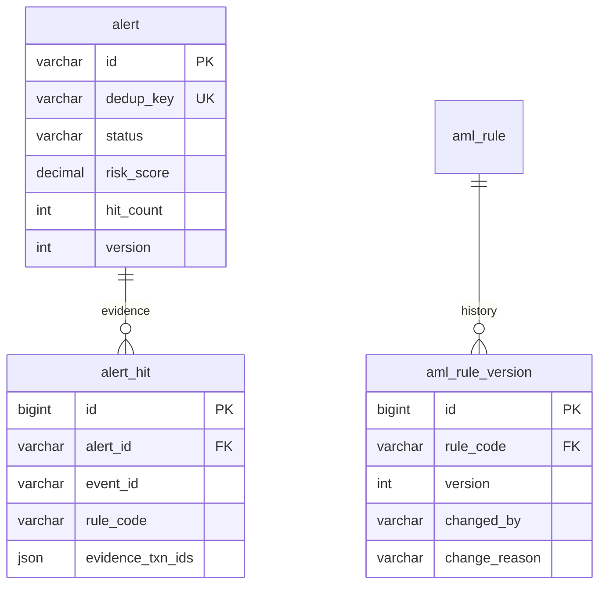

# ADR-005 · Phase 5 — Alerts, De-duplication, Live Rules & Dead Letters

| | |
|---|---|
| **Status** | Accepted (built 2026-11-15 on branch `phases/p-5`) |
| **Date** | 2026-11-15 |
| **Phase promise** | Turn rule hits into **one alert per pattern** that analysts can work, let compliance **change rules live** with an audit trail, never let one bad message stall a queue, and prove it all holds under concurrency |
| **Problems solved** | **P13** live rule tuning · **P14** alert fatigue / de-duplication · **P21** poison messages & replay · **X2** correctness under concurrent consumers · plus the customer-risk multiplier left open in ADR-004 |
| **Skills** | MySQL unique-key upserts, row locks & deadlock analysis, JPA `@Version` / `@DynamicUpdate`, JMS topics vs queues, `@TransactionalEventListener(AFTER_COMMIT)`, Artemis address settings, transacted JMS sessions, Testcontainers |
| **Builds on** | [ADR-004](ADR-004-phase-4-detection-engine.md) (it produced `windowBucket` for the de-dup key and left the risk-multiplier hook) |

> **One-line recall:** *alert-case-service folds every hit for `accountId:ruleCode:windowBucket` into ONE alert using an atomic MySQL upsert + `SELECT … FOR UPDATE` (proven by a 50-thread Testcontainers test). Rule changes are versioned (`@Version` + `aml_rule_version`) and broadcast **after commit** on a **topic** so every pod reloads in ~45 ms. The broker retries a failing message 5× with exponential backoff, then parks it in `DLQ.<queue>` where an ops API can browse, replay or delete it.*

---

## 1. Context

After Phase 4, every transaction that tripped a rule produced a `RuleHitsDetectedEvent` on `sentinel.detection.hits`… and **nothing consumed it**. Four gaps remained:

| Gap | Consequence |
|---|---|
| No alert service | Hits piled up on the queue; analysts had nothing to work |
| No de-duplication | 10 structuring deposits on one account in one day = 10 alerts for one pattern (alert fatigue, P14) |
| Rule thresholds only changeable by SQL + 5-minute poll | Compliance can't tune safely; no record of who changed what (P13) |
| Artemis default = redeliver immediately, forever | One unreadable message spins a consumer thread at 100 % and floods the logs (P21) |
| `aml:acct-risk:{acct}` never written | Customer risk multiplier always 1.0: a HIGH-risk customer scored like a LOW one |

---

## 2. Decisions

| # | Decision | Alternative rejected | Why |
|---|---|---|---|
| D1 | **De-dup key `accountId:ruleCode:windowBucket`**, UNIQUE in MySQL | De-dup in Redis (`SETNX`) | The key *is* the alert's identity; a DB constraint can't drift from the data it protects |
| D2 | **Plain SQL ingest** (`INSERT … ON DUPLICATE KEY UPDATE`, `SELECT … FOR UPDATE`, atomic `UPDATE … +1`) | JPA "find, then save" | Check-then-act races: two threads both see "no alert" and create two |
| D3 | **Lock the alert row first**, then check/insert the hit | Upsert the hit (`ON DUPLICATE KEY`) | Both alternatives deadlocked under 50 threads (see §6) |
| D4 | **Closed alerts are terminal**; later hits in the same window are attached but don't reopen | Reopen on every new hit | The analyst already decided on that pattern; a new window = new alert |
| D5 | **`@DynamicUpdate` + `@Version`** on `Alert` | Default full-row update | A status save must never overwrite a `hit_count` the consumer added after the analyst loaded the alert |
| D6 | **Rule changes: `expectedVersion` + JPA `@Version`** → 409 | Last write wins | Two admins editing the same rule must not silently overwrite each other |
| D7 | **`aml_rule_version` snapshot per change** (who, why, when) | Log line only | Regulators ask "what were the thresholds on date X?" |
| D8 | **Topic** `sentinel.rules.changed`, **published AFTER_COMMIT** | Queue; publish inside the transaction | A queue reaches one pod; publishing before commit lets a fast pod reload the old row |
| D9 | **Explicit `@Primary` queue `JmsTemplate`** next to `topicJmsTemplate` | Rely on Boot's auto-configured template | Boot stops creating its `JmsTemplate` once any exists: hits would silently go to a topic |
| D10 | **Broker-side redelivery policy** in `broker.properties` (5 attempts, 1 s × 2, max 30 s, per-queue DLQ) | Retry loops in Java | Works for every consumer, survives restarts, no code |
| D11 | **Ops API for DLQs** (browse / replay / delete) on a **non-cached** connection, replay in **one transacted session** | Artemis console only | Repeatable, scriptable; a crash mid-replay neither loses nor duplicates |
| D12 | **customer-service owns `aml:acct-risk:{acct}`**, written **after commit**, full resync at startup | detection calls customer-service per message | No synchronous hop on the hot path; Redis stays a mirror of the DB |
| D13 | **Effective rating = max(customer, account)** | Account rating only | A HIGH-risk customer makes every one of their accounts HIGH |
| D14 | **Testcontainers MySQL** for the concurrency test | H2 / mocks | The guarantee comes from InnoDB unique indexes and row locks |

---

## 3. Architecture

### 3.1 What Phase 5 added



### 3.2 One hit, from detection to an analyst's screen



### 3.3 Alert state machine



### 3.4 Data model added



Migrations: `alert-case-service` **V1__alerts.sql**, `detection-service` **V6__rule_versions.sql** (baselines every existing rule as version 1).

---

## 4. De-duplication (P14): the important code

`AlertIngestService` ([source](../../services/alert-case-service/src/main/java/com/sentinel/aml/alert_case_service/service/AlertIngestService.java)), per hit, inside one `@Transactional` method:

```sql
-- 1. create or no-op (UNIQUE dedup_key; useAffectedRows=true -> 1 created / 0 existed)
INSERT INTO alert (...) VALUES (...) ON DUPLICATE KEY UPDATE dedup_key = dedup_key;
-- 2. exclusive row lock up front: concurrent hits for this alert now queue
SELECT id FROM alert WHERE dedup_key = :key FOR UPDATE;
-- 3. redelivery check, race-free because every copy of a hit maps to THIS (locked) alert
SELECT COUNT(*) FROM alert_hit WHERE event_id = :eventId AND rule_code = :ruleCode;
-- 4. attach + 5. move counters atomically (SET is evaluated left to right!)
INSERT INTO alert_hit (...) VALUES (...);
UPDATE alert SET hit_count = hit_count + 1,
                 risk_score = GREATEST(risk_score, :score),
                 latest_explanation = IF(:txnAt >= last_txn_at, :explanation, latest_explanation),
                 last_txn_at = GREATEST(last_txn_at, :txnAt) ... WHERE id = :alertId;
```

**Measured live** (demo CSV, 99 rows): 7 hits → **5 alerts** (`hitsPerAlert` 1.4). ACC-ROUND-01's two round-amount hits and ACC-RAPID-01's two CTR hits each became one alert.

### API (`/api/v1/alerts`, via the gateway)

| Method | Path | Notes |
|---|---|---|
| GET | `/api/v1/alerts?status=&accountId=&ruleCode=&page=&size=` | Sorted by risk desc, then last activity |
| GET | `/api/v1/alerts/{id}` | All hits + evidence, `dedupKey`, `allowedNextStatuses` |
| PATCH | `/api/v1/alerts/{id}/status` | `{status, note, expectedVersion?}`; 409 on illegal move or stale version |
| GET | `/api/v1/alerts/stats` | `alerts`, `hits`, `hitsPerAlert`, count by status |

---

## 5. Live rule tuning (P13)

```http
PUT /api/v1/rules/CTR_THRESHOLD
{ "thresholdAmount": 1000000, "expectedVersion": 1,
  "changedBy": "compliance.lead", "reason": "Raise CTR to INR 10 lakh per circular 2026/11" }
```

1. `@Valid` (weight 0–100, non-negative numbers, `changedBy` + `reason` required).
2. `expectedVersion ≠ current` → **409**. Unknown param name → **400** (each `DetectionRule` declares `supportedParams()`).
3. `saveAndFlush` bumps `@Version`; a concurrent commit also gives 409.
4. Snapshot row in `aml_rule_version`; `RuleChangedApplicationEvent` raised.
5. `RuleChangePublisher` (`@TransactionalEventListener(AFTER_COMMIT)`) sends `RulesChangedEvent` to the **topic**.
6. `RulesChangedListener` on every pod (`topicListenerFactory`, pub/sub) reloads the cache and records `sentinel_rule_reload_lag`.

**Measured:** `Hot-reloaded rules after change to CTR_THRESHOLD v2 by compliance.lead (now loaded: v2, commit-to-live 45 ms)`. `GET /api/v1/rules` now returns every rule with `version` (DB) and `loadedVersion` (this pod).

---

## 6. Concurrency test (X2) and the two deadlocks it found

`AlertDedupConcurrencyTest` ([source](../../services/alert-case-service/src/test/java/com/sentinel/aml/alert_case_service/service/AlertDedupConcurrencyTest.java)): MySQL 8 in Testcontainers; 300 events over 6 accounts × 2 rules × 2 windows (24 alert keys); **every event delivered twice**, shuffled, on **50 threads** released by one latch. A deadlock victim is retried, like broker redelivery. Asserts: exactly 24 alerts, every hit attached once, `hit_count` = attached rows, `risk_score` = true max, every duplicate recognised.

| Run | Design | Result |
|---|---|---|
| 1 | upsert alert → `INSERT … SELECT` hit with `ON DUPLICATE KEY` → `UPDATE` | **5 deliveries failed permanently** (5 deadlocks each) |
| 2 | + `SELECT … FOR UPDATE` first | 64 deadlock retries, flaky |
| 3 | + hit = existence check + **plain** INSERT (no upsert) | **0** retries in 3 of 3 runs; an occasional 1–3 in full builds |

**Deadlock 1: lock upgrade.** The `alert_hit` FK check takes a **shared** lock on the parent alert; the counter `UPDATE` then needs **exclusive**. Two transactions holding S and both wanting X deadlock. → take X first (`FOR UPDATE`).

**Deadlock 2: upsert gap lock.** InnoDB's report:

```
*** (1) HOLDS THE LOCK(S): index PRIMARY of table alert_hit lock_mode X  (supremum)
*** (1) WAITING FOR THIS LOCK: index PRIMARY of table alert_hit lock_mode X insert intention waiting (supremum)
*** (2) ... same ...
```

`INSERT … ON DUPLICATE KEY UPDATE` on a table with an **AUTO_INCREMENT PK and a second UNIQUE key** takes an exclusive next-key lock on the end of the PK index whenever it hits a duplicate (every redelivery). → no upsert on `alert_hit`; the alert lock already serializes copies of the same hit.

The remaining rare retries happen when two threads create the **same brand-new** alert key at once (gap locks on the unique index). In production the transacted JMS session rolls back and the broker redelivers; every step is idempotent. Final: **600 deliveries in ~0.5 s**.

---

## 7. Dead letters (P21)

`infra/artemis/broker.properties` (mounted into the broker by `docker-compose.yml`):

```properties
addressSettings."sentinel.#".maxDeliveryAttempts=5
addressSettings."sentinel.#".redeliveryDelay=1000
addressSettings."sentinel.#".redeliveryMultiplier=2.0
addressSettings."sentinel.#".maxRedeliveryDelay=30000
addressSettings."sentinel.#".deadLetterAddress=DLQ
addressSettings."sentinel.#".autoCreateDeadLetterResources=true
addressSettings."sentinel.#".deadLetterQueuePrefix=DLQ.
```

Verified through Jolokia (`getAddressSettingsAsJSON sentinel.txn.ingested` → `maxDeliveryAttempts 5, redeliveryDelay 1000, multiplier 2.0, max 30000, autoCreateDeadLetterResources true`).

| Endpoint (detection-service, via gateway) | Does |
|---|---|
| `GET /api/v1/ops/dlq` | Depth of `DLQ.sentinel.txn.ingested` and `DLQ.sentinel.detection.hits` |
| `GET /api/v1/ops/dlq/{queue}?max=` | Browse (id, `_type`, original queue, body) without consuming |
| `POST /api/v1/ops/dlq/{queue}/replay[?messageId=]` | Move back to `{queue}` in one transacted session; broker-internal props dropped |
| `DELETE /api/v1/ops/dlq/{queue}/messages/{id}` | Remove one unfixable message |
| `POST /api/v1/ops/dlq/{queue}/poison-test` | **Local demo only** (`sentinel.ops.poison-test-enabled`) |

**Measured:** a replayed (still broken) message was back in the DLQ after **16 s**, matching 1 + 2 + 4 + 8 s of backoff.

---

## 8. Customer risk into Redis

| Trigger | Writes |
|---|---|
| `POST /api/v1/customers/{id}/accounts` (optional explicit `accountId`, e.g. `ACC-RAPID-01`) | that account, after commit |
| `PUT /api/v1/accounts/{id}/risk-rating` | that account, after commit |
| `PUT /api/v1/customers/{id}/risk-rating` | every account of the customer, after commit |
| Startup, `POST /api/v1/admin/seed-data`, `POST /api/v1/admin/risk-sync` | all accounts, 500 per pipelined call |

**Measured score impact:** ACC-CTR-01 (no rating) CTR → **30.00**; ACC-RAPID-01 (HIGH, ×1.3) CTR → **39.00**, RAPID_MOVEMENT + CTR (82.5) → **100.00** (capped).

---

## 9. Edge cases

| Case | Handling |
|---|---|
| Same event delivered twice, even concurrently | Second copy waits on the alert lock, then finds its hit → duplicate, no counter change |
| Hit without `windowBucket` | Bucket `txn-<transactionId>`: never merges unrelated hits |
| New hit on a CLOSED alert in the same window | Attached, `hit_count` grows, status unchanged (D4) |
| Analyst saves while the consumer adds hits | `@DynamicUpdate` writes only status columns; `hit_count` survives |
| Two analysts on one alert | `expectedVersion` / `@Version` → 409 |
| Two admins on one rule | `expectedVersion` / `@Version` → 409 |
| Rule broadcast lost (broker down) | Change is committed; pods pick it up at the 5-min scheduled refresh |
| Detection pod down during a change | Non-durable subscription; loads all rules from MySQL on startup |
| DLQ not created yet | Treated as empty (depth 0) |
| Replay crash halfway | Transacted session: receive + send roll back together |
| Rating change rolls back | Redis write is after-commit only, so nothing leaks |
| Redis down when a rating changes | DB is correct; logged; startup or `/admin/risk-sync` repairs |

---

## 10. Stabilization log: found while building and verifying Phase 5

| # | Problem | How it was found | Fix |
|---|---|---|---|
| 1 | Defining `topicJmsTemplate` would remove Boot's default `JmsTemplate`; hits would go to a **topic** | Code review before first run | Explicit `@Primary` queue template (D9) |
| 2 | Testcontainers 1.19.7 rejected by Docker 29 (`client version 1.32 is too old`) | Test skipped as "no Docker" | 1.21.4, and its BOM imported **before** Spring Boot's (first BOM wins) |
| 3 | `@Enumerated(STRING)` → Hibernate 6 expects MySQL `ENUM` | Testcontainers context failed schema validation | `@JdbcTypeCode(SqlTypes.VARCHAR)` |
| 4 | Lock-upgrade deadlock (§6) | 50-thread test: 5 permanent failures | `SELECT … FOR UPDATE` first |
| 5 | Upsert gap-lock deadlock on `alert_hit` (§6) | InnoDB status from the test container | Existence check + plain INSERT |
| 6 | `@Valid` silently ignored in detection and alert-case (no validator on the classpath) | Postman "missing reason" returned 500 from a DB NOT NULL | `spring-boot-starter-validation` in both |
| 7 | DLQ overview 503 when a DLQ hadn't been created yet | Live run | `InvalidDestinationException` = empty |
| 8 | DLQ `deliveryCount` always 0 (browsing isn't delivery) | Live run | Field removed |
| 9 | `hitsPerAlert` missing from JSON (record method, not component) | Live run | `@JsonProperty` |
| 10 | Unknown URL / wrong method returned 500 | Phase 4 note (`GET /customers`) | `NoResourceFoundException` → 404, method → 405 in `GlobalExceptionHandler` |
| 11 | Seeded accounts have UUID ids that never appear in transactions | Design review | Open-account endpoint accepts an explicit `accountId` |

---

## 11. Out-of-order evaluation in detection: found, then fixed

**The problem.** Detection runs 4–8 consumer threads, and the outbox publishes up to 500 messages per 200 ms poll. A sliding window used to count only entries **at or before the evaluated transaction's own timestamp**, so when transactions of one account were evaluated **out of time order**, fewer of them saw the full window. Observed: the 4-deposit structuring scenario produced 1 or 2 hits depending on the run; strictly newest-first, the pattern was missed. Rapid movement was affected too: a debit evaluated before its credit found no credit, and the credit then returned early. The Lua script also trimmed relative to the *current* entry, so a newer arrival could delete entries that a later-processed, earlier-timestamped one still needed.

**The fix: order-independent evaluation** (chosen over JMS message groups):

| | Order-independent windows (chosen) | `JMSXGroupID` = account on the outbox publish |
|---|---|---|
| A transfer touches **two** accounts | Each account side is evaluated on its own; no issue | One group id per message, so only one side gets ordering |
| Business-time order | Correct even when publish order ≠ `txnTimestamp` order (back-dated rows, CSV batches, replays from the DLQ) | Only gives *publish* order |
| Throughput | Unchanged | Hot accounts serialize on one consumer |
| Cost | Read `[ts−W, ts+W]` instead of `[ts−W, ts]`: one Lua round trip as before | Broker config + ingestion change |

- `sliding_window.lua` returns entries in **`[ts − W, ts + W]`** and trims relative to the **newest** entry minus a retention of **2W**, never inside the new entry's own look-back. Late arrivals up to one window behind the newest entry are fully evaluated. The key TTL is 2W + 1 h.
- **STRUCTURING, ROUND_AMOUNT**: `RuleSupport.fullestWindowContaining` checks every window `[start, start + W]` that contains the new entry and reports the fullest (ties: earliest start). With in-order delivery this is exactly the old `[ts − W, ts]`.
- **RAPID_MOVEMENT**: the pattern stays anchored at a debit `d` (credits and debits in `[d − W, d]`). A new credit *or* debit re-checks every anchor debit in `[ts, ts + W]`, latest first. A debit evaluated before its credit now fires when the credit arrives. Money that leaves *before* it arrives still does not count.
- **BEHAVIORAL_DEVIATION** needed no change: the day total is an idempotent hash, so whichever transaction of the day is evaluated last sees the full total.
- Concurrency: each arrival writes its own entry before reading (atomically in Lua for its own key), so of two concurrent arrivals the later reader sees both.

**De-dup contract unchanged**: hits still carry `windowBucket` = tumbling bucket of the reported window's first entry, and alert-case merges by `accountId:ruleCode:windowBucket`. The total number of hits is now the same in every order: 4 deposits always give 2 hits, which a unit test asserts for all 24 orders. Which hit carries all 4 txns varies, though: the deposit evaluated **last** sees all 4. **Residual edge:** if the deposits straddle a tumbling-bucket boundary *and* arrive out of order, the two hits can land in two buckets, giving 2 alerts. In-order delivery has the same issue whenever the oldest entry slides out.

**Verified live**: Postman folder 06 with **no spacing** between deposits, plus a script sending the 4 deposits newest-first or on 4 parallel threads: 10/10 runs gave 1 alert with `hitCount = 2`. A debit posted before its credit produced one RAPID_MOVEMENT alert. Unit tests: `StructuringRuleTest`, `RoundAmountRuleTest` and `RapidMovementRuleTest` have out-of-order cases.

---

## 12. Definition of Done: blueprint checklist

| Item | Status |
|---|---|
| alert-case-service consumes `sentinel.detection.hits` | ✅ |
| De-dup by `accountId:ruleCode:windowBucket`, race-free | ✅ (50-thread test) |
| Alert API: list / detail / status workflow / stats | ✅ |
| Rule admin API with versioning and audit | ✅ `PUT /api/v1/rules/{code}`, `aml_rule_version` |
| Rule hot reload in < 5 s on every pod | ✅ ~45 ms measured |
| Redelivery backoff + DLQ per queue | ✅ broker.properties |
| DLQ browse / replay / delete | ✅ |
| Customer risk multiplier fed from customer-service | ✅ |
| 50-thread concurrency test | ✅ Testcontainers MySQL |
| Postman folders for every Phase 5 feature | ✅ 05–08; full collection 91 requests / 162 assertions green |
| Cases, SAR drafts, append-only audit | ❌ Phase 6 |
| Security on admin / ops / alert APIs | ❌ Phase 6 (all open today, like every service) |
| Out-of-order evaluation in detection | ✅ fixed, §11 |

---

## 13. Recall card 🧠

- **Why not "find, then save" for de-dup?** Check-then-act: two threads both see "absent". Let the unique index decide (`INSERT … ON DUPLICATE KEY UPDATE`).
- **`useAffectedRows=true`?** Makes MySQL return 0 (not "1 found") for an upsert that changed nothing, so you can tell *created* from *existed*.
- **Lock-upgrade deadlock:** two transactions hold S on a row, both request X. Prevention: take X first (`SELECT … FOR UPDATE`).
- **Why no upsert on `alert_hit`?** With AUTO_INCREMENT PK + another UNIQUE key, a duplicate makes InnoDB take an X next-key lock at the PK's end → concurrent redeliveries deadlock.
- **Topic vs queue:** queue = one consumer gets each message (work distribution); topic = every subscriber gets a copy (broadcast). Rule reload must reach every pod → topic.
- **Why AFTER_COMMIT?** Publishing inside the transaction lets a listener act on data that isn't committed (or later rolls back).
- **`@Version` vs `expectedVersion`:** `@Version` guards between read and write inside one request; `expectedVersion` guards the minutes between "user opened the screen" and "user pressed save".
- **Poison message:** a message that can never be processed. Bounded retries + backoff + DLQ + replay after the fix.
- **Exactly-once?** Still a myth: at-least-once + idempotent consumers on both hops (detection `processed_event`, alerts `(event_id, rule_code)`).

**Commands**

```bash
curl -s localhost:8080/api/v1/alerts/stats
```
```bash
curl -s "localhost:8080/api/v1/alerts?status=NEW&size=5"
```
```bash
curl -s localhost:8080/api/v1/rules/CTR_THRESHOLD/versions
```
```bash
curl -s localhost:8080/api/v1/ops/dlq
```
```bash
docker exec sentinel-redis redis-cli GET aml:acct-risk:ACC-RAPID-01
```
```bash
cd services && mvn -pl alert-case-service test -Dtest=AlertDedupConcurrencyTest
```
