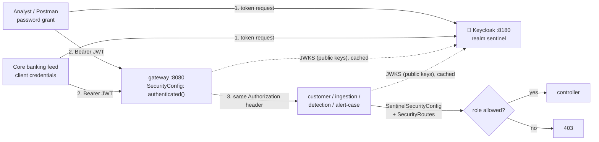
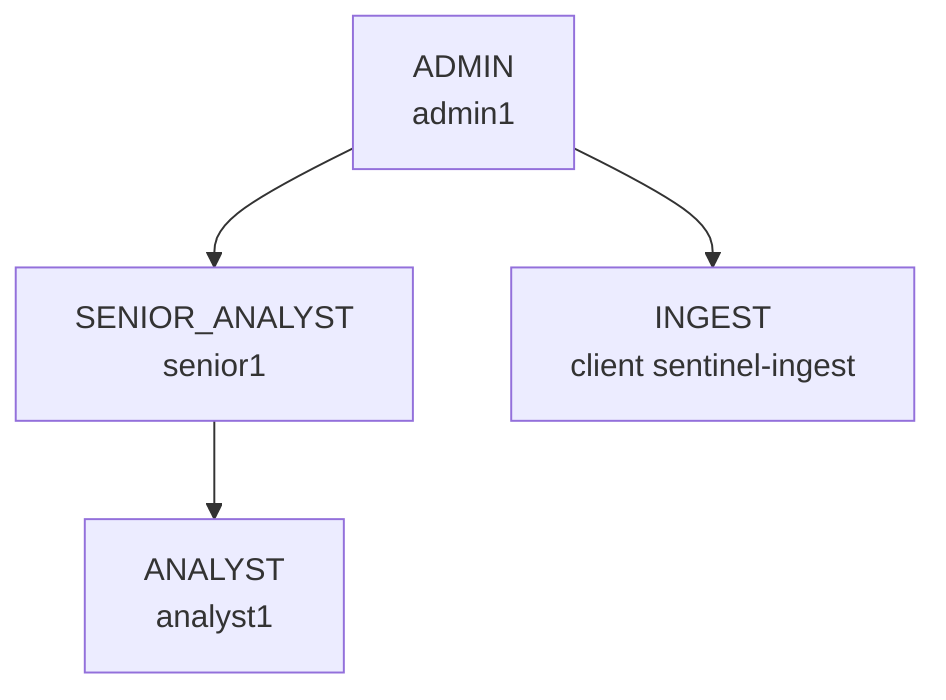

# ADR-006 · Phase 6 — Authentication & Role-Based Access (Keycloak JWT)

| | |
|---|---|
| **Status** | Accepted (built 2026-11-19 on branch `phases/p-6`) |
| **Date** | 2026-11-19 |
| **Phase promise** | Nobody calls a Sentinel API without proving who they are, and each person or system can only do what their role allows, checked at the gateway **and** in every service |
| **Problems solved** | **P19** access control / RBAC (ADR-000 D3, D8) · foundation for **P17** (every request now carries a role, which PII unmasking will key on) |
| **Carried forward** | Role-based PII unmasking, masking sensitive args in `LoggingAspect`, append-only hash-chained `audit_event`, cases (the rest of the original Phase 6 list: P16, P20, rest of P17). Scoped out on 2026-11-19 to ship authentication first |
| **Skills** | OAuth2 / OIDC, JWT (JWS signature, `iss`, `exp`), Keycloak realms, composite roles, client-credentials grant, Spring Security 6 resource server, `SecurityFilterChain`, `@WebMvcTest` + `spring-security-test` |
| **Builds on** | [ADR-005](ADR-005-phase-5-alerts-dedup-and-resilience.md) (left every admin / ops / alert API open; rule changes recorded a free-text `changedBy`) |

> **One-line recall:** *Keycloak (`sentinel` realm, imported by docker-compose) issues RS256 JWTs. The gateway rejects any request without a valid token (401) and relays it. Every service is also a resource server: one shared `SecurityFilterChain` in common-lib maps `realm_access.roles` to `ROLE_*`, and each service adds its own `RouteRules` bean. Anything without a rule is denied. Role inheritance is done with Keycloak **composite roles**, so the token already lists every effective role. Rule changes are recorded under the token's username, not a body field.*

---

## 1. Context

After Phase 5 every endpoint was open. Anyone who could reach port 8080, or a service port directly, could:

| Gap | Consequence |
|---|---|
| No authentication at all | Any client can read customer data, alerts and rules |
| No roles | An analyst (or a script) can retune detection rules, replay DLQ messages, or reseed the database |
| `changedBy` was a request field | The rule audit trail (`aml_rule_version.changed_by`) recorded whatever name the caller typed |
| Service ports reachable directly | Even a gateway-only check would be bypassed by calling `:8082`–`:8085` |
| alert-case-service had a placeholder `openUntilPhase6` chain | Security starters were on its classpath, but it permitted everything |

---

## 2. Decisions

| # | Decision | Chosen | Rejected | Why |
|---|---|---|---|---|
| D1 | Identity provider | **Keycloak 24**, realm imported from `infra/keycloak/sentinel-realm.json` | Hand-rolled JWT login; click-configured realm | Already chosen in ADR-000 D8. A file import makes the realm reproducible: `docker compose up` gives every developer the same roles, clients and users |
| D2 | Where the token is checked | **Gateway + every service** | Gateway only | Defense in depth. With gateway-only, anything that reaches a service port (misconfigured network, another pod) gets in without a token |
| D3 | Where role rules live | **In each service** (`config/SecurityRoutes`), the gateway only checks "authenticated" | Full matrix at the gateway; matrix duplicated in both | Exactly one place per endpoint, next to the controller it protects. The gateway has no idea which method on which path is sensitive, and duplicated rules drift |
| D4 | Shared vs per-service config | **One `SecurityFilterChain` in common-lib** + a per-service `RouteRules` bean | Copy a full config class into each service | Token validation, role mapping, statelessness and the open paths are identical everywhere; only the rules differ |
| D5 | Default for unmatched paths | **`denyAll()`** | `authenticated()` | A new endpoint stays closed until someone decides who may call it. Forgetting a rule fails loudly in Postman, not silently in production |
| D6 | Role inheritance | **Keycloak composite roles** (ADMIN ⊃ SENIOR_ANALYST ⊃ ANALYST, ADMIN ⊃ INGEST) | Spring `RoleHierarchy` bean | Zero code, and the hierarchy is visible in the token and the Keycloak console. (`RoleHierarchyImpl.fromHierarchy` and automatic pickup by `authorizeHttpRequests` only arrive in Spring Security 6.3; we are on 6.2) |
| D7 | Machine access (core-banking feed) | **Client-credentials client `sentinel-ingest`** with role INGEST | A shared "system" user with a password | The OAuth2 grant meant for machines: no human user, its own secret, and its role allows only ingestion |
| D8 | Human logins for local testing | **Public client `sentinel-postman`** with the password grant | Authorization-code + PKCE | Postman, newman and curl can get a token in one call. The Next.js console (Phase 7) will use authorization code + PKCE with its own client |
| D9 | Who changed a rule | **`Principal#getName()` = `preferred_username`** from the JWT | Keep `changedBy` in the body | A body field can be faked; the token is signed by Keycloak. The field was removed from `RuleUpdateRequest`; old clients that still send it are not rejected (Jackson ignores unknown fields) |
| D10 | Sessions / CSRF | **Stateless, CSRF off** | Default session + CSRF | Bearer tokens in a header, no cookies: CSRF needs a browser to attach credentials automatically, which never happens here |
| D11 | Issuer config | **`issuer-uri` = `http://localhost:8180/realms/sentinel`** (env `KEYCLOAK_ISSUER_URI`) | `jwk-set-uri` only | Validates the `iss` claim as well as the signature. Spring creates the decoder lazily, so services still start while Keycloak is down |

---

## 3. Architecture

### 3.1 What Phase 6 added



### 3.2 One request, end to end

```mermaid
sequenceDiagram
    participant A as analyst1 (Postman)
    participant KC as Keycloak
    participant GW as gateway-service
    participant DS as detection-service
    A->>KC: POST /realms/sentinel/protocol/openid-connect/token<br/>grant_type=password, client_id=sentinel-postman
    KC-->>A: access_token (RS256, 15 min) realm_access.roles=[ANALYST]
    A->>GW: PUT /api/v1/rules/CTR_THRESHOLD  Authorization: Bearer …
    GW->>KC: GET /protocol/openid-connect/certs (first request only)
    GW->>GW: verify signature, exp, iss → authenticated
    GW->>DS: PUT /api/v1/rules/CTR_THRESHOLD (header relayed)
    DS->>DS: verify again; roles → ROLE_ANALYST
    DS->>DS: SecurityRoutes: PUT /api/v1/rules/* needs ROLE_ADMIN
    DS-->>GW: 403
    GW-->>A: 403
```

### 3.3 Roles



Composite roles: a user with ADMIN gets all four in `realm_access.roles`.

### 3.4 Role matrix

| Endpoint | Method | Role (or higher) | Service |
|---|---|---|---|
| `/api/v1/transactions`, `/api/v1/transactions/ingest` | POST | INGEST | ingestion |
| `/api/v1/ingestion/batches` | POST | INGEST | ingestion |
| `/api/v1/ingestion/batches/{id}` | GET | ANALYST | ingestion |
| `/api/v1/customers/**`, `/api/v1/accounts/**` | GET | ANALYST | customer |
| `/api/v1/customers/{id}/risk-rating`, `/api/v1/accounts/{id}/risk-rating` | PUT | SENIOR_ANALYST | customer |
| `/api/v1/customers`, `/api/v1/customers/{id}/accounts` | POST | ADMIN | customer |
| `/api/v1/admin/**` (seed-data, risk-sync) | any | ADMIN | customer |
| `/api/v1/rules/**` | GET | ANALYST | detection |
| `/api/v1/rules/{code}` | PUT | ADMIN | detection |
| `/api/v1/detection/**`, `/api/v1/ops/dlq/**` | any | ADMIN | detection |
| `/api/v1/alerts/**` | GET | ANALYST | alert-case |
| `/api/v1/alerts/{id}/status` | PATCH | ANALYST | alert-case |
| `/actuator/health/**`, `/swagger-ui/**`, `/v3/api-docs/**` | any | open | all |
| anything else | any | **denied** | all |

---

## 4. The important code

### 4.1 Shared chain (common-lib `SentinelSecurityConfig`)

```java
.csrf(AbstractHttpConfigurer::disable)
.sessionManagement(s -> s.sessionCreationPolicy(SessionCreationPolicy.STATELESS))
.authorizeHttpRequests(auth -> {
    auth.requestMatchers("/actuator/health/**", "/swagger-ui.html", "/swagger-ui/**", "/v3/api-docs/**").permitAll();
    routeRules.apply(auth);          // the service's own rules
    auth.anyRequest().denyAll();     // default deny
})
.oauth2ResourceServer(o -> o.jwt(j -> j.jwtAuthenticationConverter(keycloakJwtConverter())))
```

Keycloak puts realm roles in a nested claim, not in `scope`, so Spring's default converter (which makes `SCOPE_*` authorities) is replaced:

```java
jwt -> new JwtAuthenticationToken(jwt, realmRoles(jwt), username(jwt))
// realmRoles: realm_access.roles → "ROLE_" + role ; username: preferred_username, else sub
```

### 4.2 Per-service rules (e.g. detection-service `config/SecurityRoutes`)

```java
@Bean
public RouteRules routeRules() {
    return auth -> auth
            .requestMatchers(GET, ApiRoutes.RULES + "/**").hasRole(ANALYST)
            .requestMatchers(PUT, ApiRoutes.RULES + "/*").hasRole(ADMIN)
            .requestMatchers(ApiRoutes.API_V1 + "/detection/**", ApiRoutes.OPS_DLQ + "/**").hasRole(ADMIN);
}
```

`/rules/**` also matches `/rules` itself (a trailing `/**` matches zero segments).

### 4.3 Gateway (`gateway-service` `config/SecurityConfig`)

Same stateless resource server, but only `anyRequest().authenticated()`. Spring Cloud Gateway MVC copies the `Authorization` header to the downstream call, so no token-relay filter is needed. `RequestLoggingFilter` runs at `HIGHEST_PRECEDENCE`, before Spring Security, so rejected requests (401) are still logged with a trace id.

### 4.4 Rule audit uses the token

```java
public ResponseEntity<ApiResponse<RuleView>> update(@PathVariable String code,
        @Valid @RequestBody RuleUpdateRequest request, Principal principal) {
    RuleView view = ruleAdminService.update(code, request, principal.getName());
```

`principal.getName()` is `preferred_username` thanks to the converter above; it flows into `aml_rule_version.changed_by` and the `RulesChangedEvent` broadcast.

### 4.5 Realm import

`docker-compose.yml` runs Keycloak with `start-dev --import-realm` and mounts `./infra/keycloak` at `/opt/keycloak/data/import`. The import is skipped when the realm already exists, so changes to the JSON need the container recreated (dev mode keeps its H2 data inside the container).

---

## 5. Edge cases

| Case | Behaviour | Where |
|---|---|---|
| No `Authorization` header | 401 + `WWW-Authenticate: Bearer` from the gateway | gateway `SecurityConfig` |
| Malformed / tampered / expired token | 401 (`invalid_token`) | Spring `BearerTokenAuthenticationFilter` |
| Token from another realm or Keycloak | 401: `iss` doesn't match `issuer-uri` | `JwtIssuerValidator` |
| Valid token, wrong role | 403 from the owning service, relayed by the gateway | service `SecurityRoutes` |
| Calling a service port directly without a token | 401 (defense in depth, D2) | common-lib chain |
| A new endpoint without a rule | 403 even for ADMIN | `anyRequest().denyAll()` |
| Token with no `realm_access` claim (e.g. client with no roles) | Authenticated, no authorities, so 403 everywhere except open paths | `realmRoles()` returns empty |
| Keycloak down at service startup | Services start; the first authenticated request fails until Keycloak is up (lazy JWKS fetch) | Boot `SupplierJwtDecoder` |
| Keycloak down after first request | Existing tokens keep validating with the cached keys until they expire | Nimbus JWKS cache |
| Client still sends `changedBy` | Ignored; the token's username is recorded | Jackson `FAIL_ON_UNKNOWN_PROPERTIES=false` (Boot default) |
| Health checks and load balancer probes | `/actuator/health/**` stays open | both chains |
| Token in the logs | Not logged: the gateway logs method, path and status, never headers. `LoggingAspect` prints the `Principal` arg of rule updates as `JwtAuthenticationToken [… Credentials=[PROTECTED] … Granted Authorities=[…]]`; `Jwt` has no `toString()`, so the token value never appears | `RequestLoggingFilter`, `LoggingAspect` |

---

## 6. Stabilization log: found while building Phase 6

| What was wrong | Why it mattered | Fix |
|---|---|---|
| `RuleUpdateRequest.changedBy` was `@NotBlank` and trusted | Anyone could write any name into the rule audit trail | Removed from the body; the service receives `changedBy` as a parameter from `Principal` |
| alert-case-service had its own `openUntilPhase6` chain and its own security dependencies | Two `SecurityFilterChain` beans would conflict, and the open one could win | Deleted the bean and the duplicate dependencies; it now uses common-lib's chain like every service |
| Postman tests asserted `changedBy == "compliance.lead"` | Would fail once the name comes from the token | Request bodies no longer send `changedBy`; the assertion expects `admin1` |
| Validation-test body ended with `"changedBy": "x"` after a comma | Removing the field naively would leave invalid JSON (400 for the wrong reason) | Rewrote that body so it is still valid JSON missing only `reason` |
| Considered `RoleHierarchy` for inheritance | Not picked up automatically by `authorizeHttpRequests` in Spring Security 6.2 | Keycloak composite roles (D6) |

---

## 7. Testing

| Test | What it proves |
|---|---|
| `common-lib` `SentinelSecurityConfigTest` (2) | `realm_access.roles` → `ROLE_*`, username = `preferred_username`, fallback to `sub`, empty roles when the claim is missing |
| `detection-service` `RuleAdminSecurityTest` (6) | Through the real shared chain + `SecurityRoutes`: no token 401; ANALYST reads rules 200; ANALYST PUT 403; ADMIN PUT 200 and the service gets `changedBy = admin1`; SENIOR_ANALYST on DLQ 403; unlisted path 403 for ADMIN |
| `gateway-service` `GatewayServiceApplicationTests` | Gateway context starts with the resource server and no reachable Keycloak (lazy decoder) |
| Postman folder **09 Phase 6 - Security** (9 requests) | Against live Keycloak: 401 without / with a garbage token, 401 on a service port directly, ANALYST 200 / 403s, ingest client 403 on alerts, ADMIN 200 |
| Postman folders 00–08 | Still green when run as `admin1` (the collection fetches and refreshes the token itself) |

```bash
cd services && mvn test -pl common-lib,detection-service -Dtest='SentinelSecurityConfigTest,RuleAdminSecurityTest' -Dsurefire.failIfNoSpecifiedTests=false
```

---

## 8. Definition of Done: blueprint checklist

| Item | Status |
|---|---|
| Keycloak realm with roles, clients and users, reproducible from Git | ✅ `infra/keycloak/sentinel-realm.json`, imported by compose |
| Gateway validates JWTs | ✅ |
| Every service validates JWTs (defense in depth) | ✅ common-lib `SentinelSecurityConfig` |
| Role rules on admin, ops, rule, alert, customer and ingestion APIs | ✅ per-service `SecurityRoutes`, default deny |
| Machine client for ingestion | ✅ `sentinel-ingest`, client credentials, role INGEST |
| Rule changes attributed to the authenticated user | ✅ `changedBy` from `preferred_username` |
| Automated tests for role mapping and route rules | ✅ 8 tests |
| Postman: collection authenticates itself; 401/403 folder | ✅ 100 requests (folder 09 added) |
| Full Postman / newman run against live Keycloak | ⚠️ not run when this was written (Docker was not running). Run before merging, see §10 |
| Role-based PII unmasking (full national ID for SENIOR_ANALYST) | ❌ carried forward |
| Mask sensitive args in `LoggingAspect` | ❌ carried forward |
| Append-only hash-chained `audit_event` | ❌ carried forward |
| Cases, SAR drafts | ❌ carried forward |
| Audience (`aud`) validation | ❌ deliberately skipped for local dev; add when a second resource server or client exists |
| Swagger UI "Authorize" button (bearer scheme in OpenAPI config) | ❌ nice-to-have; paste a header meanwhile |
| 401/403 bodies in the `ApiResponse` envelope | ❌ Spring Security's default (empty body + `WWW-Authenticate`) for now |

---

## 9. Security notes

- **Dev secrets in Git:** the test users' passwords and the `sentinel-ingest` client secret are in the realm file. That is acceptable only because the realm is local-dev only; any shared environment must import a realm without them and inject secrets (Secrets Manager, see `infra/modules`).
- **Password grant** is deprecated in OAuth 2.1. It is enabled only on the `sentinel-postman` client for tooling; the UI client in Phase 7 uses authorization code + PKCE.
- **Token lifetime** is 15 minutes (`accessTokenLifespan: 900`). There is no revocation check: a stolen token works until it expires. Short lifetimes are the mitigation.

---

## 10. Run it

```bash
docker compose up -d keycloak
```
```bash
curl -s localhost:8180/realms/sentinel | jq .realm
```
```bash
TOKEN=$(curl -s -d grant_type=password -d client_id=sentinel-postman -d username=analyst1 -d password=analyst1 localhost:8180/realms/sentinel/protocol/openid-connect/token | jq -r .access_token)
```
```bash
curl -s -o /dev/null -w "%{http_code}\n" localhost:8080/api/v1/alerts
```
```bash
curl -s -H "Authorization: Bearer $TOKEN" "localhost:8080/api/v1/alerts?size=5"
```
```bash
npx newman run docs/postman/Sentinel-AML.postman_collection.json -e docs/postman/Sentinel-AML-local.postman_environment.json
```

Decode a token to see its roles: paste it into the Keycloak admin console (Clients → sentinel-postman → Client scopes → Evaluate) or split on `.` and base64-decode the middle part.

---

## 11. Recall card 🧠

- **Authentication vs authorization?** Authentication = who are you (valid token, 401 if not). Authorization = may you do this (role, 403 if not).
- **Why check the JWT in every service if the gateway already does?** Defense in depth: the gateway is one network path, not the only one. Zero trust between services.
- **Why do roles live in services, not the gateway?** One place per endpoint, next to the code that knows what is sensitive. The gateway just proves identity.
- **How does a service validate a JWT without calling Keycloak each time?** It fetches Keycloak's public keys (JWKS) once, caches them, and checks the RS256 signature, `exp` and `iss` locally.
- **Why `denyAll()` at the end?** Fail closed: a forgotten rule blocks a new endpoint instead of exposing it.
- **Composite role?** A Keycloak role that includes other roles; the token lists every effective role, so services need no hierarchy logic.
- **Client credentials vs password grant?** Client credentials = a machine authenticating as itself with a secret, no user. Password grant = a user's username and password sent by the client (tooling only; deprecated in OAuth 2.1).
- **Why is CSRF disabled?** CSRF exploits cookies the browser sends automatically. Bearer tokens in a header are never attached automatically.
- **Why take `changedBy` from the token?** A request body is whatever the caller says; a token is signed by the identity provider. Audit trails must not be self-reported.
- **`401` vs `403`?** 401: no or invalid credentials, try authenticating. 403: you are known, and the answer is no.
