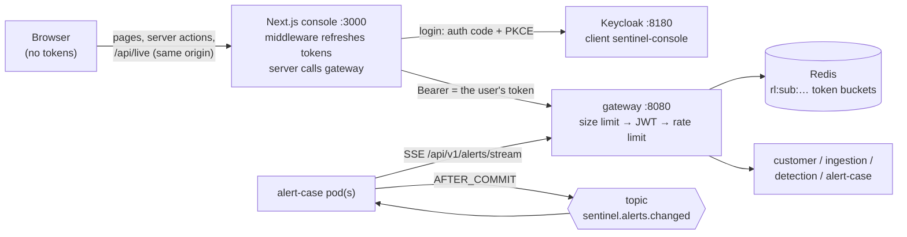
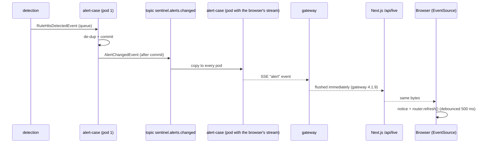
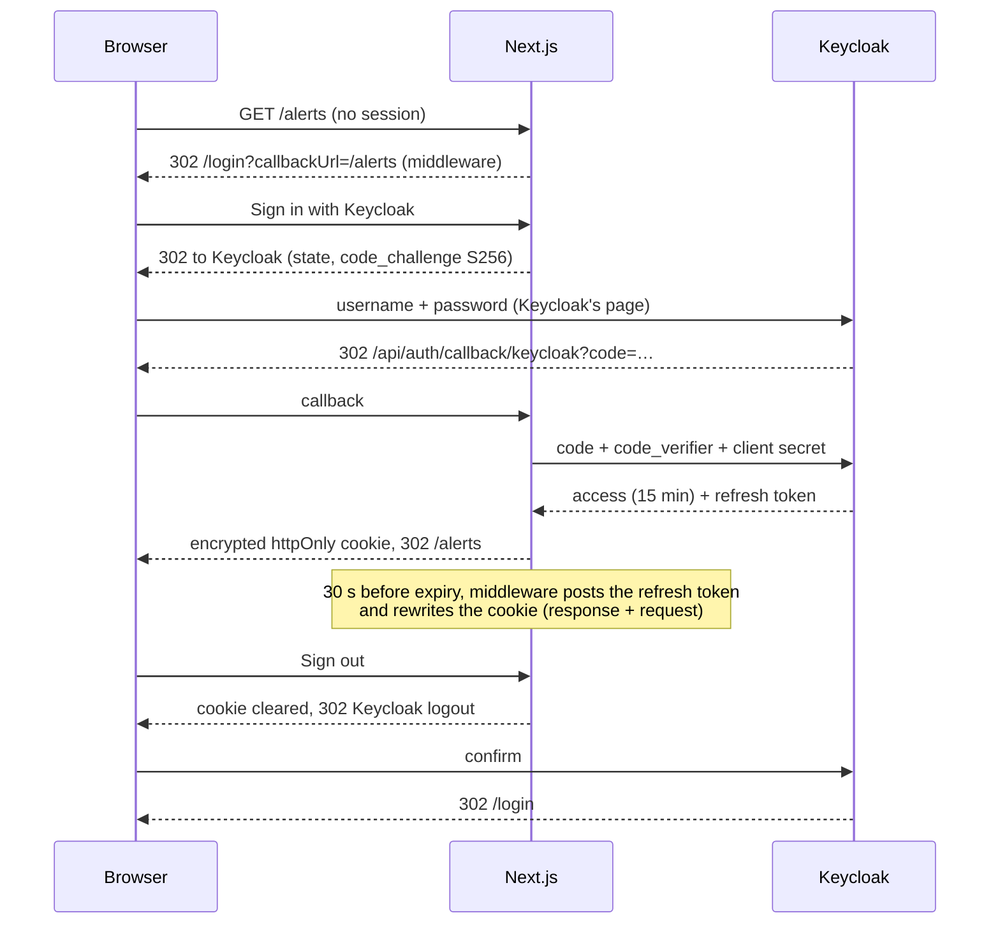

# ADR-007 · Phase 7 — Analyst Console, Live Alerts & Edge Limits

| | |
|---|---|
| **Status** | Accepted (built 2026-11-21 on branch `phases/p-7`) |
| **Date** | 2026-11-21 |
| **Phase promise** | Analysts work the queue in a browser instead of Postman: sign in with Keycloak, see alerts appear live, open the evidence, record a decision. Admins tune rules and clear dead letters from the same console. The gateway protects the platform from floods and oversized requests |
| **Problems solved** | **X3** usable analyst interface (ADR-000) · live delivery of alerts to analysts · rate limiting and body limits promised for Phase 7 in the gateway flow page |
| **Skills** | Next.js 15 App Router (server components, server actions, route handlers, middleware), next-auth 4 (Keycloak provider, encrypted JWT cookie), OAuth2 authorization code + PKCE, refresh tokens, Server-Sent Events (`SseEmitter`, `EventSource`), JMS topics, Redis Lua token bucket, servlet filters, Tailwind CSS 4 |
| **Builds on** | [ADR-006](ADR-006-phase-6-authentication-and-rbac.md) (Keycloak realm, per-service role rules) · [ADR-005](ADR-005-phase-5-alerts-dedup-and-resilience.md) (alerts API, rule admin, DLQ API, topic-after-commit pattern) |

> **One-line recall:** *A Next.js console signs users in on the server (authorization code + PKCE) and keeps their Keycloak tokens only in an encrypted httpOnly cookie; middleware refreshes them, and every API call goes from the Next.js server to the gateway with the user's own token. alert-case-service publishes every committed alert change to the `sentinel.alerts.changed` topic, each pod pushes it to its open browsers over SSE, and the console refreshes the screen. The gateway gives each caller a Redis token bucket (burst 100, 20/s, 429 + `Retry-After`) and refuses bodies over 1 MB (50 MB for CSV uploads) with 413.*

---

## 1. Context

After Phase 6 every API was secured, but the only way to use Sentinel was Postman or curl:

| Gap | Consequence |
|---|---|
| No user interface | Analysts cannot realistically work an alert queue through Postman |
| New alerts only visible on refresh | An urgent alert can sit unseen until someone reloads |
| Password grant only (`sentinel-postman`) | Fine for tooling, wrong for a browser app: the app would handle users' passwords |
| No rate limiting | One buggy script or client can flood every service behind the gateway |
| No request size limit | A huge body is streamed all the way to a service before anything refuses it |

---

## 2. Decisions

| # | Decision | Chosen | Rejected | Why |
|---|---|---|---|---|
| D1 | Framework | **Next.js 15.5 (App Router) + React 19 + Tailwind 4** | Next.js 16; a Vite SPA | 15.5 is the maintained 15.x line, and next-auth 4's middleware pattern is proven on it; 16 renamed and reworked middleware. Server components let the server call the gateway, which an SPA can't |
| D2 | Where login and API calls happen | **On the Next.js server** (backend-for-frontend) | Browser-side SPA with `keycloak-js` | Tokens never reach browser JavaScript, so an XSS bug can't steal them. The browser only calls same-origin routes, so the gateway needs no CORS |
| D3 | Login flow | **Authorization code + PKCE (S256)**, new confidential client `sentinel-console` | Password grant | The user types their password only on Keycloak's page. PKCE stops a stolen authorization code from being redeemed. Redirect URI is pinned to `localhost:3000/api/auth/callback/keycloak` |
| D4 | Auth library | **next-auth 4.24.15** with the Keycloak provider | next-auth 5 (still beta.32 after 2+ years); hand-written OIDC | Stable, handles state, PKCE, the callback and cookie encryption |
| D5 | Token storage | **Encrypted JWT session cookie** (httpOnly, SameSite=Lax) holding only access token, refresh token, expiry, username and roles | Database/Redis session store; storing the ID token | No extra infrastructure. Measured at **2,895 bytes** for `admin1`, the largest token, under the ~4 KB cookie limit. The ID token is left out for that reason, so Keycloak shows a "Do you want to log out?" page on sign-out |
| D6 | Token refresh | **In `middleware.ts`**: refresh 30 s before expiry and rewrite the cookie on the response *and* the request | next-auth's `jwt` callback | Server components can't set cookies, so a callback-based refresh is never saved. Rewriting the request cookie means the page rendered in the same request already uses the new token |
| D7 | Live alerts transport | **Server-Sent Events** | WebSockets; polling | One-way server → browser is all we need. SSE is plain HTTP (auth, gateway, proxies work unchanged), and `EventSource` reconnects by itself |
| D8 | Fan-out across pods | **AFTER_COMMIT → topic `sentinel.alerts.changed` → every alert-case pod → its own SSE clients** | Push straight from the ingesting pod | With several pods, the pod that creates an alert is usually not the one a given browser is connected to. Same pattern as rule hot-reload (ADR-005) |
| D9 | What an SSE event carries | **Only what changed** (`alertId`, account, rule, change type, status); the console re-reads via the API | The full alert | Access rules and fresh data always come from the normal endpoints, and the event contract stays tiny |
| D10 | Browser access to the stream | **Same-origin route `/api/live`** that pipes the gateway stream through | Browser connects to the gateway | Keeps D2: the token stays on the server |
| D11 | Rate limiting | **Token bucket in Redis, one Lua script**, per JWT subject (IP when anonymous), burst 100, refill 20/s, fail open | Fixed window counter; in-memory per pod; Bucket4j | A bucket allows short bursts but caps the sustained rate. Redis makes the budget shared by every gateway pod, and Lua makes read-refill-take atomic. Redis `TIME` avoids clock skew between pods. If Redis is down, requests pass (logged): limiting must not take the API down |
| D12 | Body limits | **Gateway servlet filter**: 1 MB, 50 MB for `/api/v1/ingestion/batches` | Tomcat settings; per-service limits | Refused once, at the edge, before authentication. Checks `Content-Length` up front *and* counts chunked bodies while streaming |
| D13 | Gateway SSE support | **Spring Cloud 2023.0.1 → 2023.0.6** (gateway MVC 4.1.2 → 4.1.9), which needed **Spring Boot 3.2.5 → 3.2.12** | A hand-written SSE proxy controller in the gateway | 4.1.2 copies the response with `StreamUtils.copy`, which flushes only at the end, so an endless SSE stream never left the gateway. 4.1.6+ flushes streaming media types after every chunk but calls `HttpHeaders.headerSet()` (Spring 6.1.15+). Both bumps are patch-level within the same lines; the full test suite passes |

---

## 3. Architecture

### 3.1 What Phase 7 added



### 3.2 A new alert reaching an open screen



**Measured through the gateway:** transaction posted at 11:40:15.008, `alert` event received at 11:40:15.756, about **0.75 s** from ingest to the screen, including detection.

### 3.3 Request path through the gateway

```
RequestLoggingFilter (trace id)  →  RequestSizeLimitFilter (413)  →  Spring Security (401)  →  RateLimitFilter (429)  →  route
```

The size check runs before authentication, so a huge body is refused cheaply. The rate limit runs after it, so the caller is known and each user or client gets its own bucket.

### 3.4 Sign-in, refresh, sign-out



---

## 4. The console

| Page | Who | What |
|---|---|---|
| `/login` | everyone | One button; only same-site `callbackUrl` values are honoured |
| `/` Dashboard | ANALYST+ | Open / total alerts, hits folded per alert, highest-risk new alerts, alerts by status; dead-letter count for ADMIN |
| `/alerts` | ANALYST+ | Queue sorted by risk, filters (status, rule, account), paging |
| `/alerts/{id}` | ANALYST+ | De-dup key, every hit with its explanation and evidence transactions, note + only the allowed next statuses; sends `expectedVersion` (409 if someone changed it) |
| `/rules`, `/rules/{code}` | ANALYST+ read, ADMIN edit | Live vs saved version, thresholds in each rule's own unit (INR, transactions, %, × average), version history; edit sends only changed fields plus a required reason |
| `/ops` | ADMIN | DLQ depth per queue, message bodies, replay one / all, delete |

All data comes from server components calling the gateway with the user's token; changes are server actions. The UI hides what a role can't do, but the **services still decide**: a crafted request from an analyst still gets 403.

---

## 5. The important code

### 5.1 Middleware refresh (`frontend/src/middleware.ts`)

```ts
if (!token?.accessToken) return unauthenticated(req);         // pages → /login, /api → 401
if (!needsRefresh(token)) return NextResponse.next();         // more than 30 s left
const refreshed = await refreshSession(token, keycloakConfig());
if (!refreshed) { /* Keycloak session over */ clear cookie; return unauthenticated(req); }
const value = await encode({ token: refreshed, secret, maxAge });
req.cookies.set(name, value);                                  // this request's server components
const res = NextResponse.next({ request: { headers: req.headers } });
res.cookies.set(name, value, { httpOnly: true, sameSite: "lax", ... });   // the browser
```

### 5.2 Token bucket (`gateway-service/src/main/resources/scripts/token_bucket.lua`)

```lua
local now = redis TIME in ms
tokens = min(capacity, tokens + (now - ts) * rate / 1000)      -- refill since last request
if tokens >= 1 then tokens = tokens - 1; allowed = 1
else retry_ms = ceil((1 - tokens) * 1000 / rate) end
HSET key tokens ts ; PEXPIRE key (time to refill fully + 1 s)
```

### 5.3 Alert changes after commit (`alert-case-service/.../live/`)

```java
// AlertIngestService / AlertQueryService, inside the transaction
events.publishEvent(new AlertChangedEvent(alertId, accountId, ruleCode, CREATED | UPDATED | STATUS_CHANGED, status, now));

// AlertChangePublisher
@TransactionalEventListener(phase = AFTER_COMMIT)
public void publish(AlertChangedEvent e) { topicTemplate.convertAndSend("sentinel.alerts.changed", e); }

// AlertStreamService, on every pod
@JmsListener(destination = "sentinel.alerts.changed", containerFactory = "topicListenerFactory")
public void onAlertChanged(AlertChangedEvent e) { broadcast(event().name("alert").id(e.alertId()).data(e)); }
@Scheduled(fixedRate = 25_000) public void heartbeat() { broadcast(event().comment("keep-alive")); }
```

The topic template is private to the publisher: declaring a `JmsTemplate` bean would remove Boot's default queue template (the same trap as ADR-005 D9).

---

## 6. Edge cases

| Case | Behaviour | Where |
|---|---|---|
| Not signed in, page request | 302 to `/login?callbackUrl=…` | middleware |
| Not signed in, `/api/live` | 401 JSON | middleware |
| Access token about to expire | Refreshed before the page renders; the same request already uses the new token | middleware |
| Keycloak session ended (idle or max) | Refresh refused → cookie cleared → `/login` | middleware |
| `callbackUrl=https://evil…` on `/login` | Ignored; only same-site paths starting with `/` (not `//`) | `login/page.tsx` |
| Analyst opens `/ops` or crafts a rule PUT | Page says ADMIN needed; the API answers 403 regardless | page + service `SecurityRoutes` |
| Two analysts decide on one alert | Second gets 409 ("changed by someone else"), shown as a banner | `expectedVersion` |
| Browser tab closed | `req.signal` aborts the upstream fetch; the emitter's error/completion removes it | `/api/live`, `AlertStreamService` |
| Dead SSE connection | Send fails → emitter dropped, others unaffected | `AlertStreamService.send` |
| Idle connection through proxies | `:keep-alive` comment every 25 s | heartbeat |
| SSE token expires during a long stream | Stream stays open until the 30-min server timeout; `EventSource` reconnects through middleware, which refreshes | `EMITTER_TIMEOUT` |
| Burst of alerts (CSV batch) | One `router.refresh()` per 500 ms quiet period, at most 4 notices on screen | `LiveAlerts` |
| Alert change rolls back | Nothing broadcast (AFTER_COMMIT) | `AlertChangePublisher` |
| Broker down when broadcasting | Logged; the alert is committed, the screen catches up on its next refresh | `AlertChangePublisher` |
| Redis down | Rate limiting skipped (fail open), warning logged | `RateLimitFilter` |
| 100 concurrent requests, burst 20 | Exactly 20 allowed (Lua is atomic) | `RedisRateLimiterTest` |
| Chunked body with no `Content-Length` | Counted while streamed, cut off at the limit → 413 | `RequestSizeLimitFilter` |
| Session cookie over 4 KB | next-auth chunks it (`.0`, `.1`); `readSessionCookie` joins them and the refresh writes one cookie and removes the chunks | `tokens.ts`, `middleware.ts` |

---

## 7. Stabilization log: found while building and verifying Phase 7

| What was wrong | How it was found | Fix |
|---|---|---|
| SSE through the gateway delivered nothing (not even the first event) | Live test: direct to :8085 worked in ~200 ms, via :8080 silent | Read the gateway jar: 4.1.2 flushes only at end of stream. Upgraded to 4.1.9 (D13) |
| Gateway 4.1.9 failed every request with `NoSuchMethodError HttpHeaders.headerSet()` | First call after the upgrade returned 500 | Checked 4.1.3–4.1.8: every version with the flush fix needs Spring 6.1.15 → Boot 3.2.12 |
| Status buttons sent "Unknown status" | Browser test of the alert workflow | The clicked button's `name`/`value` wasn't in the server action's FormData; each button now binds its status (`changeStatus.bind(null, s)`) |
| Rules page showed "₹3", "₹80" for non-money thresholds | Browser test of `/rules` | `threshold_amount` means INR, a count, a % or a multiplier per rule (ADR-004); per-rule units |
| Dev-mode badge covered the Live indicator | Screenshot | Indicator moved into the header |
| Preview launcher couldn't start the dev server | It stayed "starting" | `npm` comes from nvm and needs `node` on PATH; `.claude/launch.json` (git-ignored) uses the absolute node path |
| `tsconfig.tsbuildinfo` and `next-env.d.ts` would have been committed | `git status` | `.gitignore` rule named a file that doesn't exist; fixed |
| 130 sequential requests never got a 429 | Live test | Not a bug: curl was slower than the 20/s refill. A parallel burst of 250 gave 107 × 200 and 143 × 429 |

---

## 8. Testing

| Test | What it proves |
|---|---|
| `gateway` `RedisRateLimiterTest` (4, Testcontainers Redis) | Burst then deny with `retryAfter`; refill over time; separate buckets per caller; 100 concurrent requests spend exactly 20 tokens |
| `gateway` `RequestSizeLimitFilterTest` (4) | Declared length over the limit → 413 without calling downstream; chunked body counted and cut off; within limit passes; upload path gets the larger limit |
| `alert-case` `AlertStreamServiceTest` (3) | Every connected browser gets the event; a broken connection is dropped without stopping others; heartbeat reaches everyone |
| `alert-case` `AlertDedupConcurrencyTest` | Still green with event publishing inside the de-dup transaction |
| `frontend` `tokens.test.ts` (8) | Roles and username from a Keycloak token; refresh timing; refresh request shape; refresh refused → null; chunked cookie joining |
| `frontend` `format.test.ts` (3) | Threshold units per rule; UTC timestamps shown in IST; severity bands |
| Postman folder **10 Phase 7 - Gateway limits** | Rate-limit headers on every response; 413 for a 1.2 MB body |
| Full Maven build on Boot 3.2.12 | Every module, every test, including the four startup tests with MySQL running |
| Full Postman collection (newman) | Every phase, 109 requests, **184 assertions, 0 failures**, 56 s, all through the new gateway filters (no 429 in a sequential run) |
| Browser, end to end (built-in browser) | Redirect to login; Keycloak login with PKCE; dashboard data; live notice and refresh on a new alert with no reload; NEW → Under review with note (version 0 → 1); analyst sees rules read-only and is refused on `/ops`; sign-out ends the Keycloak session; deep link survives login; admin edits CTR weight (v2 by `admin1`) and reverts (v3, Live); poison message visible in `/ops` and deleted; phone width has no horizontal scroll |
| Token refresh, live | Keycloak access-token lifetime set to 60 s, fresh login, waited ~2 min: dashboard and alert pages still loaded through the gateway (which rejects expired tokens), so middleware refreshed and the same request used the new token. Lifetime restored to 900 s |

```bash
cd services && mvn test -pl gateway-service,alert-case-service
```
```bash
cd frontend && npm test
```

---

## 9. Definition of Done

| Item | Status |
|---|---|
| Console: login, alert queue, alert detail + workflow | ✅ |
| Console: rules (view all, ADMIN edit, history) | ✅ |
| Console: dashboard and dead-letter operations | ✅ |
| Authorization code + PKCE, tokens never in browser JS | ✅ client `sentinel-console`, encrypted httpOnly cookie |
| Token refresh without logging the user out | ✅ middleware (see §8) |
| Live alerts over SSE, correct with several pods | ✅ topic fan-out, ~0.75 s end to end |
| Gateway rate limiting with 429 + `Retry-After` | ✅ burst 100, 20/s per caller |
| Gateway request size limits with 413 | ✅ 1 MB / 50 MB uploads |
| Unit and integration tests for the new logic | ✅ 14 Java + 11 TypeScript |
| Aggregated Swagger UI at the gateway | ❌ not built: each service keeps its own Swagger UI |
| Cases, SAR drafts, audit hash chain, PII unmasking | ❌ still carried forward from ADR-006 |
| Production hosting of the console (Docker image, HTTPS, real secrets) | ❌ Phase 8 (infrastructure) |
| End-to-end browser tests in CI (e.g. Playwright) | ❌ verified manually in this phase |

---

## 10. Security notes

- **Secrets:** `.env.local` (git-ignored) holds `NEXTAUTH_SECRET` and the console client secret; `.env.example` and the realm file hold local-dev values only.
- **Cookie:** httpOnly, SameSite=Lax, `Secure` + `__Secure-` prefix automatically when `NEXTAUTH_URL` is https.
- **Server actions** are POST endpoints protected by Next.js' origin check; every one of them calls the API with the user's own token, so the services' role rules apply.
- **Logout** has a confirmation page because the ID token isn't stored (D5). Storing it would allow `id_token_hint` but push the cookie toward 4 KB.
- **Rate limit key** is the JWT subject, not the username: renaming a user doesn't reset their budget.

---

## 11. Run it

```bash
docker compose up -d
```
```bash
cd services && mvn clean install -DskipTests
```
Start the five services as in the manual guide, then:
```bash
cd frontend && cp .env.example .env.local
```
Set `NEXTAUTH_SECRET` in `.env.local` (`openssl rand -base64 32`), then:
```bash
cd frontend && npm install && npm run dev
```
Open http://localhost:3000 and sign in as `analyst1` or `admin1`.

If your Keycloak container is from before Phase 7, it doesn't have the `sentinel-console` client yet (realm import skips an existing realm). Recreate it:
```bash
docker compose up -d --force-recreate keycloak
```

Burst test for the rate limit (needs a token in `$T`):
```bash
seq 1 250 | xargs -P 25 -I{} curl -s -o /dev/null -w "%{http_code}\n" -H "Authorization: Bearer $T" localhost:8080/api/v1/alerts/stats | sort | uniq -c
```

---

## 12. Recall card 🧠

- **Why log in on the Next.js server, not in the browser?** The token never reaches browser JavaScript (no XSS theft), and the browser only talks to its own origin (no CORS).
- **What does PKCE add?** The app sends a hash of a random secret with the login request and the secret itself when redeeming the code, so a stolen code alone is useless.
- **Why refresh in middleware?** Server components can't set cookies; middleware can, on both the response and the current request.
- **Why SSE and not WebSockets?** One-way updates, plain HTTP, works through the gateway and auth unchanged, auto-reconnect.
- **Why a topic between alert-case pods?** The browser is connected to one pod; the alert may be created on another. A topic gives every pod a copy.
- **Why AFTER_COMMIT?** Never announce an alert the screen can't load yet, or one that rolled back.
- **Token bucket vs fixed window?** A bucket allows a short burst but enforces an average rate, with no "double burst" at a window boundary.
- **Why Lua?** Read, refill and take must be one atomic step, or two parallel requests both spend the last token.
- **Why fail open on Redis errors?** Rate limiting protects the platform; it must not become the reason the platform is down.
- **Why did SSE not work through the gateway at first?** The proxy copied the body with a buffer that flushed only at the end; an endless stream never ended.
