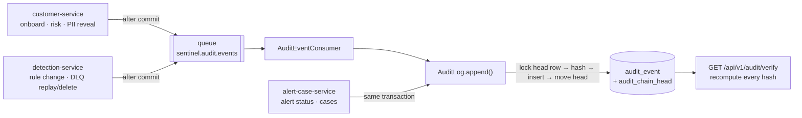
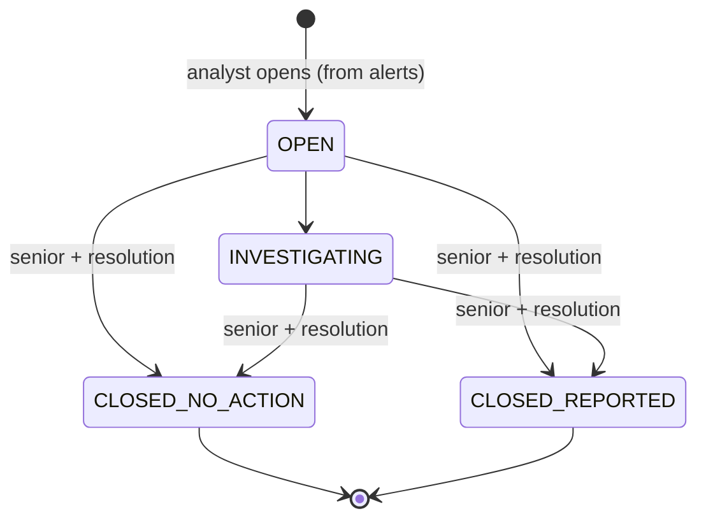

# ADR-008 · Phase 7b — Cases, Tamper-Evident Audit Trail, PII Controls, Console Redesign & Delivery

| | |
|---|---|
| **Status** | Accepted (built 2026-11-21 on branch `phases/p-7`) |
| **Date** | 2026-11-21 |
| **Phase promise** | Close the items carried since ADR-006: analysts group alerts into **cases** with an owner and an outcome; every decision from every service lands in an **append-only, hash-chained audit trail**; the national ID is shown only to seniors, **on request, with a reason, audited**, and never logged. Make the console look and work like a professional product, and make it runnable in **Docker** and checked by **CI** |
| **Problems solved** | Remaining **P16 / P20 / P17** items from ADR-006 (cases, audit trail, PII handling) · combined API reference · reproducible delivery |
| **Skills** | Hash chains (SHA-256), MySQL triggers and row locks, canonical JSON, after-commit messaging, least-privilege data access, Next.js standalone builds, OIDC behind Docker (front vs back-channel URLs), design systems with CSS variables, GitHub Actions |
| **Builds on** | [ADR-007](ADR-007-phase-7-analyst-console-and-edge-limits.md) (console, SSE, gateway limits) · [ADR-006](ADR-006-phase-6-authentication-and-rbac.md) (roles, JWT identity) · [ADR-005](ADR-005-phase-5-alerts-dedup-and-resilience.md) (alerts, DLQ, topic-after-commit) |

> **One-line recall:** *Every service sends audit events after commit to `sentinel.audit.events`; alert-case-service appends them to one SHA-256 chain, ordered by locking a single chain-head row, and MySQL triggers refuse UPDATE/DELETE, so any tampering is caught by `/api/v1/audit/verify`. Cases (analysts open, only seniors close, with a resolution) write their audit entries in the same transaction. The national ID is always masked; a senior reveals it with a reason (audited), and logs redact it. The console was redesigned (IBM Plex, charcoal + deep teal, light/dark/system), ships as a Docker image, and CI builds and tests everything on each push.*

---

## 1. Context

| Gap after Phase 7 | Consequence |
|---|---|
| Alerts could only be worked one by one | No way to investigate related alerts together, assign an owner or record an outcome |
| No audit trail beyond per-feature tables | No single, trustworthy answer to "who did what, when" across services; nothing proved records weren't edited later |
| `LoggingAspect` printed raw request payloads | The national ID on customer registration went into the logs in clear text (flagged in ADR-002) |
| Full national ID: either always masked or not at all | Seniors had no legitimate way to see it; no record of who looked |
| Each service had its own Swagger UI on its own port | "Try it out" bypassed the gateway; no single API reference |
| Console looked like a prototype; only `npm run dev` | Not something you would put in front of analysts; no reproducible way to run or check it |

---

## 2. Decisions

| # | Decision | Chosen | Rejected | Why |
|---|---|---|---|---|
| D1 | Where the audit trail lives | **One chain in alert-case-service**, fed by a queue from the other services | A chain per service; a separate audit service | One ordered history answers cross-service questions ("everything senior1 did today"). alert-case already owns cases, the main source of events. A new service is a later option, not needed now |
| D2 | How events travel | **After-commit send to `sentinel.audit.events`** (queue); local events appended **in the same DB transaction** | Synchronous REST call to an audit API | A rolled-back action is never audited as done; a slow or down audit store never blocks the business action. The queue gives retries and a DLQ (and saved us once, §6) |
| D3 | Tamper evidence | **SHA-256 hash chain** over `seq | eventId | occurredAt | service | actor | action | entityType | entityId | details | prevHash` | Signing each row; no chain | Editing, deleting or reordering any entry breaks every later hash. `GET /audit/verify` names the first broken entry |
| D4 | Ordering appends | **Lock one `audit_chain_head` row** (`SELECT … FOR UPDATE`) per append, held until commit | `GET_LOCK()` named lock; `MAX(seq)+1` | The row lock is released exactly at commit, so the next appender always sees the previous committed hash. A named lock would be released before commit; `MAX(seq)` races |
| D5 | Append-only in the database | **BEFORE UPDATE / BEFORE DELETE triggers** that `SIGNAL` an error | A separate DB user with only INSERT/SELECT (ADR-000's plan) | Triggers stop every client, including the app's own user and someone with a SQL console. A dedicated DB user is still recommended in production (§9). Creating triggers needs `SUPER` or `log_bin_trust_function_creators=1` when binary logging is on |
| D6 | Hashed bytes | **Canonical JSON (sorted keys) stored as TEXT**, timestamps fixed-width micros | MySQL `JSON` column | MySQL normalises JSON (key order, spacing) on storage, so re-hashing would never match. TEXT keeps the exact bytes |
| D7 | Idempotency | `UNIQUE(event_id)` + existence check under the head lock | — | Redelivery (at-least-once) or a DLQ replay never creates a duplicate entry |
| D8 | PII access | **Explicit reveal endpoint**, SENIOR_ANALYST+, **reason required**, audited as `PII_REVEALED`; responses always masked | Unmask automatically for seniors | Least privilege: seeing the full value is a deliberate, recorded act. The console shows it in-page for 60 s and never puts it in a URL |
| D9 | PII in logs | **Regex redaction in `LoggingAspect`** for `idNumber`, `nationalId`, tokens, secrets, passwords (record `toString` and JSON forms) | A `@Sensitive` annotation framework | Covers every controller with one tested function; the field list is short and stable |
| D10 | Cases data access | **JdbcTemplate + SQL** in `CaseService`, `UNIQUE(alert_id)` on `case_alert` | JPA entities with relations | Explicit locking (`FOR UPDATE`) and aggregate list queries are clearer in SQL; the unique key guarantees one case per alert even under races |
| D11 | Who may close | **SENIOR_ANALYST** with a **resolution**; closed cases are final | Any analyst | Four-eyes principle on the outcome of an investigation |
| D12 | Combined API reference | **springdoc in the gateway**, each service's spec proxied as `/v3/api-docs/<service>`; every spec lists the **gateway** as its server and a bearer scheme | Keep per-service Swagger only | "Try it out" goes through rate limiting and auth like any client; one **Authorize** for all services |
| D13 | Visual design | **IBM Plex Sans/Mono, charcoal neutrals, one deep-teal accent; red/amber/green only for meaning**; dark sidebar; faint dot grid; subtle motion (rise, slide-in, pulse, shimmer) honouring `prefers-reduced-motion` | Gradients, purple accents, component kits | A compliance tool should look calm and deliberate. Colour carries meaning (risk, status) instead of decoration |
| D14 | Theme switch | **System / Light / Dark**, stored in a **cookie**; the server renders `<html data-theme>` | `localStorage` + client script | No flash of the wrong theme on load |
| D15 | Console in Docker | **Next.js `standalone` image**; Keycloak started with `--hostname-url=http://localhost:8180 --hostname-strict-backchannel=false`; console gets `KEYCLOAK_INTERNAL_ISSUER=http://keycloak:8080/...` | Host networking; editing `/etc/hosts` | Tokens and the browser keep the public `localhost:8180` issuer; the container discovers Keycloak internally and receives back-channel (token, JWKS) URLs it can reach |
| D16 | CI | **GitHub Actions**: Java `verify` (excluding the four stack-dependent startup tests), console type check + tests + build, console image build | — | Every push proves it compiles, passes tests and packages |
| D17 | Time zone | **customer-service stores UTC** like every other service | Leave local time | The console showed onboarding 5½ h off (§6). Existing local rows keep their old values |

---

## 3. Architecture

### 3.1 Audit flow



### 3.2 One append

```
BEGIN
  SELECT last_seq, last_hash FROM audit_chain_head WHERE id = 1 FOR UPDATE   -- others wait here
  SELECT COUNT(*) FROM audit_event WHERE event_id = ?                           -- duplicate? stop
  hash = SHA256(seq | eventId | occurredAt | service | actor | action | type | id | details | prev_hash)
  INSERT INTO audit_event (...)                                                 -- triggers forbid later UPDATE/DELETE
  UPDATE audit_chain_head SET last_seq = seq, last_hash = hash
COMMIT                                                                          -- lock released, next appender sees this hash
```

### 3.3 Case lifecycle



Each step writes `CASE_CREATED`, `CASE_STATUS_CHANGED`, `CASE_ASSIGNED`, `CASE_PRIORITY_CHANGED`, `CASE_ALERT_ADDED`, `CASE_NOTE_ADDED` or `CASE_CLOSED` to the chain in the same transaction.

### 3.4 New API

| Method | Path | Role |
|---|---|---|
| POST | `/api/v1/cases` `{title, alertIds[], priority?, note?}` | ANALYST |
| GET | `/api/v1/cases?open=&assignee=&status=&page=&size=` | ANALYST |
| GET | `/api/v1/cases/{id}` (alerts, notes, audited history) | ANALYST |
| PATCH | `/api/v1/cases/{id}` `{status?, assignee?, priority?, resolution?, expectedVersion}` | ANALYST; closing SENIOR_ANALYST |
| POST | `/api/v1/cases/{id}/alerts` · `/notes` | ANALYST |
| GET | `/api/v1/audit?entityType=&entityId=&actor=&action=&page=&size=` | SENIOR_ANALYST |
| GET | `/api/v1/audit/verify` | ADMIN |
| POST | `/api/v1/customers/{id}/national-id/reveal` `{reason}` | SENIOR_ANALYST |
| GET | `/swagger-ui.html`, `/v3/api-docs/{customer,ingestion,detection,alert-case}` (gateway) | public (calls still need a token) |

`GET /api/v1/alerts/{id}` now includes `caseId`.

### 3.5 Console pages

Overview (stat tiles, needs-attention list, pipeline bars, open cases, recent activity for seniors) · Alerts · Alert (evidence, decision, **open case / add to case**) · **Cases** (open / mine / all) · **Case** (alerts, notes, manage, close, audited history) · **Customers** (lookup by account or customer, audited reveal, rating changes for seniors) · **Audit trail** (filters, verify for admins) · Rules · Dead letters (now including the audit queue).

---

## 4. Edge cases

| Case | Behaviour |
|---|---|
| Two pods append at the same time | Second waits on the head row; gets the next `seq` and the committed previous hash |
| Same audit event delivered twice / replayed from the DLQ | Stored once (`event_id` unique, checked under the lock) |
| Business action rolls back | Remote: never sent (after-commit). Local: the audit row rolls back with it |
| Audit queue consumer failing | 5 attempts → `DLQ.sentinel.audit.events`, visible on the Dead letters page, replayable |
| Someone runs `UPDATE audit_event …` | Refused by the trigger |
| Someone drops the trigger and edits a row | `verify` reports the first changed entry; earlier entries stay verified |
| Rows removed from the end | `verify` compares the head row with the last entry: "entries at the end are missing" |
| Alert already in a case | 409 naming the case; `UNIQUE(alert_id)` backs it under races |
| Two people edit a case | `expectedVersion` → 409 |
| Analyst tries to close | 403 (checked in `CaseService`, not only hidden in the UI) |
| Close without a resolution | 400 |
| Reveal without a reason / as analyst | 400 / 403 |
| Session cookie encrypted with another secret | Treated as signed out; cookie cleared; no 500 |

---

## 5. Testing

| Test | Proves |
|---|---|
| `AuditChainTest` (2) | Every field and the previous hash change the hash; timestamp formatting can't change it |
| `AuditAndCasesIntegrationTest` (3, MySQL in Testcontainers) | 200 events + 40 racing redeliveries on 20 threads → exactly 200 gap-free entries, chain valid · UPDATE/DELETE refused; an edit after dropping a trigger is pinpointed (entry 5) · full case workflow with roles, 409/403/400 rules, list views and audited history |
| `LoggingAspectRedactionTest` (3) | National ID and tokens masked in record and JSON form; other fields untouched |
| Existing suites | All green on the new code: **99 Java tests**, **11 console tests** |
| Postman folder **11 Phase 7b** (15 requests) | Masked response, 403/400/200 reveal, case from a fresh alert, 409 duplicate, 403 analyst close, senior close, audit 403/200, chain verified, combined Swagger |
| Full collection (newman) | **125 requests, 208 assertions, 0 failures** |
| Browser (built-in), dev server **and** Docker image | Login, overview, alert → open case → assign → investigate → note, reveal with reason (URL clean), audit trail + verify, light/dark/system with persistence, phone width without horizontal scroll, live alert from inside the container |
| CI command run locally | `mvn verify -Dtest='!*ApplicationTests'` BUILD SUCCESS |

---

## 6. Found while building

| What went wrong | How it was found | Fix |
|---|---|---|
| Remote audit events never arrived | Audit trail showed only alert-case's own events | The queue consumer was nested inside a `@RestController`; `LoggingAspect` wrapped it and needed an HTTP request. Moved to its own class. The 2 events had gone to the DLQ and were **replayed** from it, which proved the Phase 5 recovery path end to end |
| Case list returned 500 | Overview page | A Java text block strips leading spaces: SQL read `c.versionORDER BY`. Fixed, and the list query added to the integration test |
| V2 migration failed for a non-root DB user | Existing de-dup test (Testcontainers default user) | Trigger creation needs `SUPER` or `log_bin_trust_function_creators=1` with binary logging. Tests set the flag; local compose uses root; documented for production |
| Console crashed (500) with an old session cookie | First request to the Docker console | Cookie encrypted with another `NEXTAUTH_SECRET`; decrypt errors now mean "signed out" and the cookie is cleared |
| "Onboarded 5:48 pm" for a customer created at 12:18 IST | Customers page | customer-service stored local time while everything else stores UTC (D17) |
| Case history said "null → admin1" | Case page | Audit details now say "unassigned" (old entries stay as written: the trail is immutable) |
| Postman DLQ test expected exactly two queues | Full newman run | Now three: the audit queue has a DLQ too |

---

## 7. Definition of Done

| Item | Status |
|---|---|
| Cases: open, assign, prioritise, add alerts, notes, close with resolution (senior) | ✅ |
| Append-only, hash-chained audit trail across services, with verification | ✅ |
| PII: masked everywhere, audited reveal for seniors, redacted logs | ✅ |
| Combined Swagger UI at the gateway | ✅ |
| Console redesign with light/dark/system theme and motion | ✅ |
| Console Docker image + compose profile | ✅ verified in the browser |
| CI workflow | ✅ written and its commands run locally; first GitHub run happens on the next push |
| Step-by-step run guide | ✅ [docs/GETTING-STARTED.md](../GETTING-STARTED.md) |
| SAR drafting | ❌ Phase 10 per ADR-000 |
| Dedicated least-privilege DB user for the audit table | ❌ recommended for production (§9) |
| Audit of *denied* attempts (e.g. analyst reveal → 403) | ❌ only successful actions are recorded |
| Browser end-to-end tests in CI | ❌ verified manually |

---

## 8. Running it

See **[docs/GETTING-STARTED.md](../GETTING-STARTED.md)** (from zero, both console options, a guided tour, troubleshooting). Upgrading from Phase 7: `docker compose up -d keycloak` once (new start flags), rebuild the services.

```bash
curl -s localhost:8080/api/v1/audit/verify -H "Authorization: Bearer $ADMIN_TOKEN"
```

---

## 9. Security notes

- **Production audit store:** run Flyway with an admin account and the services with a user that has only `SELECT, INSERT` on `audit_event` (and `SELECT, UPDATE` on `audit_chain_head`). Ship `verify` results to monitoring. Consider anchoring the head hash externally (e.g. daily to object storage with object lock), so even a full database rewrite is detectable.
- **Reveal** returns the value to the console server, which renders it into the page only for the requesting user. It is never in a URL, redirect or log.
- **Docker compose secrets** (`NEXTAUTH_SECRET`, client secret) are local-dev defaults; override `CONSOLE_NEXTAUTH_SECRET` and use a secrets manager elsewhere.

---

## 10. Recall card 🧠

- **Why a hash chain?** Each entry includes the previous entry's hash, so changing one entry invalidates everything after it. Tampering becomes detectable, not just forbidden.
- **Why lock a head row?** Appends must be strictly ordered and each must see the previous *committed* hash; a row lock held until commit gives both.
- **Why TEXT, not JSON, for details?** MySQL rewrites JSON on storage; the hash needs the exact bytes.
- **Why triggers and a chain?** Triggers prevent casual edits; the chain detects the edits that bypass them.
- **Why audit after commit?** Never record an action that didn't happen; never let audit slowness block the action.
- **Why an explicit reveal?** Least privilege with accountability: access to PII is deliberate, justified and recorded.
- **Front-channel vs back-channel URL?** The browser uses Keycloak's public address; servers inside Docker use the internal one. Tokens keep the public issuer either way.
