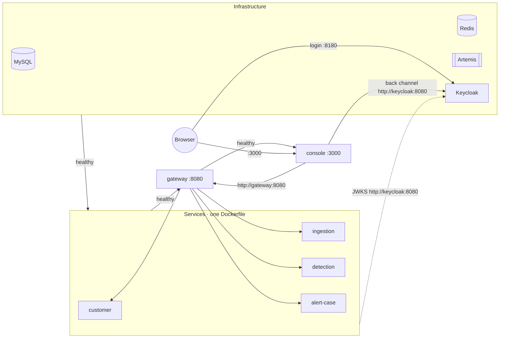
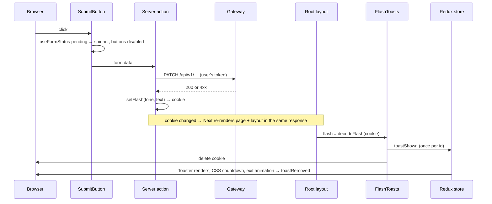

# ADR-009 · Phase 7c — Brand, Client State, Feedback States & the One-Command Stack

| | |
|---|---|
| **Status** | Accepted (built 2026-11-21 on branch `phases/p-7`) |
| **Date** | 2026-11-21 |
| **Phase promise** | Finish Phase 7 as a product: an identity of its own (logo, favicons, LinkedIn kit); predictable client-side state (Redux Toolkit); every wait, success, failure and missing page shown in the console's own design; and the **whole application** (infrastructure, five services, console) started by **one `docker compose up`** |
| **Problems solved** | X4 completed (ADR-001 promised a one-command stack for the infrastructure only) · console feedback gaps from ADR-008 (messages as inline bars, no skeletons for most pages, generic 404) |
| **Skills** | SVG and logo construction, text-to-outline, raster exports with sharp; Redux Toolkit (slices, `prepare`, listener middleware, typed hooks, per-request stores with SSR); React 19 `useFormStatus` and transitions; Next.js `loading` / `not-found` / `error` / `global-error` boundaries; cookie-based flash messages; multi-stage Maven Docker builds with BuildKit cache mounts; Spring Boot relaxed binding; JWT issuer vs JWK-set split for containers; Compose health-gated startup ordering |
| **Builds on** | [ADR-008](ADR-008-phase-7b-cases-audit-pii-and-console-redesign.md) (redesigned console, Docker image) · [ADR-007](ADR-007-phase-7-analyst-console-and-edge-limits.md) (server-side login, SSE) · [ADR-001](ADR-001-phase-1-local-platform.md) (Compose platform) |

> **One-line recall:** *Redux holds only what the browser owns (live-stream status, notifications, theme, mobile drawer); server data stays in Server Components because the token never leaves the server. Server actions report results through a short-lived cookie that re-renders the page in place and becomes a toast, so URLs never change and loading skeletons never re-mount. One `services/Dockerfile` builds all five services; Compose starts infrastructure → services → gateway → console by health checks, and containers validate the public `iss` while fetching keys from Keycloak inside the network.*

---

## 1. Context

| Gap after Phase 7b | Consequence |
|---|---|
| No logo; the mark was a placeholder glyph | Nothing to put on LinkedIn, the README or a browser tab |
| Client state lived in scattered `useState` | The live-stream status could only be shown where the stream was opened; live notices sat inside the desktop top bar, which is hidden on phones, so **mobile users never saw them** |
| Action results were inline banners driven by `?msg=` / `?err=` | Easy to miss, stayed in the URL (a reload repeated them), inconsistent with live notices |
| Only one generic `loading.tsx`, and a plain 404 | Every page showed the overview's skeleton; a mistyped alert ID showed a generic error box |
| Buttons gave no feedback while a server action ran | Double submits, "did it work?" moments |
| `docker compose up` started only the infrastructure | Running the app meant Java 21, Maven, Node and five terminals |

---

## 2. Decisions

| # | Decision | Chosen | Rejected | Why |
|---|---|---|---|---|
| D1 | Brand mark | **Shield holding an "S" drawn as a transaction flow, middle node flagged amber**; wordmark in IBM Plex Sans, text converted to outlines | Generic shield or magnifier icon | Says what the product does (protect, follow money, flag one transaction) and stays legible at 16 px. Outlined text renders the same everywhere, without the font installed |
| D2 | Brand assets | **`brand/build.js` generates every format** (SVG, PNG 16–2400, JPG/WebP on white, PDF, ICO, LinkedIn sizes); the console uses Next's file conventions (`app/favicon.ico`, `icon.svg`, `apple-icon.png`) | Hand-exported files; `<link>` tags by hand | Reproducible; Next adds the head tags and cache-busts them |
| D3 | What goes in Redux | **Only client-owned state:** `live` (stream connected), `toasts`, `ui` (theme, drawer) | RTK Query for alerts, cases… | The browser has no token (ADR-007), so it can't call the gateway; server data is fetched per request by Server Components and is always fresh. Putting it in a store would add a cache to invalidate and nothing else |
| D4 | Store lifetime | **`makeStore()` per tab in `StoreProvider` (`useRef`), preloaded from the theme cookie** | Module-level singleton | Client components also render on the server, so a module store would be shared between users' requests. Preloading means the first paint already has the right theme |
| D5 | Side effects | **Listener middleware** for the theme (DOM attribute + cookie); a toast's countdown is a **CSS animation** whose `animationend` dispatches `toastDismissed` | `setTimeout` in a listener or component | Reducers stay pure. A CSS timer pauses on hover and keyboard focus for free, and the exit animation's end removes the toast |
| D6 | Reporting action results | **Flash cookie** (`sentinel-flash`, base64url JSON with a unique id, 60 s): setting a cookie in a server action makes Next re-render the page and root layout in place; the layout passes it to `FlashToasts`, which shows it once and deletes the cookie | `redirect(?msg=…)` + `history.replaceState` to clean the URL | The redirect changed the search params, which re-mounts a page-level `loading.tsx` boundary: the whole skeleton flashed after every click, and with Next 15.5 / React 19.3 the redirect could leave the action pending forever. Cleaning the URL with `replaceState` also left the router believing `?err=` was still there (§6) |
| D7 | Waiting states | **A `loading.tsx` per route** shaped like its page, fading in after 120 ms; **`<SubmitButton>`** (`useFormStatus`) disables the form's buttons and spins the clicked one | One shared skeleton; disabling inputs by hand | Matching shapes avoid layout jumps; the delay avoids flashing on fast pages; `useFormStatus` needs no state plumbing |
| D8 | Missing and broken pages | **`notFound()` on API 404/400** in alert and case pages, with segment `not-found.tsx`; `error.tsx` with retry + digest; `global-error.tsx`; inline `ErrorPanel` with **Try again** (off for permission messages) | Generic error box for everything | A wrong ID is "not found", not an error; expected API failures stay inline, unexpected exceptions get a page |
| D9 | Images for the services | **One `services/Dockerfile`, `ARG SERVICE`**, Maven reactor as context (`-pl $SERVICE -am`), BuildKit cache mount for `~/.m2`, JRE runtime, non-root, `MaxRAMPercentage=75` | Five Dockerfiles; Jib; copying host-built jars | One recipe to maintain; common-lib is built with each service; the cache makes rebuilds fast; no Java or Maven needed on the host |
| D10 | Container configuration | **Spring's relaxed binding**: Compose sets `SPRING_DATASOURCE_URL`, `SPRING_DATA_REDIS_HOST`, `SPRING_ARTEMIS_BROKER_URL`… | Editing every `application.properties`; a `docker` profile | Environment variables already override properties, so the services' `localhost` defaults stay correct for running on the host, with no code change |
| D11 | JWT validation inside Docker | **Issuer = public `http://localhost:8180/realms/sentinel`; keys from `http://keycloak:8080/.../certs`** (`…_JWT_ISSUER_URI` + `…_JWT_JWK_SET_URI`) | Internal issuer; Keycloak frontend URL per network | Tokens carry the browser-facing issuer (Keycloak's `--hostname-url`), which a container can't reach. With a JWK set URI, Spring builds the decoder from it and still checks `iss`, without calling the issuer's discovery endpoint |
| D12 | Startup order | **Health-gated `depends_on`**: infrastructure (MySQL, Redis, Artemis, Keycloak `/health/ready`) → four services (`/actuator/health`) → gateway → console | Retry loops in the services; `sleep` | No service starts before its broker and database accept connections; the gateway and console only start when everything behind them answers |
| D13 | Infrastructure-only start | **An `infra` placeholder service** (`entrypoint: true`, reusing the Redis image) whose `depends_on` lists the infrastructure: `docker compose up -d infra` starts only that and returns once healthy; `docker compose up -d` still starts everything | Compose profiles for the app services; a second compose file; listing six services by hand | Profiles would flip the default (plain `up` = infrastructure only) or require `--profile` on every command, and `down`/`stop` only act on active profiles, so app containers could be left running. A second file duplicates the infrastructure. The placeholder keeps one file, one default, and `stop`/`down` cover everything |
| D14 | Running without persistence | **`docker-compose.ephemeral.yml` override**: `!reset` the named volumes and mount **tmpfs** for MySQL, Redis, Artemis (with `exec` and uid 1001, since `artemis create` runs scripts from its instance dir) and RedisInsight; opt in with `-f`, or by default per machine with `COMPOSE_FILE` in a git-ignored `.env` | A variable in the main file; `down -v` after each session; anonymous volumes | An override layers on either mode (`up` or `up infra`) without touching the main file. tmpfs means nothing reaches disk and the user's volumes stay untouched. `down -v` would destroy data they may want later. Anonymous volumes pile up as dangling volumes. Redis also got a **named** volume in the normal mode, for the same reason: the image declares `/data`, so every recreate used to leave an anonymous volume behind |

---

## 3. Architecture

### 3.1 The one-command stack



### 3.2 From a button click to a notification



### 3.3 Store shape

| Slice | State | Written by | Read by |
|---|---|---|---|
| `live` | `{ connected }` | `LiveFeed` (EventSource) | `LiveStatus` in the top bar and the mobile bar |
| `toasts` | `{ items: Toast[] }` (max 4, newest first) | `FlashToasts`, `LiveFeed`, any client component | `Toaster` |
| `ui` | `{ theme, navOpen }` | `ThemeToggle`, `Sidebar` | same + listener (theme → DOM + cookie) |

---

## 4. Edge cases

| Case | Handling |
|---|---|
| Same error twice in a row | Each flash has a unique id, so both show |
| Re-render without a new action (live refresh) | Layout prop still holds the last flash; `FlashToasts` remembers the id and doesn't repeat it |
| Malformed or edited flash cookie | `decodeFlash` returns null (tested); text capped at 500 characters |
| Reduced motion | All animations collapse, but the toast countdown keeps its real duration (invisible), so notices still close |
| Toast on a phone | Rendered at layout level, as a bottom snackbar stack |
| Alert or case ID that doesn't exist or isn't a UUID | API 404/400 → `notFound()` → "Alert not found" / "Case not found" |
| Permission message (`/ops` as a senior) | `ErrorPanel retry={false}`: no pointless **Try again** |
| Root layout throws | `global-error.tsx` renders its own `<html>` |
| Keycloak still importing the realm | It isn't healthy until `/health/ready` says UP; services wait |
| Low Docker memory | `MaxRAMPercentage=75` + `ExitOnOutOfMemoryError` + `restart: unless-stopped`: a service restarts instead of hanging |
| Developer runs one part on the host | Compose publishes the infrastructure ports and the services keep `localhost` defaults; `docker compose stop <service>` frees its port |

---

## 5. Testing

| What | How | Result |
|---|---|---|
| Store reducers (live, toasts incl. cap / sticky / dismiss / remove / unknown id, ui) | `src/store/store.test.ts` | ✅ |
| Flash cookie round trip, tampered values, length cap | `src/lib/flash.test.ts` | ✅ (21 console tests in total) |
| Production build of the console | `next build` in an isolated copy | ✅ |
| Action → notification, twice in a row, URL unchanged, cookie cleared | Production build, scripted in the browser | ✅ |
| All six images build | `docker compose build` | ✅ |
| Full stack from one command, every container healthy | `docker compose up -d` | ✅ ~45 s after the build |
| Token from Keycloak accepted by the gateway and services inside Docker; 401 without | `curl` through the gateway | ✅ |
| Customer → account → ₹12,00,000 deposit → `CTR_THRESHOLD` alert, score 39.0, processed by the containers (their logs) | `curl` through the gateway | ✅ |
| Docker console: sign-in through Keycloak, every page renders, new alert and its audit entries visible, live stream connects | Browser | ✅ |
| Animations, auto-dismiss and hover-pause by eye | — | ⚠️ not verified (the test browser pane was hidden, which pauses animations) |

---

## 6. Found while building

| What went wrong | Why | Fix |
|---|---|---|
| Live notices never appeared on phones | They were rendered inside the top bar, which is `hidden` below `lg` | Moved to a layout-level `Toaster`; the status pill reads the store and appears in both bars |
| The developer's `next dev` broke (404 for every chunk) after a check build | `next build` and `next dev` share `frontend/.next` | Build in an isolated copy while a dev server runs (documented in the troubleshooting tables) |
| Server actions stuck "pending"; the page stayed on its skeleton | `redirect` to the same page with new `?msg=`/`?err=` re-mounted the page-level `loading.tsx` boundary, and the navigation never committed | D6: flash cookie, no self-redirects |
| After cleaning `?err=` from the address bar, the next action posted to `…?err=…` | `history.replaceState` changed the address bar but not the router's own URL | Same fix: nothing in the URL to clean |
| 404 illustration invisible in dark mode | Drawn in `--line-strong`, nearly the background colour | Base lines use `--muted` |
| Services in Docker would reject every token | Tokens say `iss=http://localhost:8180/…`, unreachable from a container | D11 |
| During testing, streamed pages and toasts looked frozen | The automated browser pane was hidden: no animation frames, so React's reveal and CSS animations paused | Testing note only; not an application bug |

---

## 7. Definition of Done

| Item | State |
|---|---|
| Logo in every common format, LinkedIn images, favicons in the console | ✅ `brand/`, `frontend/src/app/` |
| Redux Toolkit for client state, typed hooks, tests | ✅ `frontend/src/store/` |
| Toasts for action results, errors and live changes; pause on hover; mobile snackbar | ✅ |
| Skeleton per route; pending state on every action button | ✅ |
| Custom 404 (global, alert, case), error and global-error pages | ✅ |
| User guide and frontend technical guide | ✅ `docs/console-user-guide.md`, `docs/frontend-technical-guide.md` |
| Whole application from one `docker compose up` | ✅ |
| Infrastructure alone from one command (`docker compose up -d infra`), for running services or the console yourself | ✅ tested with the five services run by hand |
| No-persistence mode (`docker-compose.ephemeral.yml`) | ✅ tested: empty MySQL on start, full pipeline works, a MySQL restart wipes it, named volumes untouched |
| README and getting-started guide describe the one-command way and local development | ✅ |
| CI builds the service images | ❌ CI still builds and tests the services with Maven and builds only the console image |
| Animations reviewed by eye | ⚠️ |

---

## 8. Running it

```bash
docker compose up -d --build
```

Then open http://localhost:3000. The full walkthrough, local development and troubleshooting are in [GETTING-STARTED.md](../GETTING-STARTED.md).

---

## 9. Recall card 🧠

- **Why isn't server data in Redux?** The browser never holds the access token; Server Components fetch per request with it. A client store couldn't fetch, and caching server data would only add invalidation.
- **Why a store per tab and not a singleton?** Client components render on the server too; a module-level store would leak one user's state into another's render.
- **How does a toast know when to close, and how does hover pause it?** Its countdown is a CSS animation; `animation-play-state: paused` on hover/focus; `animationend` dispatches `toastDismissed`, the exit animation's end dispatches `toastRemoved`.
- **Why a cookie instead of `?msg=`?** Same URL means the page's loading boundary isn't re-mounted, no skeleton flash, nothing to clean from the address bar, router and address bar agree. Setting a cookie in a server action already re-renders the page and layout.
- **How do containers validate a token issued for `localhost:8180`?** Check `iss` against the public issuer, fetch keys from `keycloak:8080` via the JWK set URI; with a JWK set URI Spring never calls discovery.
- **How does Compose know a Spring service is ready?** `curl -f /actuator/health` health checks; `depends_on: condition: service_healthy` chains infra → services → gateway → console.
- **How do you start only the infrastructure?** `docker compose up -d infra`: a do-nothing service that depends on it. Why not profiles? Plain `up` would stop meaning "everything", and `stop`/`down` skip inactive profiles.
- **How do you run with no persistence?** Layer `docker-compose.ephemeral.yml`: it resets the volumes and mounts tmpfs, so data lives in memory and dies with the container; your named volumes are never touched.
- Try: `docker compose up -d --build`, then `docker compose ps`; `docker compose logs -f detection-service`; `docker compose stop console` and run `npm run dev` for hot reload.
