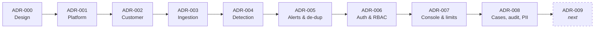

# Architecture Decision Records: Sentinel AML

One ADR per build phase. Each one records **what the phase promised, the decisions and why, the code that implements them, the edge cases, what went wrong and how it was fixed, the blueprint checklist, and a recall card** for interviews and revision.

Diagrams are Mermaid: they render on GitHub and in IntelliJ / VS Code Markdown preview.

For runtime flows (which class, table, Redis key and queue each step touches), open the HTML flow pages in [`../flows/index.html`](../flows/index.html). The ADRs explain *why*; the flow pages show *what runs where*.

| ADR | Phase | Solves | One-line summary |
|---|---|---|---|
| [ADR-000](ADR-000-phase-0-design-and-kickoff.md) | 0 · Design & kickoff | frames P1–P21, X1–X9 | Event-driven microservices: ingest → detect → alert in < 1 s |
| [ADR-001](ADR-001-phase-1-local-platform.md) | 1 · Local platform | X4 | One-command Docker stack + Maven multi-module with BOMs |
| [ADR-002](ADR-002-phase-2-data-model-and-customer-service.md) | 2 · Data model & customer-service | P2, (P17) | Flyway schema, AES-256-GCM PII converter, AOP tracing, one error envelope |
| [ADR-003](ADR-003-phase-3-ingestion.md) | 3 · Ingestion | P3, P4, P5, P18, X1 | Idempotent REST + Spring Batch CSV → one factory → transactional outbox |
| [ADR-004](ADR-004-phase-4-detection-engine.md) | 4 · Detection engine | P1, P6–P12, P15 | Strategy rules on atomic Lua windows, per-account perspective, probabilistic score |
| [ADR-005](ADR-005-phase-5-alerts-dedup-and-resilience.md) | 5 · Alerts, de-dup, live rules, DLQ | P13, P14, P21, X2 | Race-free MySQL de-dup (50-thread test), topic hot reload after commit, broker backoff + DLQ replay |
| [ADR-006](ADR-006-phase-6-authentication-and-rbac.md) | 6 · Authentication & RBAC | P19, (P17) | Keycloak JWTs checked at the gateway and in every service, per-service role rules, default deny |
| [ADR-007](ADR-007-phase-7-analyst-console-and-edge-limits.md) | 7 · Analyst console & edge limits | X3 | Next.js console (server-side login + PKCE), live alerts over SSE via a topic, Redis token-bucket rate limit, 413 body limits |
| [ADR-008](ADR-008-phase-7b-cases-audit-pii-and-console-redesign.md) | 7b · Cases, audit trail, PII, redesign | P16, P17, P20 | Cases with senior-only closing, SHA-256 hash-chained append-only audit across services, audited PII reveal + log redaction, redesigned console, Docker image, CI |

## How each ADR is laid out

1. Header: status, dates/commits, problems solved, skills, LinkedIn post
2. Context: the problem the phase promised to solve
3. Decisions table: chosen vs rejected, and why
4. Architecture diagrams (flow, sequence, ER, state)
5. The important code, with explanations
6. Edge cases and how each is handled
7. Stabilization log: what was wrong at first and why it was changed
8. Blueprint Definition-of-Done checklist (✅ / ⚠️ / ❌)
9. Recall card 🧠: interview answers and commands to try

## Writing the next one

Copy the structure above into `ADR-00N-phase-N-<topic>.md` when a phase is merged. Never rewrite an accepted ADR's decisions. If a later phase changes a decision, add a new ADR that **supersedes** it and link both ways.
