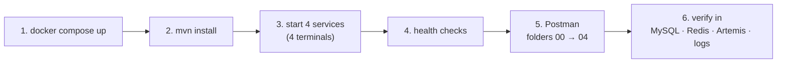

# Manual run & test guide (Phases 1–4)

Everything here is done by hand: Docker Compose, one terminal per service, Postman for the API, and Adminer, `mysql`, `redis-cli`, the Artemis console and the service logs to see what happened inside.



---

## 0. Prerequisites

| Tool | Check | Notes |
|---|---|---|
| Java 21 | `java -version` | |
| Maven 3.9+ | `mvn -v` | |
| Docker Desktop | `docker version` | running |
| Postman | desktop app | import files from `docs/postman/` |
| Free ports | 3306, 6379, 5540, 61616, 8161, 8180, 8081, 8080, 8082–8084 | `lsof -nP -iTCP:8080 -sTCP:LISTEN` shows who holds a port |

---

## 1. Start the infrastructure

From the repository root:

```bash
docker compose up -d
```
```bash
docker compose ps
```

Wait until **mysql**, **redis** and **activemq** show `(healthy)` (≈ 20–40 s on first start; the first run also downloads the RedisInsight image). Keycloak, Adminer and RedisInsight have no healthcheck.

| Container | Web UI | Login |
|---|---|---|
| sentinel-mysql | Adminer → http://localhost:8081 | System **MySQL**, Server **mysql**, user **root**, password **root** |
| sentinel-redis | RedisInsight → http://localhost:5540 (container `sentinel-redisinsight`) | none; first time *Add Redis database* → host **redis**, port **6379** |
| sentinel-activemq | Artemis console → http://localhost:8161/console | admin / adminpassword |
| sentinel-keycloak | Admin console → http://localhost:8180/admin | admin / admin (not used until Phase 6) |

All web UIs, Swagger pages and API routes are listed in one place in the README, under **Local web UIs & routes**.

Before any service starts, the service schemas don't exist yet. Each service creates its own schema (`createDatabaseIfNotExist=true`) and Flyway builds the tables on first boot.

---

## 2. Build once

```bash
cd services
```
```bash
mvn clean install -DskipTests
```

`install` (not just `package`) puts `common-lib` into your local `~/.m2`, which the services depend on. Each service jar ends up in `services/<service>/target/<service>-1.0.0-SNAPSHOT.jar`.

---

## 3. Start the services: one terminal each

Open **four terminals** in `services/`. Start them in this order (any order works, but this keeps the logs easy to follow).

**Terminal 1: customer-service (:8082)**
```bash
java -jar customer-service/target/customer-service-1.0.0-SNAPSHOT.jar
```
**Terminal 2: ingestion-service (:8083)**
```bash
java -jar ingestion-service/target/ingestion-service-1.0.0-SNAPSHOT.jar
```
**Terminal 3: detection-service (:8084)**
```bash
java -jar detection-service/target/detection-service-1.0.0-SNAPSHOT.jar
```
**Terminal 4: gateway-service (:8080)**
```bash
java -jar gateway-service/target/gateway-service-1.0.0-SNAPSHOT.jar
```

Alternatives: `mvn -pl customer-service spring-boot:run` from `services/`, or run each `*Application` class from IntelliJ.

### What a healthy startup looks like in each terminal

| Service | Log lines to look for |
|---|---|
| customer | `Successfully applied 1 migration to schema \`customer_db\`` → `Tomcat started on port 8082` → `Started CustomerServiceApplication` |
| ingestion | `Successfully applied 4 migrations to schema \`ingestion_db\`` → `Running startup reconciliation for stale ingestion batches...` → `Started IngestionServiceApplication` |
| detection | `Successfully applied 5 migrations to schema \`sentinel_detection\`` → `Watchlist loaded: 8 countries, 5 names` → `Loaded 6 active AML rules: [...]` → `Started DetectionServiceApplication` |
| gateway | `Tomcat started on port 8080` → `Started GatewayServiceApplication` |

On later restarts Flyway says `Schema ... is up to date. No migration necessary.`

In Adminer you should now see three databases: `customer_db`, `ingestion_db`, `sentinel_detection`, each with a `flyway_schema_history` table.

---

## 4. Import into Postman

1. **Import** → select both files in `docs/postman/`:
   - `Sentinel-AML.postman_collection.json`
   - `Sentinel-AML-local.postman_environment.json`
2. Top-right environment dropdown → **Sentinel AML – Local** (`baseUrl = http://localhost:8080`, the gateway).
3. Run the folders **in order**: `00 → 01 → 02 → 03 → 04`. Every request has:
   - a **Tests** tab with assertions (green/red in the response panel),
   - a **Docs/description** with the exact SQL / redis-cli / log line to verify it.
4. You can also run a whole folder with **Run folder** (Collection Runner). For folder 03, re-attach the CSV files first (see §6.3).

Variables the collection manages for you:

| Variable | Set by | Used for |
|---|---|---|
| `run` | Gateway health, first detection request | Random suffix in account ids (`ACC-STR-K3F9QZ`), so every run starts with empty windows |
| `replayKey`, `txnId` | Streaming request 1 | Replay test |
| `fixKey` | Streaming request 5 | Retry-after-422 test |
| `batchId`, `batchErrId` | Batch uploads | Batch status requests |
| `idemKey` | Pre-request script, every POST | A fresh `Idempotency-Key` |

Look up the current values under **Collection → Variables** (needed to fill the SQL below).

---

## 5. Where to look: verification toolbox

### MySQL
Adminer (http://localhost:8081) → SQL command, or:
```bash
docker exec -it sentinel-mysql mysql -uroot -proot --default-character-set=utf8mb4
```
(`--default-character-set=utf8mb4` so `₹` displays correctly instead of `?`.)

### Redis
GUI: **RedisInsight** at http://localhost:5540 → your database → *Browser*. Filter by key pattern, e.g. `aml:win:*` or `idempotency:txn:*`. Sorted sets show members with their scores, and hashes show fields; the *Workbench* tab runs the commands below.

CLI:
```bash
docker exec -it sentinel-redis redis-cli
```
| Command | Shows |
|---|---|
| `KEYS idempotency:txn:*` | Idempotency keys (value = transactionId after commit) |
| `GET "fxRates::USD"` | Cached FX rate (Java-serialized, so it looks binary) |
| `KEYS aml:*` | All detection state |
| `ZRANGE aml:win:struct:<acct> 0 -1 WITHSCORES` | Structuring window: `txnId\|amountInr`, score = event time in ms |
| `HGETALL aml:day:<acct>:<yyyyMMdd>` | One day of activity (txnId → amount) |
| `GET aml:baseline:<acct>` | 90-day average from the baseline job |
| `TTL <key>` | Seconds until the key expires |

Use `SCAN 0 MATCH aml:* COUNT 100` instead of `KEYS` on big datasets.

### ActiveMQ Artemis console
http://localhost:8161/console → **Artemis** tab → **Queues**:

| Queue | Expected |
|---|---|
| `sentinel.txn.ingested` | Consumer count = number of detection listener threads; **Message count ≈ 0** (consumed instantly); *Messages acknowledged* grows with every transaction |
| `sentinel.detection.hits` | **No consumer yet** (Phase 5), so *Message count* grows with every rule hit. Click the queue → *Browse* to read the JSON of a `RuleHitsDetected` event |
| `DLQ` | Should stay empty. A message here = it failed repeatedly in detection; check the detection log |

### Logs
The terminal of each service. Useful searches (or pipe to a file with `| tee customer.log`):

| Service | Line | Meaning |
|---|---|---|
| any | `▶ [REQ] [a1b2c3d4] POST /api/v1/...` / `◀ [RES] [a1b2c3d4] ... Status: 202 ACCEPTED \| Time: 12ms` | Every controller call, same trace id on both lines |
| ingestion | `Transaction <id> saved with outbox event <id>` | Streaming write committed |
| ingestion | `Idempotent replay for key <key> -> transaction <id>` | Replay served from Redis |
| ingestion | `Batch <id> line N rejected: <reason>` | A CSV row went to `ingestion_error` |
| ingestion | `Batch <id> COMPLETED: total=.., accepted=.., failed=..` | Job finished |
| detection | `AML hit on account <acct> (txn <id>): rules=[...] score=..` | A rule fired |
| detection | `Duplicate delivery ignored for transaction <id>` | Idempotent consumer at work |
| detection | `Baseline job finished: N accounts updated` | Baseline recomputed |

### Swagger UI (try requests in the browser)
customer http://localhost:8082/swagger-ui.html · ingestion http://localhost:8083/swagger-ui.html · detection http://localhost:8084/swagger-ui.html. Swagger calls the service directly, not through the gateway, so the response is the same but the gateway is not exercised.

### Metrics
```bash
curl -s localhost:8084/actuator/metrics/sentinel_ingest_to_detection_latency
```
`TOTAL_TIME / COUNT` = average seconds from ingestion to detection. Other metrics: `sentinel_detection_latency`, `sentinel_rule_hits_total` (`?tag=rule:STRUCTURING`).

---

## 6. Test walkthrough

### 6.1 Folder 00: health (Phase 1)

| Request | Expect |
|---|---|
| Gateway / Customer / Ingestion / Detection health | `{"status":"UP"}` |
| Active rules (via gateway) | 200, six rule codes. This proves the gateway route to detection |

Without Postman:
```bash
curl -s localhost:8080/actuator/health
```

### 6.2 Folder 01: customer service (Phase 2)

| # | Request | Expect | Verify |
|---|---|---|---|
| 1 | Create customer | 201, `idNumberMasked` = `****…` + last 4, `riskRating: MEDIUM` | SQL below: `id_number` is ciphertext |
| 2 | Invalid customer | 400, ≥ 3 messages in `errors` | log `Validation failed: [...]` |
| 3 | Unknown enum | 400 | log `JSON parsing error` |
| 4 | Seed 5,000 customers | 200 (≈ 4 s); second call says "already seeded" | counts below |

```sql
SELECT full_name, id_number, risk_rating FROM customer_db.customer ORDER BY created_at DESC LIMIT 3;
SELECT (SELECT COUNT(*) FROM customer_db.customer) AS customers, (SELECT COUNT(*) FROM customer_db.account) AS accounts;
```
Experiment: send request 1 twice with the same body. Two rows, two **different** `id_number` values (random IV per encryption).

### 6.3 Folders 02 & 03: ingestion (Phase 3)

**Streaming (run 1 → 8 in order)**

| # | Request | Expect |
|---|---|---|
| 1 | Post transaction (USD 100) | 202, `data` = transactionId |
| 2 | Replay same key | **200**, header `Idempotent-Replayed: true`, **same** transactionId |
| 3 | Missing Idempotency-Key | 400 |
| 4 | Invalid body | 400 (amount, currency messages) |
| 5 | Unsupported currency XYZ | 422 |
| 6 | Retry with the same key, fixed | 202 (the key was released after the 422) |
| 7 | Unknown account `BOGUS-1` | 422 |
| 8 | Future-dated | 400 (`@PastOrPresent` on `txnTimestamp`) |

```sql
-- after request 1 (put the txnId from Collection → Variables)
SELECT id, external_ref, amount, currency, amount_inr, txn_timestamp FROM ingestion_db.transaction WHERE id = '<txnId>';
SELECT status, created_at, published_at FROM ingestion_db.outbox_event WHERE aggregate_id = '<txnId>';
SELECT * FROM sentinel_detection.processed_event WHERE transaction_id = '<txnId>';
-- after request 2: still exactly one row
SELECT COUNT(*) FROM ingestion_db.transaction WHERE external_ref = '<replayKey>';
```
Expected: `amount_inr = 8350.0000` (100 × 83.50); outbox `PUBLISHED`, with `published_at` a few hundred ms after `created_at`; and the transaction present in `processed_event` (detection consumed it).

Redis:
```
GET idempotency:txn:<replayKey>       -> the transactionId
TTL idempotency:txn:<replayKey>       -> ~86400
```

**Batch (folder 03)**

1. Open **1. Upload clean CSV** → Body → form-data → `file` → **Select Files** → `docs/testData/sentinel_demo_data.csv` (Postman sometimes shows the file as missing on import; just select it again).
2. Send → 202 + batchId. Send **2. Batch status** → `COMPLETED`, total 99, failed 0.
3. Same with `sentinel_demo_with_error_entry.csv` → total 101, **failed 12**, and `errors[]` lists each line number with its reason:

| Line | Reason |
|---|---|
| 4, 32, 37, 39, 44, 46, 95 | `STRUCTURAL ERROR … expected 5 actual 4` |
| 9 | `Amount must be positive` |
| 13 | `Column 'type' is missing or empty` |
| 100 | `Unsupported currency: XYZ` |
| 101 | `Amount is not a number: 'fsafsf'` |
| 102 | `Column 'sourceAccountId' is missing or empty` |

```sql
SELECT id, status, total_records, failed_records, created_at, completed_at FROM ingestion_db.ingestion_batch ORDER BY created_at DESC;
SELECT line_number, error_reason FROM ingestion_db.ingestion_error WHERE batch_id = '<batchErrId>' ORDER BY line_number;
SELECT status, COUNT(*) FROM ingestion_db.outbox_event GROUP BY status;     -- no PENDING left after a second
SELECT JOB_INSTANCE_ID, STATUS, START_TIME, END_TIME FROM ingestion_db.BATCH_JOB_EXECUTION ORDER BY JOB_EXECUTION_ID DESC LIMIT 3;
```

Optional crash test: upload a CSV, stop ingestion (Ctrl+C) within a second, restart it. The log shows `Marking stale batch <id> as FAILED due to unexpected system restart.`

### 6.4 Folder 04: detection (Phase 4)

Run the folder **top to bottom** (Runner is easiest: 30 requests). The first request generates a new `{{run}}` suffix. Then look at the results:

```sql
SELECT account_id, rule_codes, risk_score, LEFT(explanation, 160) AS explanation
FROM sentinel_detection.aml_alert
WHERE account_id LIKE '%-<run>'
ORDER BY account_id, created_at;
```

| Scenario (accounts end in `-<run>`) | Rule(s) expected | Score | What makes it fire |
|---|---|---|---|
| `ACC-CTR-…` 12 L cash | CTR_THRESHOLD | 30 | single amount ≥ ₹8,30,000 |
| `ACC-STR-…` 4 × USD 9.1k–9.9k in 20 h | STRUCTURING (from deposit 3) | 70 | ≥ 3 in ₹7,51,500–₹8,34,999 within 24 h, on the **receiving** account |
| `ACC-RAP-…` 50 L in, 42 L out 30 h later | CTR on the credit; RAPID_MOVEMENT + CTR on the debit | **82.5** | 84% out ≥ 80% within 48 h |
| `ACC-HRC-…` counterparty IR | HIGH_RISK_JURISDICTION | 90 | country on the watchlist |
| `ACC-HRN-…` "Zenith Shel Holdings Ltd." | HIGH_RISK_JURISDICTION | 90 | Jaro-Winkler 0.95 ≥ 0.92 |
| `ACC-RND-…` 6 × ₹5,00,000 in 6 days | ROUND_AMOUNT (from transfer 5) | 40 | ≥ 5 round amounts in 7 days |
| `ACC-BEH-…` 10 days × 15k, baseline, then 2 L | BEHAVIORAL_DEVIATION | 55 | ₹2,00,000 > 3 × ₹15,000 |
| `ACC-OK-…` 2,350 | **nothing** | – | negative control |

Redis, for the same run:
```
ZRANGE aml:win:struct:ACC-STR-<run> 0 -1 WITHSCORES
ZRANGE aml:win:cr:ACC-RAP-<run> 0 -1
ZRANGE aml:win:dr:ACC-RAP-<run> 0 -1
ZRANGE aml:win:round:ACC-RND-<run> 0 -1
GET aml:baseline:ACC-BEH-<run>
KEYS aml:day:ACC-BEH-<run>:*
SISMEMBER aml:accounts:active ACC-BEH-<run>
```

Artemis: `sentinel.detection.hits` message count increased by the number of hits. *Browse* a message to see the JSON with `hits[].evidenceTxnIds` and `windowBucket`.

**Try tuning a rule live**
```sql
UPDATE sentinel_detection.aml_rule SET threshold_amount = 2 WHERE rule_code = 'STRUCTURING';
```
Then send **Reload rules + watchlist**, and `GET /api/v1/rules` shows the new threshold. Now two near-threshold deposits are enough. Set it back to `3` afterwards.

**Try a duplicate delivery:** in the Artemis console you can't easily resend, but you can watch the protection. Each transaction appears **once** in `processed_event`, and:
```sql
SELECT transaction_id, COUNT(*) FROM sentinel_detection.aml_alert GROUP BY transaction_id, account_id HAVING COUNT(*) > 1;   -- empty
```

---

## 7. Troubleshooting

| Symptom | Cause | Fix |
|---|---|---|
| `Port 8080 was already in use` | Keycloak from an old compose config, or a previous service still running | `docker compose up -d` (recreates Keycloak on 8180); `lsof -nP -iTCP:8080 -sTCP:LISTEN` then stop that PID |
| `Public Key Retrieval is not allowed` | MySQL 8 auth | already handled by `allowPublicKeyRetrieval=true` in the JDBC URL. Check you're running the latest build |
| `Schema-validation: missing table` | Flyway didn't run | rebuild (`mvn clean install -DskipTests`); detection needs the flyway dependency (present since commit 5f27921) |
| `Connection refused: localhost:61616` | Artemis still starting | wait for `(healthy)` in `docker compose ps` |
| `no main manifest attribute` | old jar | `mvn clean install -DskipTests` |
| Batch status stays PROCESSING | job still running or failed | ingestion terminal for the stack trace |
| Transaction accepted but no hit | wrong account prefix, or scenario incomplete | only `ACC-` accounts are monitored (EXT- = other bank); check `processed_event` contains the txn |
| Behavioral deviation doesn't fire | baseline not computed | send *recompute baseline* **after** the 10 history transactions were processed |
| `?` instead of `₹` in mysql CLI | client charset | add `--default-character-set=utf8mb4` |
| Postman batch upload 400 | file not attached | re-select the CSV in Body → form-data |

---

## 8. Reset to a clean state

```sql
-- keeps schemas, removes data (detection keeps rules & watchlist)
TRUNCATE sentinel_detection.aml_alert; TRUNCATE sentinel_detection.processed_event;
```
```bash
docker exec sentinel-redis redis-cli FLUSHALL
```
Full reset, which drops every database and every queue message:
```bash
docker compose down -v
```

## 9. Stop

Ctrl+C in each service terminal, then:
```bash
docker compose stop
```
